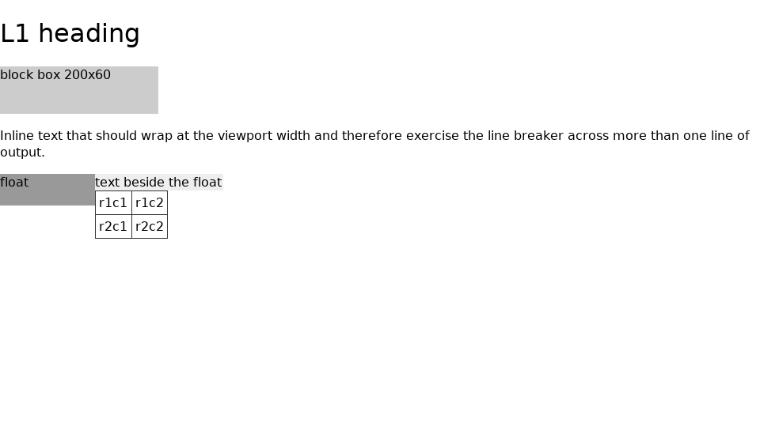
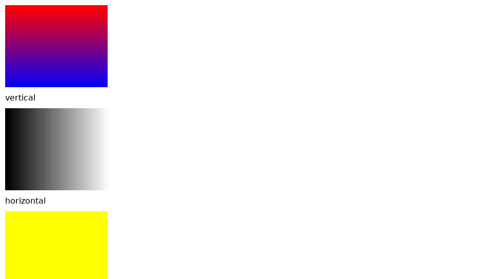
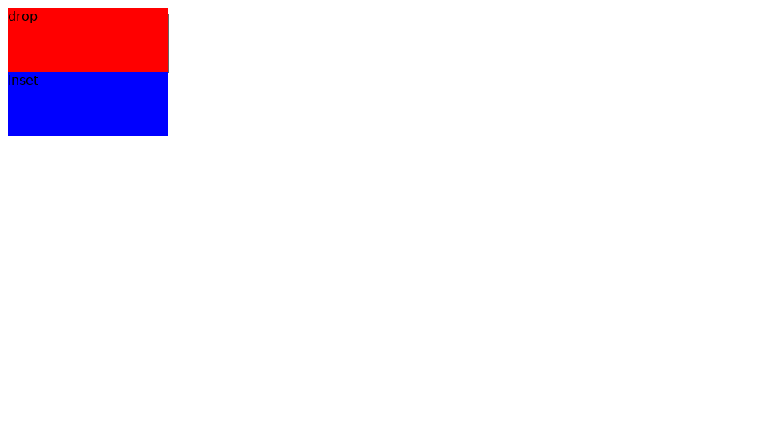
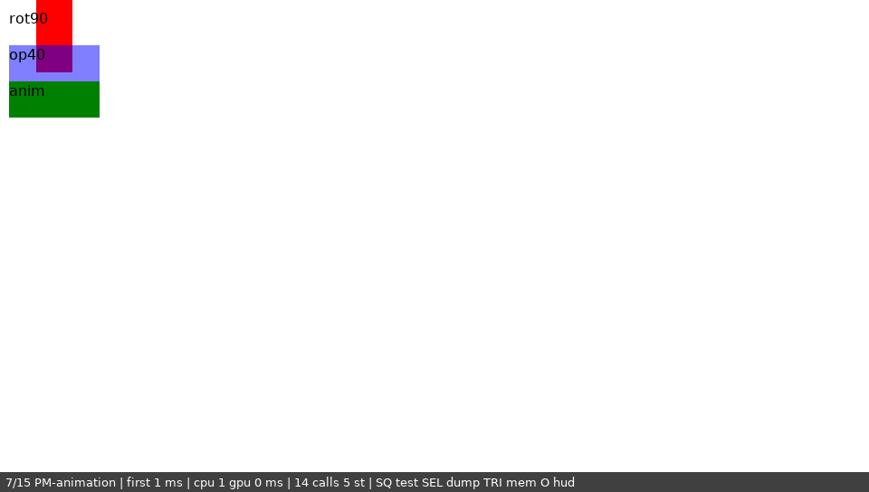
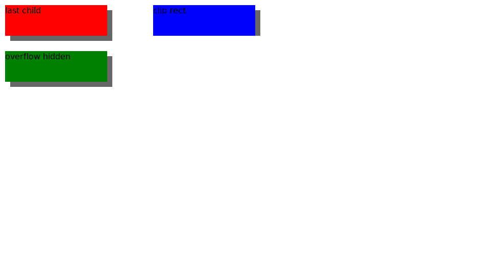
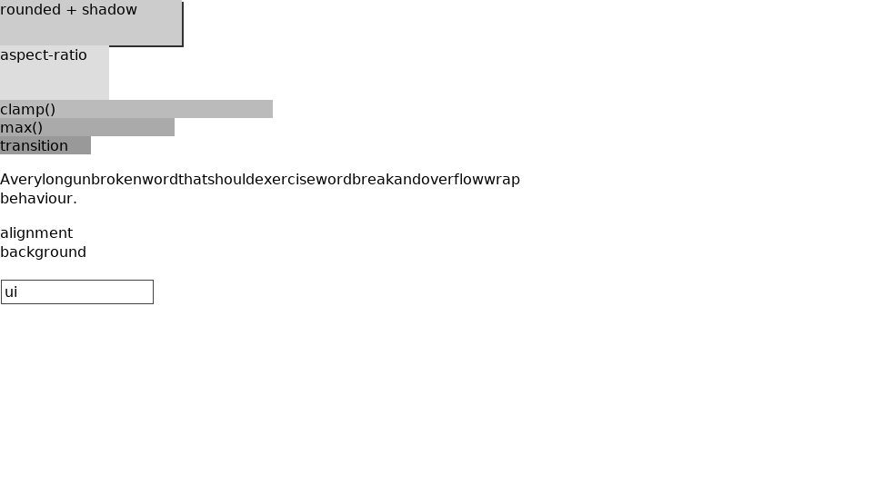
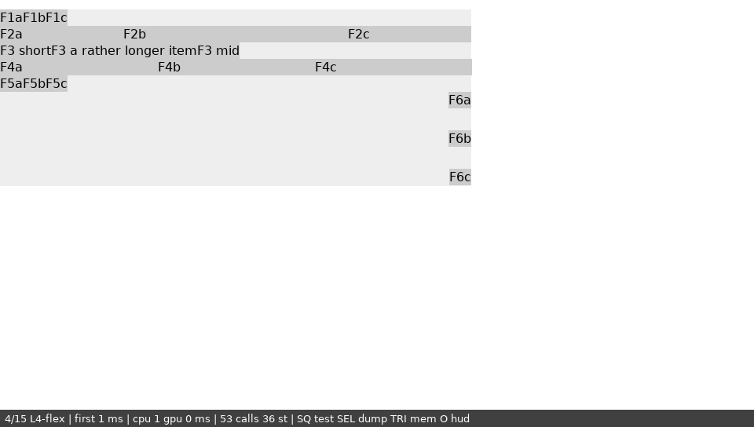

# 09 — The Vita frontend (Phase 1 item 3, patches 29–31)

**Date:** 2026-09-22 · **Branch:** `pre-phase-0-findings` · **Brief:** §7.2, Phase 1 step 6

The verified monkey plot-stream contract (06 §6c–6e: `RECT` / `POLY` /
`OPAQUE`, gradient bands, box-shadows, transform quads) now has a pixel
consumer: a NetSurf frontend for the PS Vita, `frontends/vita`, drawing
through libvita2d. The full patched engine plus the frontend cross-compiles
to `nsvita.elf` and packs into `VitaBrowser.vpk`. No Vita hardware was
available, so everything below was proven on the build machine. §3 says
exactly which parts that covers.

| Deliverable (task spec) | State | Evidence |
|---|---|---|
| (1) frontend skeleton + build hook | **done** | `make TARGET=vita` → `nsvita.elf` (ELF32 ARM); `tools/build-vita.sh` |
| (2) libvita2d renderer for the contract | **done** | `tools/test-vita-renderer.sh`: 91/91, contract byte-identical to monkey over 200 000 fuzz cases |
| (3) app entry point that fetches + renders a test page | **done, cross-built; run on host only** | `VitaBrowser.vpk` bundles `testpages/pages/`; `tools/run-vita-sim.sh` renders all 11 through the real frontend (§3.3) |
| (4) docs | this file | |
| fallback (renderer + host test + renderer cross-compile) | exceeded | the whole stack cross-compiles and links, not only the renderer |

Reproduce, from a clean checkout:

```
WORK=<WORK>/vitabrowser-work tools/build-patched.sh     # stages + applies the stack (now incl. 29-31), host nsmonkey
tools/check-patched-streams.sh                      # probe fixtures match the live patched engine
WORK=<WORK>/vitabrowser-work tools/test-vita-renderer.sh # 91/91
WORK=<WORK>/vitabrowser-work tools/build-vita.sh         # nsvita.elf + VitaBrowser.vpk (2m41s)
WORK=<WORK>/vitabrowser-work tools/run-vita-sim.sh       # 11 pages -> $WORK/vita-sim/shots/*.png
```

## 1. What was built

Three patches in `patches/vitabrowser/`, applied after the generated stack
(`apply-patches.sh` routes them by name). Run on a clean upstream checkout:
**applied 114, failed 2**. The two failures are the known
`autogenerated*` collisions recorded in 08 §1, unchanged. 111 + 3 new patches.

| Patch | What | Why separate |
|---|---|---|
| `29-netsurf-flex-use-after-free` | MacSurf `layout_flex.c` fixes167b logs `ctx->line.count` *after* `layout_flex_ctx__destroy(ctx)`; now logs first | A real bug on every platform (§4.1) |
| `30-netsurf-vita-portability` | `fetch.c` curl include guard, `time.c` `<string.h>` + init, `config.h` `__vita__` entries | Core changes, no-ops on the host (L1 canary unchanged) |
| `31-netsurf-vita-frontend` | `frontends/vita/**`, `vita` added to `VLDTARGET` in `frontends/Makefile.hts` | The frontend itself |
| `32-netsurf-shadow-transform-ink-clip` | *(added later)* shadows and transform quads no longer clipped to their own box | The §5 finding's fix (§10); with it the stack applies 115 + the known 2 |

`frontends/vita` (2 970 lines):

| File | Role |
|---|---|
| `plot_geom.c/.h` | **The contract as coloured geometry.** One `plot->rectangle` → the pieces monkey records (bands, drop/inset shadow rects, transform quad, bucket), each with its colour and a `paint` flag. No platform dependencies. Also formats pieces as monkey stream lines. |
| `plot.c/.h` | The vita2d `plotter_table`, plus primitives shared with the replayer: `fill_rect`, `fill_quad` (triangle fan), `line`, `text` (FreeType, §11; system PGF before patch 38), `set_clip` |
| `js_platform.c/.h` | The services MacSurf's QuickJS bridge calls (scheduler, clocks, random bytes, text measurement) (patch 46) |
| `jsprobe.c/.h`, `qjs_hooks.c/.h` | QuickJS-ng engine probe (ES2023, memory cap, runaway-script interrupt, benchmark) and the engine's MacSurf instrumentation hooks (patch 43) |
| `net.c/.h` | Brings sceNet up once, for curl and the mirror (patch 42) |
| `netlog.c/.h` | Mirrors `ux0:data/VitaBrowser/` (logs, plot dumps, markers) to a PC receiver over UDP (patch 39; 10 §Run 6) |
| `text.c/.h` | The FreeType text engine (patch 38, §11): bundled fonts, fallback chain, glyph atlas; measures and draws |
| `replay.c/.h` | Replays a recorded `.plot` stream through the same primitives (a debug viewer, and test layer C) |
| `bitmap.c/.h` | Bitmaps *are* vita2d textures: RGBA8 texture memory = NetSurf's default `BITMAP_LAYOUT_RGBA8888`, so decoders write straight into GPU-visible memory |
| `layout.c/.h` | Text measurement with the advances the plotter draws with (`text.c`; PGF before patch 38) |
| `window.c/.h` | One full-screen window; invalidate marks dirty; redraw at `(-scrollx, -scrolly)` |
| `file.c/.h` | `file:///app0:/x` ↔ `app0:/x`: Vita paths have a device prefix and no leading slash |
| `fetch.c/.h` | MIME type from a built-in extension table (no `/etc/mime.types`); resources from `app0:/res/` |
| `schedule.c/.h` | Monkey's scheduler, renamed (it is portable `gettimeofday` + a list) |
| `main.c` | Entry point: vita2d + PGF init, `netsurf_register`/`netsurf_init`, opens `app0:/testpages/L1-layout-basics.html`; D-pad/stick scroll, L/R cycle the 10 bundled test pages, START quits |
| `compat/regex.h` | Shadows `<regex.h>` with PCRE2's POSIX layer (§4.3) |
| `Makefile`, `.defaults`, `.tools` | Cross toolchain, feature set, `package-vita` target (VPK) and `VITA_HOST_SIM=YES` (§3.3) |
| `res/` | Symlinks into `resources/` like the framebuffer frontend; `Messages` generated per build |

## 2. The renderer

**Why a geometry layer, not a stream parser.** The Vita frontend is a real
plotter: it receives the same `plot_style_t` calls monkey does, not monkey's
text. `plot_geom.c` is monkey's `monkey_plot_rectangle` (patches 25–27)
transcribed statement for statement. The only difference is that it emits
`(geometry, colour, bucket, paint)` instead of printing geometry. Where monkey computes a
value and throws it away (the per-band gradient colour, `plot.c` 452–458), the
geometry layer passes it on. So "the Vita draws what the stream says" is
checkable mechanically (§3.1 A), rather than argued.

**Colour.** NetSurf's `colour` is `0x00BBGGRR` and vita2d's `RGBA8` macro packs
`a<<24 | b<<16 | g<<8 | r` (`vita2d.h` line 14). Same byte order, so the
conversion is just `(c & 0xffffff) | alpha << 24`. That also strips
`NS_TRANSPARENT` (bit 24).

**Opacity = bucket, drawn as alpha.** MacSurf approximates the fixes49
buckets with QuickDraw stipples: ltGray / gray / dkGray, i.e. 25 / 50 / 75 %
foreground (`plotters.c` 1799–1855). The GXM blends, so bucket *n* is drawn
at alpha 0 / 64 / 128 / 191 / 255, and bucket 0 draws nothing. The bucket, not the
exact CSS opacity, reaches the screen. That keeps the Vita render a function
of the verified stream, and matches MacSurf's quantisation. One deliberate
difference: MacSurf's stipple paints its 0-bits white (fixes220), so a
translucent box over a dark background comes out lighter on the Mac. The
Vita blends over what is underneath, which is what CSS means.

**MacSurf's paint rules the stream cannot carry.**
- Drop shadow with `box_shadow_color == 0` → MacSurf's 50% grey `0x6666`
  (`plotters.c` 1363). Vita: `0x666666`.
- Inset shadow with `box_shadow_color == 0` → MacSurf **skips the paint**
  (`plotters.c` ~1965, "fixes225 dark-wash regression"). Monkey still records
  the two bands, so `plot_geom` emits them with `paint = false`: the geometry
  still matches the stream, and nothing is drawn. `PM-shadow.html`'s inset is
  exactly this case.
- Radial gradients: one flat rect in the start colour, as on monkey (06 §6c).

**What the Vita plotter adds that the stream never records.** Monkey ignores
strokes, so rectangle outlines (form fields, table borders) are Vita-only:
four rects of `stroke_width`, drawn over the fill. Lines ≥ 2 px that are
axis-aligned are exact rects; others are quads. Polygons and paths are
triangle fans, exact for convex shapes (list bullets, widgets); SVG paths
flatten Béziers to 12 segments. Bitmaps are scaled textures, tiled across
the clip on repeating axes. `option_knockout = true`, as on monkey: knockout
reorders the core's plot calls, and the verified stream was recorded with it
on.

## 3. Verification

### 3.1 Host unit test — `tools/test-vita-renderer.sh` (91/91)

The test builds the frontend's `plot_geom.c`, `plot.c` and `replay.c` against a logging stub of
`<vita2d.h>` (`tools/vita-stub/`: the real header's exact names, signatures
and struct layouts for the subset used). It also compiles the **real patched
monkey `plot.c`** in its own translation unit, because both files define a
static `plotters` table.

- **A. Contract.** `vita_geom_rectangle` formatted as monkey lines vs
  `monkey_plot_rectangle` on the same style: **20 hand cases** (the 06
  §6c–6e probes: solid, fill-none, V/H gradients, narrow and empty spans,
  radial, drop 8,8, drop clamp, inset 6,6, negative inset clamp, rotate
  90/30, scale 0.5, translate, %-translate, opacity 40/90/3 %, rotate+40 %)
  and **200 000 seeded fuzz cases** over every field the contract reads
  (all 7 fill types, fractional shadow offsets ±40 px, inset, colour 0 or
  set, opacity 0–1200, packed transforms incl. random 32-bit, scales,
  degenerate and inverted rects). **Byte-identical in all.**
- **B. Backend.** vita2d calls for: colour packing, bucket alphas; solid
  rect; 32 gradient bands with exact first/last colours (`#ff0000ff` …
  `#fff70008`); H strips; 40 % → alpha 128; 3 % → no call; rotate(90) → one
  4-vertex fan at `80,-20 80,80 40,80 40,-20` (the 06 §6e corners); drop
  shadow grey **before** the fill; colour-0 inset → fill only; coloured inset
  → two bands **after** the fill; stroke outline; clip clamped to the screen;
  empty clip suppresses drawing; text as a NUL-terminated copy at 16 px for
  12 pt; lines; polygon fan; disc; bitmap scale and X-repeat tiling.
- **C. Stream replay.** Every recorded stream is replayed through
  `replay.c`: the 5 pristine-engine goldens plus the patched engine's 3 probe
  streams (`testpages/patched-streams/`, captured from build 17 in this
  session). Checks: every `RECT`/`POLY`/`CLIP`/`TEXT`/`LINE` op
  is counted, and the rect/fan call sequence equals a geometry sequence the
  test derives independently from the stream text, clip and bucket
  included.
- **D. Ink clip** (added with patch 32, §10). On the patched-engine
  fixtures, each drop shadow and the rotated quad lie inside the clip in
  force when drawn, and a `clip: rect` still clips its shadow.

**Mutation check.** A green suite is not evidence until it has failed on
purpose. Three bugs were planted, one at a time:

| Planted bug | Caught by |
|---|---|
| drop-shadow clamp 16 → 15 | hand case "drop clamp" + fuzz (2 171 / 200 000) |
| rotate(270) cardinal swapped | fuzz only (177 / 200 000) — no hand case covers 270°, which is why the fuzz exists |
| bucket 2 alpha 128 → 127 | 3 backend checks |

### 3.2 Cross build — `tools/build-vita.sh`

From a clean checkout: five patched engine libraries, five support libraries
(nsutils, utf8proc, nspsl, nsgif, nsbmp), NetSurf core and the frontend,
all `arm-vita-eabi-gcc` 15.2. Output: `nsvita.elf` 8.6 MB (ELF32, ARM) and
`VitaBrowser.vpk` 4.0 MB (`eboot.bin`, `sce_sys/param.sfo`, 8 resources,
the 10 test pages + `pm-link.css`). `vita-elf-create` accepted the ELF, so
every firmware import resolved to a known NID. Feature set
(`Makefile.defaults`): **no curl, no OpenSSL, no JavaScript** (the first
milestone fetches through the file fetcher). Images: PNG, JPEG, GIF, BMP.
PSL and utf8proc on. vdpm packages, installed without sudo:
`libvita2d` (pulls freetype, libpng, libjpeg-turbo, zlib, bzip2) and `libpcre2`.

### 3.3 Host simulator — `tools/run-vita-sim.sh`

Nothing can *run* `nsvita.elf` here, so the frontend is also built for the
host from the same sources, with `VITA_HOST_SIM=YES`. It uses the host
compiler, the host-built patched engine, and `tools/vita-sim/vitasim.c` in
place of the SDK. The stand-in:

- rasterises vita2d calls into a 960×544 frame with the pixel-centre
  coverage rule, straight alpha and the clip rectangle;
- provides 8-bit alpha textures and `vita2d_draw_texture_tint_part`, which
  the frontend's own FreeType engine (§11) draws glyphs with, so text in the
  simulator is the device's text path, fonts included (before patch 38 the
  stand-in drew "PGF" text itself, with DejaVu Sans at `scale × 20` px);
- scripts the pad: once no frame has been drawn for ~1 s it writes the last
  shown frame to PNG and presses R (the frontend's next-page handler), then
  START after the last page. A page that draws no new frame fails the run.

The run directory holds a directory literally named `app0:`, so
`file:///app0:/testpages/…` goes through the frontend's own `file.c` mapping
to `app0:/testpages/…` and opens on Linux exactly as on the Vita.

**Result: 11/11 pages fetched, laid out and drawn** (388 vita2d calls over 12
frames; 10/10 before `PM-shadow-clip` was added with patch 32). Screenshots,
committed as evidence (regenerated after patch 32):

| | |
|---|---|
|  `L1-layout-basics`: heading, 200×60 block, wrapped paragraph, float, bordered table |  `PM-gradient`: 32-band vertical red→blue, horizontal black→white strips, radial = flat start colour |
|  `PM-shadow`: the full 8 px drop shadow (was a 1 px sliver before patch 32, §5) |  `PM-animation`: rotate(90) quad to y = 80, seen through `op40` at bucket 2 (50 %) |
|  `PM-shadow-clip` (§10): last-child shadow, `overflow:hidden` card shadow, and the `clip: rect` control with its bottom clipped | |
|  `L2-macsurf-css`, incl. a stroked form input |  `L4-flex`: justify-content variants |

`L3-grid.png` shows standard `grid-template-columns` still unimplemented
(the known gap, 06 §7). `PM-macsurf-grid.png` shows MacSurf's own grid as 3 columns, and
`PM-tagtype.png` a select + input.

**What the simulator does not prove:** anything about the GXM, the real
PGF metrics and baseline, memory, or speed. It proves the frontend's logic:
init order, table registration, resource and file-path handling, the
scheduler, layout-plotter agreement, redraw and scrolling state. That logic
was otherwise only reachable on hardware.

### 3.4 Regression

After the clean rebuild with 29–31: **L1 canary SAME** (byte-identical to
`golden/L1-layout-basics.plot`), and the three probe streams are unchanged. Patch
30's core edits are `__vita__`-only or no-ops with curl present. Patch 29
moves one log line.

## 4. Porting findings (what the first cross build found)

### 4.1 A real bug: use-after-free in MacSurf's flex guard (patch 29)

`layout_flex_inner` (fixes167b) destroyed its context and then read
`ctx->line.count` for its trace line. That's a heap read after free on every
platform. Host GCC 11 never flagged it; GCC 15 does
(`-Werror=use-after-free`, `layout_flex.c` 2406). Fixed by logging first.
It only fires past `FLEX_MAX_LINES`, which is why no probe page hit it.

### 4.2 GCC 15 vs GCC 11

vitaSDK ships GCC 15, which makes six former warnings default errors
(`implicit-function-declaration`, `incompatible-pointer-types`,
`int-conversion`, `implicit-int`, `return-mismatch`,
`declaration-missing-parameter-type`). The host build, which every earlier
finding was verified on, is GCC 11, where they are warnings.
`build-vita.sh` demotes exactly those six, so the cross build follows the same
rules. Every site they fire on in the libraries was checked:

- **libcss, 2 sites** (`custom_properties.c` 1458, `select/properties/helpers.c`
  260): `macsurf_debug_log_writef` called without a prototype. It's safe on
  hard-float ARM only because every argument is an integer or pointer
  (checked). An unprototyped call with a `double` argument would pass it in
  VFP registers where the variadic callee reads core registers. The host
  log shows the same two warnings. Latent, not a Vita regression.
- **libdom, 1 site** (`core/string.c` 375): passes `unsigned char *` to
  `lwc_string_caseless_isequal`'s `bool *`. It's a Mac OS 9 shim, where `bool`
  was an unsigned char. Harmless on ARM EABI: `_Bool` is one byte.

### 4.3 newlib and the SDK

| Gap | Fix |
|---|---|
| `content/fetch.c` includes `content/fetchers/curl.h` (hence `<curl/curl.h>`) unconditionally, **also in pristine upstream**, while registering it under `WITH_CURL` | guard the include (patch 30) |
| `utils/time.c` got `memset` via `curl.h` | `<string.h>` (patch 30) |
| GCC 11 `-Wmaybe-uninitialized` in the curl-less date parser (`time__parse_number`), only compiled without curl (host simulator) | false positive (a full-length parse always stores `value`); zero-init (patch 30) |
| `PATH_MAX`: vitaSDK's `<limits.h>` resolves to GCC's, which lacks it; newlib has it in `<sys/syslimits.h>` | include it for `__vita__` (patch 30) |
| no `mmap`; no `dirfd`/`fstatat`/`unlinkat` | `__vita__` joins the existing `config.h` opt-outs (patch 30) |
| `<regex.h>` exists, **no implementation** (`regcomp` undefined at link) | `frontends/vita/compat/regex.h` → PCRE2's POSIX layer (`vdpm libpcre2`, macros onto `pcre2_regcomp` with its own `regex_t`, so every user gets one type set) |
| libvita2d needs `sceSharedFb*` + `sceAppMgrGetBudgetInfo` | `-lSceAppMgr_stub` (both live there, checked with `nm`) |
| libdom's expat binding | `WITH_EXPAT_BINDING=no` (XML/SVG only; SVG off) |
| static linking | `pkg-config --static --define-prefix`, as vitaSDK's own `arm-vita-eabi-pkg-config` does |
| upstream `test/Makefile` calls bare `pkg-config` at parse time (prints "No package … found") | harmless noise on any cross target, only used by `make test`; left alone |
| **newlib's `iconv` has no converters** (every `iconv_open` fails); libparserutils' input filter needs it even for UTF-8, so no HTML/CSS parser could be created. *Found on hardware, run 2; the host simulator missed it because it linked glibc.* | libparserutils built `-DWITHOUT_ICONV_FILTER` (its own codecs); the simulator now models the empty `iconv` ([10](10-hardware-test-plan.md) §Run 2) |

`__vita__` is predefined by the compiler (`arm-vita-eabi-gcc -dM -E`), so the
frontend needs no `-Dvita` of its own.

## 5. Finding: drop shadows and transformed boxes are clipped to their own box — fixed by patch 32 (§10)

The simulator's `PM-shadow` frame shows the 8 px drop shadow as a **1 px
sliver** at x = 210. The stream explains it:

```
PLOT CLIP X0 10 Y0 0 X1 211 Y1 91        <- the box's border rect (+1)
PLOT RECT X0 18 Y0 18 X1 218 Y1 98       <- the shadow (patch 26 geometry)
PLOT RECT X0 10 Y0 10 X1 210 Y1 90       <- the fill
```

The core clips a box's background plot to the box itself, and the shadow is
painted inside that same `plot->rectangle`. MacSurf honours the clip
identically: `macos9_plot_clip` sets the rect, intersected with the window's
content rect, and the shadow's `macos9_push_clip` *narrows* further. So this
is the engine's behaviour on MacSurf too, not a Vita artefact. The rotated
`PM-animation` quad is cut the same way (`CLIP … Y1 51`, quad to y = 80).

Patch 26's verification (06 §6d) checked the shadow rect's geometry and not
the clip in force, which only a rasteriser shows. This is a core
(`redraw.c`) follow-up: widen the background clip by the shadow's offset (and
a transformed box's rotated extent) before plotting. Recorded in 06 §8,
and fixed by patch 32 (§10).

## 6. Decisions and hardware assumptions (unverified until a device run)

| Item | Choice | Status |
|---|---|---|
| ~~PGF size~~ | ~~`VITA_PGF_EM_PX 20`~~ | superseded by patch 38: FreeType renders at the exact pixel size (§11) |
| Text `y` | the baseline (NetSurf's text `y`); FreeType's `bitmap_top` places each glyph | by construction since patch 38 |
| DPI | core at 96 dpi (`browser_set_dpi`), plot converts pt → px at 96 | consistent by construction |
| Clipping | `vita2d_enable_clipping` + `vita2d_set_clip_rectangle(x0,y0,x1,y1)`, max exclusive like NetSurf's rects | **assumption** about r188's exact edge semantics |
| Memory | `_newlib_heap_size_user` 192 MiB (MacSurf's preferred partition), main-thread stack 4 MiB, vita2d vertex pool 4 MiB; `ATTRIBUTE2=12` **not** set in the default VPK | **measured on hardware** (10 §Run 1): ≈ 256 MiB default, ≈ 365 MiB with `ATTRIBUTE2=12`, which works on 3.65 HENkaku |
| Bitmaps | vita2d textures (default memblock type); `destroy` waits for the GPU first | correctness over speed; CPU writes to texture memory may be slow, so measure |
| Glyph advances | FreeType's hinted advance, rounded to whole pixels, used by layout and drawing alike | by construction since patch 38 (was `width("a"+c+"a") − width("aa")` for PGF) |
| Title ID | `VBRW00001`, no LiveArea art | placeholder |
| Redraw | whole screen on any invalidate, only when dirty; idle loop sleeps 16 ms | simple first |

## 7. Blocked / not done

- **No on-device run.** No Vita hardware in this session (out of scope by
  the task). Everything in §6 marked *assumption* waits for one.
- **No sudo** was used or needed: vdpm installs into `~/vitasdk`.
- ~~**Networking and JS are off** in this build.~~ Networking is on since
  patches 41–42: libcurl 8.22 on mbedTLS 3.6.5, with Mozilla's roots
  bundled (10 §Run 8). JavaScript: pages run scripts through QuickJS-ng
  and MacSurf's DOM bridge since patches 44–46 (10 §Run 10), fetch()/XHR
  included; its window services (location, history, scrolling, title,
  alert/confirm, localStorage) since patch 48 (10 §Run 12). Name lookup
  runs off the main thread since patch 49: vitaSDK's libcurl resolves
  blocking, and a dead DNS server froze the browser (10 §Run 11).
- `clip: rect(0px, 200px, 60px, 0px)` on an absolutely positioned box clips
  its bottom edge but **not its right** (the clip stays at the parent's
  x1 = 951). Seen on `PM-shadow-clip`; pre-existing (identical before and
  after patch 32), not investigated.
- ~~The on-device plot-stream log that 03 anticipates ("the Vita frontend can
  emit the identical format over the UDP log") has its formatter
  (`vita_geom_format_rect/_quad`, tested in §3.1 A) but no transport yet.~~
  Done in patch 39: the plot dumps, both logs and the markers go to a
  receiver on the PC over UDP, which compares each dump with the
  simulator's (10 §Run 6).

## 8. Next actions

1. **First hardware run**: plan and diagnostics build in
   [10](10-hardware-test-plan.md) (patch 33). ~~Calibrate `VITA_PGF_EM_PX`~~
   (PGF replaced, §11), check the baseline and clip edges against the simulator screenshots,
   and measure the allocate-until-failure budget (pre-phase-0 §1).
2. ~~**Core clip fix for shadows/transforms** (§5)~~ — done, patch 32 (§10).
3. ~~**Plot-stream log over UDP** from the frontend, diffed against the desktop
   goldens on-device.~~ Done, patch 39 (10 §Run 6). The comparison is against
   the simulator's dumps (same frontend, fonts and FreeType), not the
   nsmonkey goldens: monkey measures text differently, so any wrapped line
   would differ for no reason.
4. ~~**curl + TLS**~~ (done: patches 41–42, `curl-mbedtls` rather than
   `curl` + OpenSSL 1.0.2; 10 §Run 8) and **QuickJS**, the remaining
   Phase 1 engine item: step 1 (the engine, its limits and probe) done in
   patch 43 (10 §Run 9); step 2, MacSurf's DOM bridge, done in patches
   44–46 (10 §Run 10); its window services in patch 48 (10 §Run 12).
5. **Real internet pages work on the device** (10 §Run 11: http and https
   example.com, byte-identical to the simulator). DNS off the main thread:
   patch 49. Next costs: CPU per frame on text pages (~100 ms) and the
   mbedTLS handshake (~1 s).
6. **A browser to hold** (patches 51–54, 10 §Run 14):
   - touch, pointer, back/forward, zoom;
   - URL and text entry (the system keyboard, or a URL sent from a phone
     to the Vita's LAN listener on :8080);
   - a home page built from `bookmarks.txt`;
   - a persistent cookie jar;
   - ad and tracker blocking;
   - text drawn in batches;
   - an autotest interaction pass that drives all of it on the device.
7. **Real websites end to end** (patches 55–58, doc 11):
   - example.com, Wikipedia (https, mobile skin), Hacker News, CNN Lite and
     DuckDuckGo Lite load in the simulator over the live network;
   - fixed: the user agent, body `overflow` going to the viewport, and a
     leading space in inline elements;
   - next: SVG, `mask-image`, Minerva's hidden labels, Wikipedia's 1011-px
     overflow.

## 9. Corrections to earlier documents

- **Brief §7.2**: "`libvita2d` (`v2d_*`, direct RGB565 960×544 front /
  480×272 rear)" is wrong on three counts. The API prefix is `vita2d_*`
  (`vita2d.h`: 121 matches, 0 for `v2d_`). The display's only pixel formats
  are `A8B8G8R8` and `A2B10G10R10`, with no RGB565 (`psp2common/display.h`
  34–35). And there is one screen: `sceDisplaySetFrameBuf` takes no display
  selector, and the Vita's rear panel is the touch pad the same table's
  input row names. Corrected in place.
- **01 §3.2**: `pkg-config` is now installed (`/usr/bin/pkg-config`), and the
  `<WORK>/vitabrowser-work/bin/pkg-config` shim no longer exists. Noted in place.
- **pre-phase-0 §1** counted "480×272 rear surfaces" against CDRAM. There
  is no rear screen (above). Corrected in place.
- The task description named the cross toolchain `arm-none-eabi-gcc`. It is
  `arm-vita-eabi-gcc` 15.2.0, as 01 already records.

## 10. The clip fix (patch 32)

**What.** `32-netsurf-shadow-transform-ink-clip` makes the plotters' ink
visible: drop shadows and transformed quads are no longer cut to their own
box (§5). Three files, core only, no frontend changes:

- `content/handlers/html/box_ink.h` (new, header-only): `box_ink_outset()`,
  how far a box's background paint reaches past each border edge. For a drop
  shadow (not inset), it's the offset, clamped ±16 px like every plotter.
  For a non-identity `-macsurf-transform`, it's the quad's bounds, using the
  plotters' own unpack (Q10.6 angle, Q8.8 scale, int8 translate, percent →
  0). The bound is exact for a static angle, with +1 px for the plotters' integer
  centre and Q15 rounding. An animated rotation (fixes77) replaces the angle at
  draw time, so it uses the circumscribed circle, which bounds every angle. It is
  conservative (it may be a pixel wide, never narrow) and capped at 4096 px per edge
  against garbage scales (the fixes625 class).
- **Part A, `layout.c` `layout_get_box_bbox`:** the box's own ink is added
  to its bbox. That function is the one place a box's own extent enters the
  descendant bboxes, including for an `overflow:hidden` child seen from its
  parent. So every ancestor's redraw clip (a descendant bbox) contains it.
  Text, line-break and inline-end boxes are skipped: they share a style but
  paint no background.
- **Part B, `redraw.c` `html_redraw_box`:** around the background paint
  only, the clip is widened to border box + ink, bounded by the **parent's**
  clip, then restored as before. A box's own `overflow:hidden` makes its own
  clip its border box, which must not cut its own shadow. A CSS
  `clip: rect` must still clip it, so that branch is left alone.

**Both parts are needed, shown by building each alone** against the new
probe `testpages/pages/PM-shadow-clip.html`:

| Build | last child in a wrapper | `overflow:hidden` card | `clip: rect` control |
|---|---|---|---|
| before | cut to 1 px (wrapper clip `X1 211 Y1 71`) | cut away (own clip = border box) | clipped |
| A only | visible | **cut away** | clipped |
| B only | **cut by the wrapper** | visible | clipped |
| A + B | visible | visible | clipped (bottom 10 px) |

**What changed in the streams.** Pre- and post-fix builds were captured over
all 10 earlier pages. **7 are byte-identical**, including the L1 canary. The 3
with shadows or transforms (`L2-macsurf-css`, `PM-shadow`, `PM-animation`)
changed **only in `CLIP` lines**: 0 `RECT`/`POLY`/`TEXT` lines differ, so no
geometry moved. `PM-shadow` now draws its shadow under
`CLIP X0 10 Y0 10 X1 218 Y1 98`, exactly the shadow's extent. In the
simulator, the same seven screenshots are byte-identical and the three
changed ones show the ink.

**Guards.**
- `tools/check-patched-streams.sh`, new: re-captures
  `testpages/patched-streams/*.plot` with the live patched `nsmonkey` and
  diffs them (`UPDATE=1` rewrites), the patched-engine counterpart of
  `check-goldens.sh`. The fixtures were refreshed with patch 32 applied, and
  `PM-shadow-clip.plot` was added.
- Test layer **D** in `tools/test-vita-renderer.sh` (9 new checks, 91/91)
  asserts on those fixtures that each shadow rect and the rotated quad lie
  inside the clip in force when drawn, and that the `clip: rect` control's
  shadow does not. Mutation check: run on the pre-fix fixtures, exactly the
  4 positive assertions fail and the control passes. With A-only or B-only
  engines, exactly the one assertion for the missing part fails.

**Clean checkout:** applied 115, failed 2 (the known pair, 08 §1). L1 SAME,
4/4 fixtures PASS, 91/91, `build-vita.sh` → `VitaBrowser.vpk` 4.0 MB with
11 pages, simulator 11/11.

**Known trade-off.** The descendant bbox also sizes the document (`html.c`
`c->width/height`) and prunes hit-testing (`box_inspect.c`). So a shadow on
the bottom-most or right-most box now extends the scrollable area by its
offset (≤ 16 px). CSS counts box-shadow as ink overflow that does *not* extend
scrolling (a transform does). The alternative is a separate ink bbox in
`struct box`: 4 more fields computed alongside every descendant bbox, a
larger change for ≤ 16 px. Recorded, not done.

## 11. Text: FreeType and bundled fonts (patch 38)

Hardware run 3 (10 §Run 3) showed the limits of the system PGF font, which
vita2d rasterises once and scales. The atlas bled marks next to glyphs.
Greek and Cyrillic came from the Japanese font at full width. Hangul, emoji
and `简` were missing. The simulator's gap before punctuation after an
inline element (`text ,`) came from layout measuring PGF advances
indirectly (`width("a"+c+"a") − width("aa")`) while drawing used other
metrics.

**`frontends/vita/text.c`** is one engine for measuring and drawing:

- **Faces** open lazily from `app0:/res/fonts/`. There are twelve DejaVu 2.37
  faces: Sans, Serif and Mono, each with real bold, italic and bold-italic.
  CSS `serif` and `monospace` map to their family and everything else to
  Sans. `font-weight ≥ 600` is bold; italic and oblique are italic.
- **Fallback, per code point:** the style's face, then DejaVuSans, then
  DroidSansFallbackFull (kana, kanji, simplified and traditional Hanzi),
  then NanumGothic (Hangul). A code point no face has draws DejaVu's
  `.notdef` box and is counted.
- **Advances** are FreeType's hinted advances in whole pixels. They come
  from one cache that layout and drawing share, so a line is drawn exactly
  as wide as it was measured.
- **Glyphs** are rasterised at the exact pixel size and drawn unscaled with
  point sampling. They sit in 512×512 8-bit alpha atlas pages (U8 → R111,
  so the tint's RGB passes through), shelf-packed with a 1-pixel empty gap.
  At most 16 pages (4 MiB). Nothing is ever sampled across a glyph's edge.
- **Full atlas:** later glyphs in that frame are dropped and counted. The
  atlas is reset at the next frame start, after `vita2d_wait_rendering_done()`,
  so a texel the GPU may still read is never overwritten.

**Fonts** are third-party binaries, so `tools/fetch-fonts.sh` fetches them
into `$WORK/fonts`. Every source is pinned (a release or a commit) and
checked by SHA256. `build-vita.sh` and `run-vita-sim.sh` bundle them into
`res/fonts/`, with each licence beside its fonts:

| Font | Covers | Size | Licence |
|---|---|---|---|
| DejaVu 2.37 (12 faces) | Latin, Greek incl. tonos, Cyrillic, symbols, some emoji | 5.3 MB | Bitstream Vera / Arev (free, redistributable) |
| DroidSansFallbackFull (AOSP, pinned commit) | kana, CJK ideographs | 4.0 MB | Apache 2.0 |
| NanumGothic Regular (google/fonts, pinned commit) | Hangul | 2.1 MB | SIL OFL 1.1 |

The VPK grows from 4.1 MB to 10.3 MB (the fonts compress).

**Verification (host):**
- `tools/test_vita_text.c`, run by `test-vita-renderer.sh`: **30/30**.
  It uses the real engine, real FreeType and the real fonts, with a vita2d
  stand-in whose atlas textures are real memory, pre-filled with garbage.
  - Coverage: each run-3 failure resolves to a face that has it.
  - Styles pick the real faces; bold is wider; Mono advances are all equal.
  - Width equals the sum of advances, and every glyph of `iiii`, `WWWW`,
    kanji and Hangul is drawn exactly one advance after the previous one.
  - 17 px is rasterised afresh, not scaled; a repeat is an atlas hit.
  - No two atlas rects overlap, and each glyph's 1-pixel border is empty
    in the texture itself.
  - Overfilling drops glyphs and does not overwrite; the next frame resets
    the atlas exactly once, after one GPU wait.
  - Mutations, each caught: gap 0 (2 checks fail), pages not cleared (1),
    a double flush (1).
- `test_vita_plotter.c`: **101/101** (+1: a weight-700 run is drawn bold).
- Simulator: all 15 pages render. The whole 4-pass autotest used **3 atlas
  pages, 0 flushes, 0 drops**. CPU clip vs stencil clip is still
  pixel-identical on 14/14 comparable pages. `VT-text` shows every script,
  and the gap before punctuation is gone (10 §Run 5).
- Cross build: `-Werror` clean; the ELF has no PGF symbols.
- Since patch 39 the simulator and this test link FreeType 2.14.3, the
  Vita's release (`tools/build-host-freetype.sh`). Every dump and page is
  identical to the 2.11.1 results (10 §Run 6).

**Not proven without hardware:** FreeType's speed on the Vita's ARM (the
first page rasterises a few hundred glyphs), how long a cold open of the
4 MB Droid face takes from `app0:`, and whether CPU writes into the atlas
are seen by the GPU without artefacts. Run 5 shows them indirectly: every
page's first-frame time, `VT-text`'s first frame (the Droid and Nanum faces
open there), the atlas counters in `log.txt`, and the screenshots (10 §Run 5).

