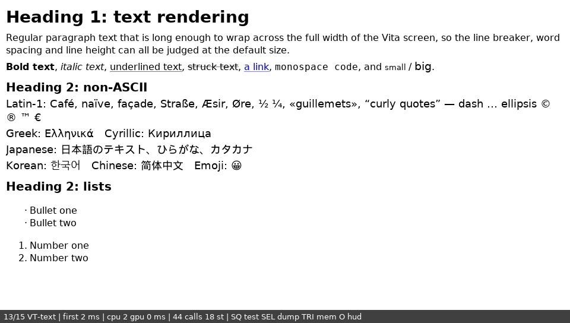
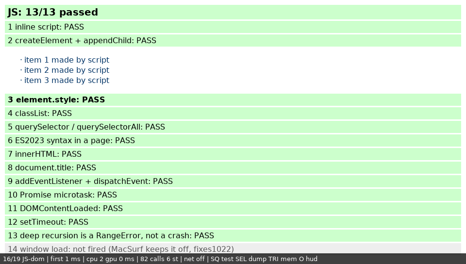
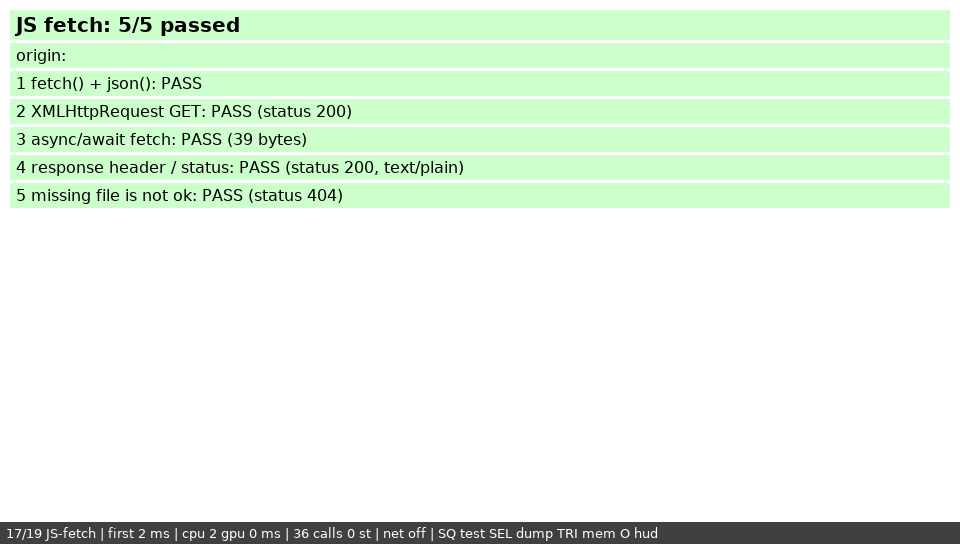
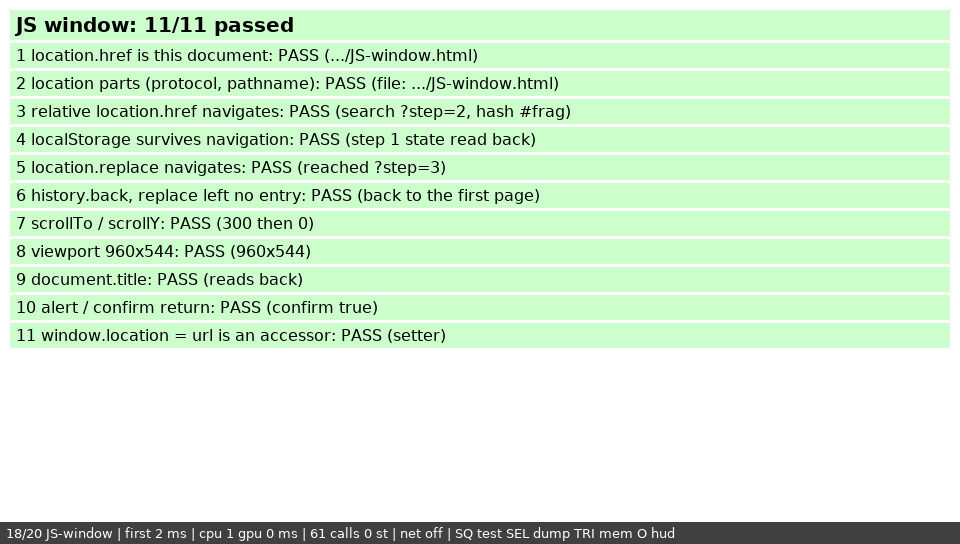
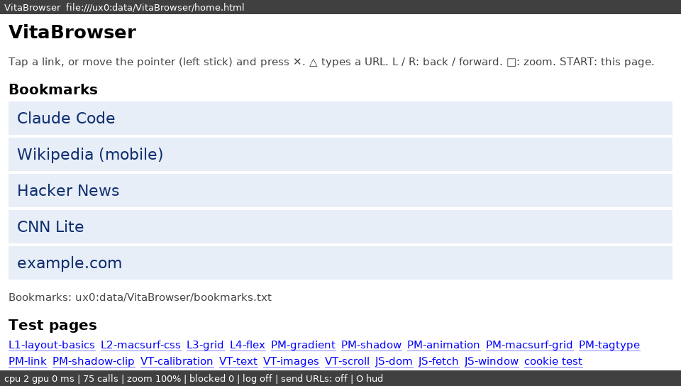

# 10 — First hardware test plan

**Date:** 2026-09-22 · **Build:** patches 29–33 · **Artifacts:** `C:\Users\seleron\<PC>\VitaBrowser-hwtest\`

The first run of VitaBrowser on a real PS Vita. Everything up to now was
proven on the build machine (09 §3). This run answers what only hardware
can: does it boot; do the PGF font size, baseline and clip edges match the
assumptions (09 §6); how fast is it; how much memory does the app really
get (pre-phase-0 §1, still open).

The test build carries its own instrumentation (patch 33, `vita/diag.c`).
Almost every question below is answered by a **file the Vita writes**, not
by eye. The visual checks are there for what files cannot show.

## What was built for the run

| Item | Where |
|---|---|
| `VitaBrowser.vpk` (title `VBRW00001`, default memory budget) | hand-off folder |
| `VitaBrowser-ext.vpk` (title `VBRW00002`, `ATTRIBUTE2=12`: the extended 365 MiB budget) | hand-off folder |
| 15 reference screenshots from the host simulator (same code, DejaVu font instead of PGF) | `reference-screenshots\` |
| exact `nsvita.elf` (for crash-dump symbols), SHA256 sums, the simulator's reference `log.txt` + plot dumps | `<WORK>/vitabrowser-work/hwtest-2026-09-22/` |

SHA256 (first 12 hex digits; full sums in `hwtest-2026-09-22/SHA256SUMS`):
`VitaBrowser.vpk` `0ab65b70c9c5`, `VitaBrowser-ext.vpk` `6a22c474457b`,
`nsvita.elf` `e156ce9ed6a4`.

**Diagnostics the build writes** to `ux0:data/VitaBrowser/`:
- `log.txt`: timestamped and flushed per line, so a crash leaves everything
  up to it. It records the title id, CPU/GPU clocks, each init stage's result,
  and free memory per pool. For every page it logs navigation, load time,
  first-frame time, CPU and GPU ms per frame, draw calls, extent and memory.
  It also records the PGF font metrics and the allocate-until-failure probe
  (newlib heap, USER_RW, CDRAM, PHYCONT, `sceAppMgrGetBudgetInfo`).
- `NN-<page>.plot` (+ `-bottom` for long pages): the frame's plot stream in
  the nsmonkey format. It diffs line for line against the simulator's
  reference dumps; text-width differences show PGF vs DejaVu metrics
  directly.
- `autotest.done`: marker written when the autotest finishes.

**Controls:** D-pad / left stick scroll · L / R previous / next page ·
□ autotest · SELECT dump this page · △ memory probe · ○ toggle HUD ·
START quit. The HUD (bottom bar) shows page n/15, first-frame ms, CPU/GPU ms
of the last frame, and draw calls.

## The plan

Allow **30–40 minutes**. Record answers in the results template at the end.
If something fails, **stop at that step, do step 8 (collect), and send
what you have**: a partial log is still useful.

### Step 0 — Setup facts (record, no action)

- Model: PCH-1000 (OLED) / PCH-2000 (slim) / PSTV.
- Firmware version (Settings → System → System Information).
- Exploit: Enso / h-encore / HENlo, and HENkaku version.
- Storage: Sony memory card or SD2Vita, and free space (≥ 50 MB).
- taiHEN plugins loaded, **especially overclock plugins** (PSVshell,
  oclockvita…): they change every timing number.
- VitaShell version.

### Step 1 — Install

1. Copy `VitaBrowser.vpk` and `VitaBrowser-ext.vpk` to the Vita, e.g.
   `ux0:downloads/`, over VitaShell's FTP (SELECT in VitaShell) or USB mode.
2. If `ux0:data/VitaBrowser/` exists from an earlier try, delete it, so the
   log starts clean.
3. In VitaShell, highlight each VPK, press ✕ → install. Neither should ask
   for extended permissions: the eboot is built "safe" (`vita-make-fself -s`).
4. **Record:** install result for each. Do two bubbles appear ("VitaBrowser"
   and "VitaBrowser ext-mem"), each with a blue square icon, and does the
   LiveArea open (blue background, a "start" gate)?

### Step 2 — Boot (T1)

Launch **VitaBrowser** (not ext-mem).

- **Expected:** within a few seconds, a white page with "L1 heading", a grey
  block, a paragraph, a float and a small table; a dark HUD bar at the
  bottom reading `1/15 L1-layout-basics | …`.
- **Record:** time from tapping the gate to the page (rough stopwatch), and
  what you see.
- **If it fails:**
  - System error dialog (e.g. `C2-12828-1`): note the code. A crash dump
    `ux0:data/psp2core-*.psp2dmp` should exist; keep it.
  - Blue text "VitaBrowser: … failed (n)": photograph it, press START.
  - Black or frozen screen for > 30 s: hold PS to close. Note it.
  - In every case, go to step 8.

### Step 3 — Autotest (T2)

On the L1 page, press **□ once** and **do not touch the Vita** until it says
**AUTOTEST DONE**. It visits all 15 pages. A cyan message box shows
`AUTOTEST page n/15`. Long pages scroll to the bottom by themselves. At the
end it measures font metrics and memory. The simulator needs about 21 s;
expect longer on the Vita.

- **Record:** did it reach DONE; total time (stopwatch); if it stalls,
  the page number and how long you waited (give it 2 minutes per page).
- Do **not** quit yet.

### Step 4 — Visual checks with screenshots (T3)

Use **L / R** to visit each page. On each, take a **screenshot**: press the
**PS button and START together**. They land in `ux0:picture/SCREENSHOT/`,
and are pixel-exact, which matters for calibration. If screenshots don't
work for this app, take phone photos instead and say so.

Compare each with its reference in `reference-screenshots\` (NN matches
the HUD's page number). The references use a different font, so **text
will differ in size and width**. Everything else should match. Answer:

| # | Page | Check |
|---|---|---|
| 1 | L1-layout-basics | layout as the reference? table borders visible? |
| 2 | L2-macsurf-css | "rounded + shadow" box has a thin dark shadow right/bottom; form input box with border |
| 3 | L3-grid | a stacked list G1a…G6d **is expected** (standard grid not implemented, 06 §7) |
| 4 | L4-flex | six rows; rows 2/4/6 spread items apart |
| 5 | PM-gradient | smooth(ish) red→blue vertical band, black→white horizontal, solid yellow box |
| 6 | PM-shadow | red box with a grey 8 px shadow on its right edge; blue box below it |
| 7 | PM-animation | red vertical bar crossing a 50%-blue box (overlap purple); green box |
| 8 | PM-macsurf-grid | 3×2 bordered cells C1…C6 |
| 9 | PM-tagtype | a label, a select "optA", an input "hello" |
| 10 | PM-link | link text renders |
| 11 | PM-shadow-clip | red and green boxes each with a full 10 px grey shadow; blue box's shadow cut at the bottom (right side showing is a known, separate bug) |
| 12 | **VT-calibration** | see step 4a, the most important page |
| 13 | VT-text | see step 4b |
| 14 | VT-images | four colour-bar images (PNG/JPEG/GIF/BMP), one ×2, a tiled strip, a repeat-x strip, and a box split **dark red \| pink** |
| 15 | VT-scroll | orange wide bar + "Row 1…" stripes; see step 5 |

**4a — VT-calibration (page 12).** Take **two** screenshots of this page.
For each item, answer yes/no, or describe:

- A. **Ticks:** 11 thin tick marks along the very top, 100 px apart,
  the last at the right edge?
- B. **Shared edge:** the red and blue boxes touch with no gap and no
  darker/overlapping line?
- C. **Hairlines:** four thin horizontal lines, equally spaced and equally
  thick, none missing?
- D. **Clip:** the green box near the top at x = 700 (100 × 40) has a black
  border on its **top and left only**, none on its right or bottom?
- E. **Text size / baseline:** seven yellow strips labelled 10px…48px. For
  each, is the text about as tall as its strip? Is it **too big**
  (spilling out), **too small**, **too high** (tops cut or above) or
  **too low** (sitting on or below the bottom edge)? The 48px and 20px
  strips matter most.
- F. **Width agreement:** four grey boxes at the right (MMMMMMMMMM,
  iiii…, "The quick brown fox", "a b c d…"). Does the text end **exactly**
  where the grey ends? If not, which way (text past the grey, or grey past
  the text), and by roughly how many letters?
- G. **Wrapping:** in the light-blue box, does any line run past its right
  edge?

**4b — VT-text (page 13).** For each line, does it render correctly, show
empty boxes, show nothing, or show garbage?
Latin-1 accents · Greek · Cyrillic · Japanese · Korean · Chinese · emoji.
Also: is **bold** distinguishable from regular (expected: no, weight isn't
implemented)? Are the underline and strike-through lines in sensible
places? Are there bullets and numbers on the lists?

### Step 5 — Controls, scrolling, HUD (T4)

On **VT-scroll** (page 15):
- D-pad down: does it scroll smoothly to "Bottom of the page"? Any tearing,
  flicker, stale stripes or garbage? Rate smoothness 1–5.
- Left stick: scrolls, speed proportional to tilt? D-pad right / stick
  right: reaches "END" of the orange bar?
- **Record** the HUD's `cpu … gpu … ms` while scrolling (read a typical
  value).

Anywhere:
- ○ hides and shows the HUD.
- SELECT → message "dumped manual-….plot".
- △ → "memory probe…", then "memory probe done". Record how long it takes
  and whether the app survives.
- **START** → the app exits back to LiveArea **without an error dialog**.
  Record exactly what happens.

### Step 6 — Extended-memory variant (T5)

Launch **VitaBrowser ext-mem**.
- Does it launch at all? (`ATTRIBUTE2=12` has not been confirmed on your
  firmware; an error dialog here is a valid, useful result: note the code.)
- If it runs: press **△**, wait for "memory probe done", then **START**.
  That's all: its numbers go into the same `log.txt` under title
  `VBRW00002`.

### Step 7 — Robustness (T6)

Launch **VitaBrowser** again, open **VT-scroll** (R until page 15):
- scroll up and down continuously for about 1 minute;
- press the **power button briefly** (suspend), wait 10 s, wake the Vita:
  does the app come back and still draw and scroll?
- press **PS** to go to the home screen, then return to the app: same
  question;
- then START to quit.

### Step 8 — Collect and send

Copy to `C:\Users\seleron\<PC>\VitaBrowser-hwtest\results\` (VitaShell
FTP or USB):
1. the whole folder `ux0:data/VitaBrowser/`: `log.txt`, all `*.plot`,
   `autotest.done`;
2. your screenshots from `ux0:picture/SCREENSHOT/` (the VitaBrowser ones);
3. any crash dumps: `ux0:data/psp2core-*.psp2dmp`;
4. photos, if you took any.

Then paste the filled-in template below into the chat and say the files
are in place. The analysis side (the log, dump diffs against
`hwtest-2026-09-22/sim-reference/`, crash dumps against the archived ELF)
is on me.

## Results template

```
VITABROWSER HW TEST 2026-09-22 — RESULTS

STEP 0  model:            firmware:         exploit/HENkaku:
        storage + free:   plugins (overclock?):     VitaShell:
STEP 1  install VitaBrowser: ok/fail ...   install ext-mem: ok/fail ...
        bubbles + icons + LiveArea: ...
STEP 2  boot: ok/fail   time to page: ~ s   notes/error code:
STEP 3  autotest reached DONE: y/n   total time: ~ s   stalled at page:
STEP 4  screenshots work: y/n (photos instead?)
        pages 1-11 (anything different from the reference other than text):
          1: 2: 3: 4: 5: 6: 7: 8: 9: 10: 11:
        4a VT-calibration  A ticks:  B shared edge:  C hairlines:  D clip:
           E text size/baseline per strip (10/12/16/20/24/32/48):
           F width agreement (4 boxes):
           G wrapping:
        4b VT-text  Latin-1:  Greek:  Cyrillic:  Japanese:  Korean:  Chinese:  emoji:
           bold distinguishable:  underline/strike:  bullets/numbers:
        14 VT-images  PNG/JPEG/GIF/BMP:  x2:  tiles:  dark red|pink:
STEP 5  scroll smoothness 1-5:   artefacts:   stick:   reaches END:
        HUD cpu/gpu while scrolling:   O hud:   SELECT dump:
        TRIANGLE probe time + survived:   START exit clean:
STEP 6  ext-mem launches: y/n (error code?)   probe done:
STEP 7  1-min scroll:   suspend/resume:   PS home + return:
STEP 8  files copied to results\: y/n   crash dumps: y/n
OTHER   anything else you noticed:
```

## What each answer decides

| Result | Decides |
|---|---|
| boot / init stages in the log | whether the next session fixes start-up or moves on |
| E (text size/baseline) + the logged PGF metrics | `VITA_PGF_EM_PX` and the baseline convention (09 §6) |
| F (width) + `.plot` text diffs | whether layout and drawing agree on PGF (glyph-advance method) |
| B, C, D, ticks | vita2d rect coverage and clip-edge semantics (09 §6) |
| page timings, CPU/GPU ms | first real performance numbers vs the brief's §1 estimates |
| memory probe (both VPKs) | the measured budget: closes pre-phase-0 §1's open item, and whether `ATTRIBUTE2=12` works here |
| VT-text scripts | how much of the web the system font can show before freetype/harfbuzz |
| step 7 | whether suspend/resume needs GXM handling before daily use |

## Run 1 — results (2026-09-22, PCH-2000, firmware 3.65 HENkaku, no overclock)

Files: `<WORK>/vitabrowser-work/hwtest-2026-09-22/device-results/` (log,
17 plot dumps, 2 screenshots); the tester's filled-in template is quoted in
the session.

**What works on hardware.** Install (both VPKs), LiveArea, boot in about
0.5 s to the first frame, every init stage (`vita2d_init_advanced -> 1`,
PGF font, `netsurf_register`, `nsoption_init`, messages, `netsurf_init`
all OK), GPU drawing (the HUD), input (L/R, ○, SELECT, △, START), the
memory probe, clean exit, suspend/resume and PS-home/return. No crash, no
crash dump.

**The failure: no page ever loads.** Every page logs `load not finished`
after the 20 s settle timeout, with `extent 0x0` and 1 draw call; every
dump is `CLIP` + one full-screen `RECT`, the core's placeholder when it has
no document. So the fetch never completes, and it does not fail either: a
failure would have produced an error page. The same code loads every page
in the host simulator (~165 ms each).

What was ruled out:
- **The file fetcher itself.** `stat` / `fopen` / `fread` would report an
  error, not hang, and setup only converts the path.
- **Miscompiled implicit calls.** A clean cross build has exactly one
  implicit declaration, `strcasecmp` (returns `int`, ABI-safe).
- **Init.** Every stage returned OK on the device.

> **Corrected after run 2: this hypothesis was wrong.** The fetch
> completes in about 100 ms; HTML creation fails because vitaSDK's newlib
> has an empty `iconv`. See §Run 2 — results.

**Leading hypothesis (wrong, see above): fetches stranded by the
scheduler-only fetch poll.**
Upstream frontends call `fetch_fdset()` every loop iteration (monkey, gtk),
which also dispatches queued fetches and polls every fetcher. MacSurf's core
documents fetches getting stranded when the self-rescheduling poll goes
dormant, and its own event loop calls `fetch_pump()` every iteration
(`content/fetch.c`, fixes90). The Vita loop did neither. It is not yet
explained why the simulator escapes it, so run 2 is built to show the
mechanism rather than assume it.

**Measured memory (closes pre-phase-0 §1's open item):**

| | default VPK (VBRW00001) | `ATTRIBUTE2=12` VPK (VBRW00002) |
|---|---|---|
| free USER at boot, after the 192 MiB heap + 4 MiB stack | 51 MiB | — |
| newlib heap free to `malloc` | 190 MiB | 190 MiB |
| USER_RW blocks beyond the heap | **40 MiB** | **149 MiB** |
| app MAIN total, approx. | **≈ 256 MiB** | **≈ 365 MiB** |
| CDRAM free (after vita2d's framebuffers) | 89 MiB (112 MiB before `vita2d_init`) | 89 MiB |
| PHYCONT | 26 MiB | 26 MiB |

The documented budgets hold on 3.65 HENkaku: 256 MiB default and
**365 MiB with `ATTRIBUTE2=12`, which works here** (+109 MiB).
`sceAppMgrGetBudgetInfo` is refused to a normal app (`0x8080201f`), as its
header says. vita2d and the engine's init take about 13 MiB of USER and
23 MiB of CDRAM.

**Other readings.**
- Clocks read ARM 333 MHz and GPU 41 MHz (as returned by
  `scePowerGetGpuClockFrequency`; probably a power-managed idle reading).
- The first blank frame took 52 ms of CPU and 4 ms of GPU.
- The HUD did not update on L/R: the loop only repainted when the page
  invalidated, and with no document it never did. Fixed in run 2.
- VitaShell 2.02 showed "this package requests extended permissions" for
  both VPKs. The eboot's authid is the safe `0x2F00000000000002` (file
  offset 0x80), and none of the libraries VitaShell's current source flags
  (`SceVshBridge`, `ScePromoterUtil`, `SceShellSvc`) are imported. The one
  unusual import is `SceGxmInternalForVsh`, from libvita2d, which is the
  likeliest trigger. Unverified and harmless; open.

## Run 2 — the diagnostics-2 build (patch 34)

The same VPK names in the hand-off folder, rebuilt (SHA256 first 12:
`VitaBrowser.vpk` `0683dfb74f4d`, `VitaBrowser-ext.vpk` `7cbcc9129308`,
`nsvita.elf` `60314993b2ca`; archive
`<WORK>/vitabrowser-work/hwtest-2026-09-23-run2/`).

What it adds:
- `netsurf.log`: the engine's own log, with NetSurf's NSLOG at every level
  plus MacSurf's engine traces. It is buffered, flushed each second, and
  capped at 16 MB. A full simulator autotest writes about 0.5 MB.
- Once a second until a page's document arrives: `load status … loading,
  extent, sched pending (added, fired), pump on/off`. This shows directly
  whether scheduled callbacks, including the fetch poll, run on the Vita.
- Window events, status text and URL changes in `log.txt`.
- **Stall rescue.** If a page has no document 1.5 s after navigating, the loop
  logs `fetch stalled?` and calls `fetch_pump()` every iteration for that
  page. The log then says whether the document arrived with the pump on.
  Verified safe in the simulator by forcing the pump on for every page:
  16/16 loads, dumps byte-identical, documents arrive sooner (117 ms vs
  165 ms).
- The HUD and messages repaint on their own.

Run 2 is short:
1. Install the new **VitaBrowser.vpk** over the old one (the ext-mem VPK
   isn't needed this time).
2. Delete `ux0:data/VitaBrowser/`.
3. Launch VitaBrowser and wait 10 s on L1. **Does the page render now?**
4. Press □ (autotest), wait for AUTOTEST DONE, then START.
5. Copy `ux0:data/VitaBrowser/` (now including `netsurf.log`) into
   `results\`.
6. If pages render, also redo the checklist's steps 4, 4a, 4b, 5 and 7 with
   screenshots.

## Run 2 — results (2026-09-23)

Files: `<WORK>/vitabrowser-work/hwtest-2026-09-23-run2/device-results/`.
Pages still did not render. `netsurf.log` (13.5 MB, the engine's own log)
settled the cause.

**The fetch was never the problem.** For every page the engine log reads:

```
llcache: Starting fetch ... Fetch event 2/3/4    (headers, data, done)
MS fetch FINISHED                                (~100 ms after navigating)
MS html create
MS hlcache content create FAILED
MS NAV: ERROR ... -> error page                  (about:query/fetcherror)
MS html create
MS hlcache content create FAILED                 (the error page is HTML too)
... repeated: 6111 times in 5 minutes
```

**Root cause: vitaSDK's newlib ships `iconv` with no converters.** Its alias
table is a single empty string, its CCS table is empty, and its encoding
handler tables are two empty NULL-terminated lists (`arm-vita-eabi-nm`/
`objdump` on `libc.a`). So every `iconv_open()` fails, even UTF-8 → UTF-8.
libparserutils' input filter calls `iconv_open()` for every input stream,
UTF-8 included (`src/input/filter.c` `filter_set_encoding`). No HTML or CSS
parser can be created. The host simulator linked glibc, whose `iconv` works,
which is why only the device failed.

**Reproduced on the host, and the fix proven there:**
- With `iconv_open()` forced to fail (an `LD_PRELOAD` shim), the simulator
  produces the device's exact trace (`html create` → `content create
  FAILED` → error page, looping).
- With libparserutils built `-DWITHOUT_ICONV_FILTER`, an upstream option
  that uses its own codecs (UTF-8/16, ISO-8859-x, Windows-125x), and
  `iconv_open()` still failing: **0 failures, 16/16 documents, every dump
  byte-identical** to the reference made with a working `iconv`.

**What changed for run 3:**
- `tools/build-vita.sh` builds libparserutils `-DWITHOUT_ICONV_FILTER` and
  fails the build if the archive still references `iconv_open`.
- **The simulator now models the gap.** `vitasim.c` defines an
  `iconv_open()` that always fails, like newlib, and `run-vita-sim.sh`
  links a libparserutils built exactly as the Vita's. If that overlay ever
  stops being linked, no page loads and the run fails. (Its own check
  caught a stale-object mistake while it was being written.) Lesson: the
  simulator stands in for the SDK's *libc* as well as its GPU.
- **Patch 35: the error-page loop is guarded.** When the page that failed
  is `about:query/fetcherror` itself, the core stops the load instead of
  retrying forever. This is upstream behaviour, not MacSurf's. Verified in
  the broken configuration: two failures per page (the page, then its
  error page), then `STOP_THROBBER`.
- **Patch 36:** the automatic fetch pump from run 2 is removed (its
  hypothesis was wrong); the load-status lines stay.
- **`log.txt` stayed untouched in run 2** (its timestamp moved; its bytes did
  not), while `netsurf.log` and the dumps were written, and the
  `autotest.done` marker was not refreshed. Not explained yet, so patch 36
  instruments it: one line-buffered handle, every write checked, failures
  reported with their errno in `netsurf.log`, and every line mirrored there
  as `DIAG …`.
  > **Corrected after run 3: not a Vita bug.** The copy to the PC served
  > cached old versions of every filename it had seen before (see §Run 3).
  > Patch 36's instrumentation is harmless and stays.
- **Still using `iconv`:** NetSurf's form-submission encoding
  (`utils/utf8.c`, from `html/form.c`) for non-UTF-8 charsets. Irrelevant
  until forms and networking exist, then it needs a converter (libiconv,
  or libparserutils' codecs).

## Run 3 — the iconv fix (patches 35–36)

Hand-off VPKs rebuilt (SHA256 first 12: `VitaBrowser.vpk`
`fbf54ea178b3`, `VitaBrowser-ext.vpk` `2f03b5c184ee`, `nsvita.elf`
`0bd94a0eaee2`; archive `<WORK>/vitabrowser-work/hwtest-2026-09-23-run3/`).
Clean checkout: applied 119 + the known 2; L1 SAME; fixtures 4/4; 93/93;
simulator 15/15 pages with newlib's `iconv` modelled.

This time the full checklist applies:
1. Install the new **VitaBrowser.vpk** over the old one, and delete
   `ux0:data/VitaBrowser/`.
2. Launch it. L1 should render within about a second.
3. Work through the checklist from step 3 (autotest) to step 8, clearing its
   old answers first.
4. Copy `ux0:data/VitaBrowser/` and the screenshots into `results\`.

## Run 3 — results (2026-09-23): pages render on hardware

**Every page renders.** The tester's checklist:
- Autotest completed in about a minute, with no stalls.
- Pages 1–11 pass against the references.
- **All seven VT-calibration checks pass** (ticks, shared edge, hairlines,
  clip, text size and baseline, width agreement, wrapping).
- Latin-1, Greek, Cyrillic, Japanese and Chinese render; PNG, JPEG, GIF, BMP,
  ×2 scaling, tiling and alpha are correct.
- D-pad scrolling rated 5/5 with no artefacts; the stick works and reaches
  the far right.
- HUD, dumps, memory probe, clean exit, the ext-mem VPK, a 1-minute scroll,
  suspend/resume and PS-home all pass.

Files: `<WORK>/vitabrowser-work/hwtest-2026-09-23-run3/device-results-partial/`.

**Issues seen:**
- **Korean** renders as blanks. The default PGF set that
  `vita2d_load_default_pgf()` loads evidently lacks Hangul; the system has
  a separate Korean font to try.
- **Emoji** render as blanks (expected: no colour-glyph font).
- **Bold** is not distinguishable (known: weight is not implemented).
- The **strike-through** line sits a little high, towards the top of the
  lower-case letters.
- **Performance while scrolling** (HUD): CPU 2–3 ms, but **GPU 31–37 ms**
  per frame. The "GPU" figure is `vita2d_end_drawing()` →
  `vita2d_wait_rendering_done()`. A blank frame measured 4 ms in run 1, so
  the cost grows with content: either display-queue / vblank waiting is
  counted in it, or `vita2d_set_clip_rectangle` is expensive (a page issues
  about 100 clips per frame). Needs its own look before real pages.

**The file-copy problem, and the run-2 "log.txt bug" explained.** In the
copied `results\`, every file whose name already existed on the card from
an earlier run came back **byte-identical to that earlier run's copy**.
That covers `log.txt` (= run 1), `netsurf.log` (= run 2), the top-of-page
dumps (= run 2's placeholders) and `autotest.done`, even though the listing
showed this run's times. Every *new* filename has new content: the
`-bottom` dumps and the two new manual dumps. The screenshots from this run
were not visible either. The Vita writes correctly; the PC-side copy served
cached files and listings for known names, which is typical of Windows
Explorer's FTP view. That is also what run 2's untouched `log.txt` was.

**What the fresh files show.** The device's `-bottom` dumps match the host
simulator's reference structurally (same op and rect counts). The only
differences are text widths: PGF's glyphs are about a pixel wider than
DejaVu's in places, so shrink-to-fit boxes (flex items, table cells) come
out a pixel wider and everything around them shifts consistently. Pages
without shrink-to-fit text (L3-grid, PM-gradient) are **byte-identical to
the simulator** at the scrolled bottom, so scrolled redraw is correct on
hardware.

### Run 3 — the full data (re-copied past the cache)

Files: `<WORK>/vitabrowser-work/hwtest-2026-09-23-run3/device-results/` (log,
engine log, 22 dumps, 7 screenshots). All 9 boots of the run-3 build report
`log.txt: open (errno 0)` with no write failures, and the engine log has no
HTML failures from run 3 (its 6111 are all run 2's, appended to), which
confirms the copy-cache explanation above.

**Timings on hardware (333 MHz ARM, no overclock):**

| | measured |
|---|---|
| boot to first frame | ~0.5 s |
| navigate → document (bundled pages) | **344–1403 ms**, most 400–700 ms (simulator: ~165 ms) |
| CPU per frame (layout walk + plot submit) | **1–7 ms** |
| GPU per frame (`end_drawing` → `wait_rendering_done`) | **12–69 ms**, growing with draw calls: 7-call PM-link 12 ms, 123-call VT-calibration 69 ms |

**The GPU figure is the performance problem.** About 0.5 ms per draw call is
far slower than the GXM should be. Two suspects, both cheap to test:
- the boot log reads **GPU clock 41 MHz** (`scePowerGetGpuClockFrequency`);
  homebrew ports commonly raise it with `scePowerSetGpuClockFrequency`;
- the per-call cost of `vita2d_set_clip_rectangle` (a page issues 30–160
  clips a frame).

CPU is not the constraint.

**PGF font metrics:** `text_height("Hg")` at scale 1 is 17 px (34 at scale
2), and "M" advances 17 px. Advances measured `"a"c"a" − "aa"` equal the
raw single-glyph widths for every printable ASCII character, space
included (6 px). The workaround in `layout.c` for PGF under-reporting
ink-less glyphs is therefore unnecessary on hardware, though harmless.
Calibration E and F passed visually with `VITA_PGF_EM_PX = 20`.

**Memory:** as in runs 1–2 (≈ 40 MiB USER_RW beyond the heap, 84–89 MiB
CDRAM, 26 MiB PHYCONT).

**Screenshots** (pixel-exact, from the Vita) show five rendering issues,
none of which the checklist asked about:
1. **Stray marks above some glyphs** (`Caf̄é`, `f̄açade`, `d̄ash`,
   `J̄apanese`, `C̄hinese`): pieces of neighbouring glyphs from vita2d's PGF
   atlas, sampled with linear filtering at a non-integer scale. Large
   headings are also soft (bitmap glyphs scaled up).
2. **Greek and Cyrillic are spaced out** (`Ε λ λ η ν ι κ _`), and accented
   `ά` is missing: the Latin system font lacks them, so they come from the
   Japanese font as full-width glyphs. Simplified Chinese is partial
   (`_体中文`: `简` missing). Korean and emoji are blank.
3. **A gap before punctuation after inline elements** (`Bold text ,
   italic text ,`). The host simulator shows it too, so it is a layout bug
   in the engine, not a device issue.
4. The strike-through sits a little high (tester).
5. One screenshot is completely black (probably taken mid-transition; not
   reproducible from the log).

Issues 1 and 2 argue for drawing text with FreeType from a TTF with
broad coverage (vita2d's `vita2d_font`, already linked) instead of the
system PGF, and for measuring with the same face.

## Next actions after run 3

1. **GPU time:** raise the GPU clock and measure; then measure clip cost,
   and batch or avoid clips.
2. **Text:** FreeType + a broad-coverage TTF for drawing and layout (fixes
   the atlas marks, Greek/Cyrillic/CJK coverage, and the soft headings).
   **Done in patch 38 (§Run 5).**
3. **Inline punctuation gap:** reproduce on the desktop (it shows in the
   simulator) and fix in the engine.
   **Gone in the simulator with patch 38** (a PGF measuring artefact, §Run 5);
   confirm on the device.
4. **Transfers:** copy results over USB or with a client that doesn't cache
   (FileZilla, WinSCP), or rename the folder on the Vita first.

## Run 4 — GPU time: clipping on the CPU, and the GPU clock (patch 37)

**Why run 3's GPU time was so high.** libvita2d clips with the stencil
buffer, and `vita2d_set_clip_rectangle()` rewrites the whole stencil every
time: a full 960×544 rectangle to clear it, then the clip rectangle
(libvita2d `vita2d.c`, read upstream). `vita2d_enable_clipping()` calls it
too. The plotter called **both for every core clip**: four stencil fills,
two of them full-screen, per clip, at 30–160 clips a frame. That fits both
the 12–69 ms and its growth with page complexity. `vita2d_wait_rendering_done()`
is `sceGxmFinish()`, so the number is real GPU work, not a vblank wait.

**The fix (patch 37, `frontends/vita/plot.c`): clip on the CPU.**
- Axis-aligned fills (backgrounds, gradient bands, shadows, borders, most
  calls) are intersected with the clip exactly on the CPU.
- A primitive wholly outside the clip is skipped; one wholly inside needs
  nothing.
- Only a primitive that crosses the clip edge (a quad, text, a texture or
  a line) uses the stencil, and the stencil is rewritten only when the clip
  changed since it was last written.
- Clipping is left off at the end of each frame, so
  `vita2d_start_drawing()` doesn't rewrite it before the next.
- The old behaviour stays selectable (`VITA_CLIP_STENCIL`) for measuring
  against.

**The GPU clock.** The run-1 and run-3 boot logs read "gpu 41 MHz". The build
now logs ARM, bus, GPU and GPU-crossbar clocks at boot, and the **browsing
profile sets the GPU to 222 MHz (crossbar 166)**, leaving the ARM as booted.
Every change is logged with its return code and the clocks read back.

**Verified on the host:**
- Unit test 100/100: new checks for each clipping path (cut, skipped,
  inside, crossing → stencil set once for many primitives, clipping off at
  frame end, stencil mode unchanged). Two planted mutations (no stencil
  cache, no CPU cut) are caught.
- Simulator: CPU clipping is **pixel-identical to the stencil clip on all
  14 comparable pages**. PM-animation changes by itself over time (its
  rotation is clock-driven: it differs even between two stencil-mode
  passes), so the harness reports it as time-varying and skips it. The
  harness now fails if any other page differs.
- Stencil writes per frame, same pages (simulator):

| page | clips | stencil writes, run-3 behaviour | CPU clip |
|---|---|---|---|
| VT-calibration | 169 | 338 | **25** (18 crossing primitives) |
| VT-scroll | 90 | 180 | **2** (1 crossing) |
| average over 15 pages | 77 | 154 | **13** |

- Plot dumps are byte-identical to run 3's reference, except
  PM-animation's animated box (time).
- Clean checkout: applied 120 + the known 2; L1 SAME; fixtures 4/4.

**The run-4 autotest measures both changes on the device.** It runs **four
passes** over all 15 pages, each page timed over 5 redraws (min/avg/max),
with a `pass X summary` line per pass in `log.txt`:

| pass | clipping | clocks | isolates |
|---|---|---|---|
| A | stencil per clip (run 3) | as booted | the baseline (≈ run 3) |
| B | stencil per clip | GPU 222 / crossbar 166 | the GPU clock alone |
| C | CPU | as booted | CPU clipping alone |
| D | CPU | ARM 444, bus 222, GPU 222, crossbar 166 | both, plus the ARM for load time |

Hand-off VPKs rebuilt (SHA256 first 12: `VitaBrowser.vpk` `83290de32e4f`,
`VitaBrowser-ext.vpk` `4233dac74fe0`, `nsvita.elf` `bdb66bef8a3a`; archive
`<WORK>/vitabrowser-work/hwtest-2026-09-23-run4/`, with the simulator's
reference log, dumps and per-pass snapshots).

Run 4 on the device (about 5 minutes):
1. Install the new **VitaBrowser.vpk**, and **delete
   `ux0:data/VitaBrowser/`** first.
2. Launch, press □, wait for AUTOTEST DONE (four passes, a few minutes),
   then START.
3. Scroll VT-scroll for a few seconds and note the HUD's `cpu … gpu … ms`
   and `… st` (stencil writes).
4. Copy `ux0:data/VitaBrowser/` into `results\` over USB mode or a
   non-caching FTP client (FileZilla / WinSCP), not Explorer's FTP view
   (§Run 3).

What decides the next step: pass B vs A (the clock), C vs A (the clipping),
and D (both). Whether GPU 222 needs anything beyond a safe homebrew
(`scePowerSetGpuClockFrequency` return codes in the log).

### Run 4 — results: not received (checked 2026-09-23)

`VitaBrowser-hwtest\results\` was **empty** when checked for the run-4
data: no `log.txt`, no `autotest.done`, nothing newer than the hand-off
(03:06), and no stray copy elsewhere under `VitaBrowser-hwtest\`. The
four-pass timings (clock vs clipping) are therefore **still unmeasured**.
Nothing was waited for. The next build (text, below) keeps the same
four-pass autotest, so one device run can measure both.

## Run 5 — text with FreeType and bundled fonts (patch 38), plus run 4's timings

**Why.** Run 3's text problems all came from the system PGF font. vita2d
rasterises it once and scales it: the scaled atlas bled marks next to
glyphs. Its fallback put Greek and Cyrillic in the Japanese font at full
width, and it has no Hangul, no emoji and no `简`. Patch 38 replaces it with
one FreeType engine, `frontends/vita/text.c` ([09 §11](09-vita-frontend.md)):
- **Fonts:** DejaVu Sans/Serif/Mono with real bold and italic faces; per
  code point, fallback to DroidSansFallbackFull (kana, CJK) and NanumGothic
  (Hangul).
- **Glyphs:** rasterised at the exact size and drawn unscaled from an alpha
  atlas with a 1-pixel empty gap.
- **Advances:** one set, used by layout and drawing alike.

The fonts (11 MB, three licences) are fetched by `tools/fetch-fonts.sh`,
pinned and SHA256-checked, and bundled in `res/fonts/`. The VPK is now
10.3 MB.

**Host results** (sim screenshots: `img/10-run5/`):

| run-3 problem | cause | now (simulator) |
|---|---|---|
| marks beside glyphs | scaled glyphs sampled past their atlas cell | exact-size glyphs with an empty border, point-sampled; the test checks every border texel |
| Greek/Cyrillic full-width | PGF fallback to the Japanese font | DejaVu Sans: `Ελληνικά`, `Кириллица` at proportional width |
| Korean, emoji, `简` blank | not in the PGF fonts | NanumGothic, DejaVu (😀 as an outline), Droid |
| gap before punctuation after inline elements | layout's PGF advances (`width("a"+c+"a") − width("aa")`) ≠ what was drawn | **gone**: measured = drawn (below) |
| strike-through too high | PGF ascent vs the engine's baseline guess | through the x-height (below); confirm on device |
| soft headings | no bold face (PGF regular only) | real DejaVu Bold (≥ 600) and Oblique |



Before (run-3 simulator reference) and after, the same line at 2×:


- `tools/test_vita_text.c` **30/30**. It uses the real engine, FreeType and
  fonts. Three mutations were planted and each is caught.
- `test_vita_plotter.c` **101/101**.
- Clip modes: still pixel-identical, 14/14 comparable pages.
- Atlas over the whole 4-pass autotest: **3 pages, 0 flushes, 0 drops, 1
  missing** (the U+E000 probe).
- `VT-calibration`: every grey width box ends with its text, and every
  yellow row holds its descenders.
- Clean checkout: applied 121 + the known 2; L1 PASS; fixtures 4/4;
  101/101 + 30/30; simulator 15/15; cross build `-Werror` clean, no PGF
  symbols in the ELF.
- Seen, not changed: on `VT-calibration` the in-flow paragraph paints over
  the absolutely positioned 200 px box. The pixels are identical before
  patch 38, so this is a paint-order issue, not a text one.

**Hand-off.** Built from the clean chain: `VitaBrowser.vpk` `bba81d5cdce7`,
`VitaBrowser-ext.vpk` `353b963ade0b`, `nsvita.elf` `59e5942ccdd7` (SHA256,
first 12). They are copied to `VitaBrowser-hwtest\`, replacing run 4's,
which stay in `<WORK>/vitabrowser-work/hwtest-2026-09-23-run4/`. Archive:
`<WORK>/vitabrowser-work/hwtest-2026-09-23-run5/` (VPKs, ELF, SHA256SUMS, the
simulator's reference log, dumps, shots and per-pass snapshots).
`VitaBrowser-hwtest\reference-screenshots\` is refreshed with the new
simulator shots.

**Run 5 on the device** (about 6 minutes). It keeps run 4's four-pass
autotest, so one run measures both:
1. Install the new **VitaBrowser.vpk** over the old one, and **delete
   `ux0:data/VitaBrowser/`** first.
2. Launch. The boot log should read `init: fonts (app0:/res/fonts/) -> 0`.
   If the fonts cannot be opened there is nothing to draw an error with, so
   the app returns straight to LiveArea; `log.txt` then ends at
   `init: fonts … -> <non-zero>`.
3. Press □ and wait for AUTOTEST DONE (four passes), then START.
4. Open **VT-text** (R to cycle) and compare it with
   `reference-screenshots\13-VT-text.png`:
   - Greek, Cyrillic, Japanese, Korean, Chinese and the emoji outline are
     all present;
   - no marks beside glyphs;
   - no gap before commas;
   - the strike-through crosses the middle of the lowercase letters;
   - bold and italic are distinct.
   Take a screenshot (PS + START).
5. Scroll VT-scroll and note the HUD's `cpu … gpu … ms` and `… st`.
6. Copy `ux0:data/VitaBrowser/` and the screenshots into `results\` over USB
   or with FileZilla/WinSCP.

**What decides the next step:**
- **The four passes (run 4's question):** pass B vs A is the GPU clock, C
  vs A is CPU clipping, and D is both.
- **Text cost:** each page's `first frame` ms against run 3. The first
  frame now rasterises glyphs, and VT-text's first frame also opens the
  Droid and Nanum faces.
- **The atlas line** in `log.txt` (`font: atlas … pages, … flushes, …
  dropped`). Any flushes or drops on the device mean the atlas needs more
  pages or an LRU.

### Run 5 — results: not received (checked 2026-09-23 03:48–03:52)

`VitaBrowser-hwtest\results\` was **empty** again: no `VitaBrowser\`
folder, no `log.txt`, no `autotest.done`, no screenshots. A search of the
whole user profile and drives D:–F: found nothing newer than the run-5
hand-off (03:31) apart from files this project wrote. The hand-off was 17
minutes old at the check, so the device run may simply not have happened
yet. Run 5 (text) and run 4 (timings) are both **still unmeasured**; the
VPKs in `VitaBrowser-hwtest\` stay valid.

Twice now the results did not arrive through the manual copy step (plus
run 2's stale Explorer-FTP copies). That is one more reason for the next
task: the Vita sends its log and plot dumps over the network itself
(§Run 6).

## Run 6 — results over the network (patch 39), plus runs 4 and 5

**Why.** Three runs have now lost results between the Vita and the PC:
- run 2's copies were stale, served from Explorer's FTP cache;
- runs 4 and 5 never reached `results\`.

Doc 03 also anticipated an on-device plot-stream log "over the UDP log"
([09 §7](09-vita-frontend.md)), and until now the formatter had no
transport.

**Patch 39 (`frontends/vita/netlog.c`)** sends everything the frontend
writes under `ux0:data/VitaBrowser/` to a receiver on the PC as it is
written: `log.txt` lines live, `netsurf.log` about once a second, and each
plot dump and `autotest.done` as it closes. The files on the memory card
are written exactly as before, so the network copy is an addition, not a
replacement.
- **Finding the PC:** the Vita broadcasts on UDP port 45100 until a
  receiver answers, then sends to the receiver alone. Nothing needs
  configuring. `ux0:data/VitaBrowser/netlog.cfg` can hold `off` or an
  address.
- **Checking:**
  - Every datagram carries a sequence number, so losses are counted.
  - Every finished file carries its length and CRC-32, and the receiver
    checks both.
  - Each launch gets its own folder (`results\net-<date>-<time>-<boot>\`),
    so a result can never be an old copy.
- **Safety:**
  - Sockets are non-blocking; only a full send buffer is retried (up to
    8 ms).
  - Bursts are paced at 2 ms per ~10 KB.
  - Sending pauses after 16 failures in a row and retries every 3 s.
  - A network failure is never fatal.
- **The receiver (`tools/vita-netlog.py`):**
  - Python stdlib only, for the PC's Python 3.12.10 (`py -3`).
  - It prints `log.txt` as it arrives.
  - With `--reference`, it compares each plot dump with the simulator's
    (SAME / DIFF + first differing line). That is the on-device diff the
    plot-stream item asked for.

**Host FreeType now matches the Vita's.** The simulator and the text test
used the host's FreeType 2.11.1, but the Vita has 2.14.3.
`tools/build-host-freetype.sh` builds 2.14.3 into `$WORK/host-freetype`
(userspace, no sudo). The SHA256 matched from both official mirrors, and
the simulator and the text test link it. Result: all 23 plot dumps are
byte-identical under both releases, and so are all 15 page screenshots
(only the HUD's timing numbers differ). So the fonts and sizes used today
hint the same in both. The pin stays as a guard, so a device-vs-simulator
DIFF means a real difference.

**Verified on the host:**
- The simulator's autotest sends to a local receiver, the same code path as
  after a receiver answers on the Vita. Result: **23/23 files byte-identical
  to the simulator's memory card** (log.txt, netsurf.log 2.0 MB, 20 dumps,
  autotest.done), **3 613 datagrams, 0 lost**, and a clean goodbye.
  `run-vita-sim.sh` now fails if any file differs or any datagram is lost.
- **The first attempt lost 5 datagrams, and the test caught it.** netsurf.log
  grows at ~32 KB/s, the old tail step, so a backlog went out at exit as
  one unpaced burst and overflowed the receiver's socket buffer. Pacing and
  a 64 KB/s tail fixed it. The cost is 450 pacing pauses (≈0.9 s) over a
  64 s autotest.
- **What the mirror costs the measurements (simulator):**
  - Frame times are unchanged: the mirror sends between frames.
  - Page-load averages rise by **≈7 ms** (160 → 167 ms in every pass), from
    the log lines and netsurf.log tails that land during loading.
  - All four passes pay it alike, so pass-vs-pass comparisons still hold.
  - For absolute load times on the device, put `off` in `netlog.cfg`.
- **Windows side:** the receiver ran under the PC's own Python 3.12.10
  (bound to 127.0.0.1, so no firewall prompt). It answered the hello, and
  all 22 files replayed to it arrived byte-identical, with matching CRCs.
- The `netlog.cfg` `off` path runs in the screenshot pass.
- Clean checkout: applied 122 + the known 2; L1 PASS; fixtures 4/4;
  101/101 + 30/30; simulator 15/15 with clip modes 14/14 identical; cross
  build `-Werror` clean; the ELF imports `sceNetInit`, `sceNetCtlInit` and
  `sceNetSendto`.

**Not verifiable without the device:**
- broadcast on real Wi-Fi, and whether the router passes it;
- Windows Firewall on the user's network profile;
- whether newlib translates sceNet's errno values (both forms are
  handled);
- sceNet start-up on 3.65 HENkaku (the result code is logged).

If nothing arrives, the memory-card copy is unaffected, and `log.txt` says
why: its `netlog:` lines.

**Hand-off.** SHA256, first 12: `VitaBrowser.vpk` `890c37c6d7bf`,
`VitaBrowser-ext.vpk` `b8b4a7746f01`, `nsvita.elf` `efac32b43687`. They
replace run 5's in `VitaBrowser-hwtest\`; run 5's stay in
`<WORK>/vitabrowser-work/hwtest-2026-09-23-run5/`. Archive:
`<WORK>/vitabrowser-work/hwtest-2026-09-23-run6/` (VPKs, ELF, SHA256SUMS,
the simulator's reference files, shots and received mirror). New in
`VitaBrowser-hwtest\`:
- `receive-results.bat`
- `vita-netlog.py`
- `reference-dumps\`: the simulator's 20 plot dumps for this build.

**Run 6 on the device** covers runs 4, 5 and 6 in one go (about 6 min):
1. On the PC, double-click **`receive-results.bat`** in
   `VitaBrowser-hwtest\`. If Windows asks whether Python may use the
   network, allow **private** networks. Leave the window open.
2. The Vita must be on the same Wi-Fi as the PC. Install the new
   **VitaBrowser.vpk** and **delete `ux0:data/VitaBrowser/`** first.
3. Launch. Within a few seconds the window should print
   `== boot … from 192.168.…` and the Vita's log lines.
4. Press □ and wait for AUTOTEST DONE. The Vita's message should say
   `results sent to <PC address>`. Then START (a clean exit sends the rest
   of netsurf.log and a goodbye).
5. As in run 5: open VT-text, compare it with
   `reference-screenshots\13-VT-text.png`, and take a screenshot. Also
   scroll VT-scroll and note the HUD numbers.
6. **Results:**
   - The receiver's folder `results\net-…\` is the run. Its
     `receiver.txt` lists every file with OK/INCOMPLETE and each dump's
     SAME/DIFF.
   - Screenshots still need copying: USB, or FileZilla/WinSCP.
   - If nothing arrived over the network, copy `ux0:data/VitaBrowser/`
     as before.

**What decides the next step:**
- **The four passes:** B vs A is the GPU clock, C vs A is CPU clipping,
  D is both.
- **Text:** VT-text on the device (run 5's checks).
- **The dump comparison.** SAME on all 20 means the device lays out and
  plots exactly like the simulator. Each DIFF points at a line to
  investigate.
- **`receiver.txt`'s loss count on real Wi-Fi.** If it isn't 0, add
  retransmission.

### Run 6 — results: none arrived; the receiver was not running (checked 2026-09-23 04:56)

What is on the PC, checked directly rather than inferred:
- `VitaBrowser-hwtest\results\` is **empty** (mtime 03:06). Nothing in
  `VitaBrowser-hwtest\` is newer than the run-6 hand-off (04:06).
- **No receiver ever ran.** Nothing is listening on UDP 45100. The only
  `python.exe` processes on Windows are the Hermes voice bridges
  (`desktop_bridge.py`, `audio_bridge.py`, started 2026-09-22 21:42).
  `receive-results.bat` was not started.
- **The firewall is not the cause.** Windows has `python.exe` (Python312)
  rules that **allow inbound on Private** and block on Public. The PC's
  only LAN interface is wired `Ethernet` at 192.168.x.x/24, category
  **Private**. So a running receiver would have been reachable, provided
  the router passes broadcast from Wi-Fi to the wired LAN (untested).
- **There is no evidence that a device run happened.** The supervising
  watchdog records that the "run 6 results are in" message it relayed was
  never actually submitted. Only the Vita's own
  `ux0:data/VitaBrowser/log.txt` could show whether the app ran and what
  its `netlog:` lines said.

**Finding: the network mirror fails silently when no receiver listens.**
- UDP needs no connection, so the Vita's sends succeed and Windows drops
  the datagrams unseen.
- A receiver started later gets only what is sent after it starts: the
  earlier log lines and dumps are never re-sent.
- On the PC nothing shows that anything was missed.
- The Vita does show it: AUTOTEST DONE says "copy ux0:data/VitaBrowser/"
  instead of "results sent to …". But that message appears only at the end
  of the run, and nothing on screen says so earlier.

Fix, next (§Run 7):
1. When a receiver answers, the Vita re-sends everything this launch has
   written so far, so a receiver started late still gets the whole run.
2. The HUD shows the mirror's state from the first frame ("net: waiting
   for PC", "net → 192.168.x.x"), so a receiver that is not running is
   obvious at launch, not at the end.

Runs 4, 5 and 6 remain **unmeasured**. The run-6 VPKs in
`VitaBrowser-hwtest\` stay valid until run 7's replace them.

## Run 7 — a late receiver still gets everything (patch 40)

This fixes run 6's silent failure (above).

**Patch 40:**
- **Catch-up:** when a receiver first answers, the Vita re-sends this
  launch's files from the start: `log.txt` (read back from the card), every
  finished plot dump and marker, and `netsurf.log`, re-tailed from its
  start at the usual pace. The hello repeats every 3 s, so a receiver
  started at any point before the app exits gets the whole run.
  A receiver that was already listening gets the same bytes at the same
  offsets again, which changes nothing.
- **HUD:** the bottom line shows `net waiting for PC`, `net <PC address>`,
  `net no network` or `net off` from the first frame. A receiver that isn't
  running is visible at launch.
- **Receiver:** losses are counted from the first datagram it heard;
  anything earlier matters only if the re-sent files come out incomplete,
  and `receiver.txt` checks each file.

**Verified on the host:**
- `run-vita-sim.sh` now starts the receiver **15 s late**, as a stand-in
  for run 6's receiver that never started. By then about 800 datagrams had
  gone to nobody. The receiver's first answer got 26 KB of `log.txt` and 17
  finished files re-sent. Result: **23/23 files byte-identical, 0 lost
  after joining**.
- **Mutation:** with the catch-up disabled, the same test fails with
  **18 of 23 files missing or incomplete**.
- Clean checkout: applied 123 + the known 2; L1 PASS; fixtures 4/4;
  101/101 + 30/30; simulator 15/15, clip modes 14/14. The dumps are
  identical to run 6's.
- The cross build needed one fix: GCC 15's `-Wformat-truncation` counts a
  row of a 2-D array as the whole array, so the path now uses `%.63s`.
  The host compiler did not warn.

**Hand-off.** SHA256, first 12: `VitaBrowser.vpk` `963b53636073`,
`VitaBrowser-ext.vpk` `e7d0d958613e`, `nsvita.elf` `7c808fb35289`. In
`VitaBrowser-hwtest\` with the updated `vita-netlog.py`. Archive:
`<WORK>/vitabrowser-work/hwtest-2026-09-23-run7/`.

**Run 7 on the device** is run 6's procedure, with a check at launch:
1. Double-click `receive-results.bat`. The window must say
   `listening on UDP 0.0.0.0:45100`.
2. Install the new VPK, delete `ux0:data/VitaBrowser/`, and launch.
3. **Look at the HUD.**
   - `net 192.168.x.x` (this PC's wired address) means it works.
   - `net waiting for PC` for more than a few seconds means the broadcast
     is not reaching the PC. Either the router does not pass broadcast
     from Wi-Fi to the wired LAN, or the Vita is on another network.
     Write the PC's address into `ux0:data/VitaBrowser/netlog.cfg`
     (`192.168.x.x`, set once via VitaShell) and relaunch.
   - `net no network` means the Vita's Wi-Fi is off.
4. Then as in run 6: □, AUTOTEST DONE, START; a VT-text screenshot.

Everything is still on the memory card whatever happens to the network.

## Run 8 — http and https: libcurl on mbedTLS (patches 41–42)

Phase 1's networking item: pages from the web, not only from `app0:`.

**The TLS stack.** vdpm offers two builds of curl:
- `curl`: 8.17 on **OpenSSL 1.0.2**, end-of-life and without TLS 1.3;
- `curl-mbedtls`: **8.22.0 on mbedTLS 3.6.5**, the current LTS, with
  TLS 1.3.

The build uses `curl-mbedtls`, installed with vdpm (userspace, no sudo).
NetSurf's curl fetcher already works without OpenSSL: it detects the
backend at start-up, and its OpenSSL hooks only add certificate-chain
display. So `NETSURF_USE_OPENSSL` stays off.
- **Entropy:** the Vita has no `/dev/urandom`. vitaSDK's mbedTLS patch
  reads entropy through newlib's `getentropy()`, which calls
  `sceKernelGetRandomNumber`, checked in the library objects.
- **Certificates:** vitaSDK's libcurl defaults to the firmware's CA list,
  `vs0:data/external/cert/CA_LIST.cer`, which on 3.65 dates from 2017.
  The frontend points NetSurf's `ca_bundle` at `app0:/res/ca-bundle.pem`
  instead: Mozilla's roots as extracted by curl, **2026-08-13, 121 roots**,
  pinned by date and SHA256 (`tools/fetch-certs.sh`; MPL 2.0 data,
  bundled unmodified). The VPK grows to 11.6 MB.
- **Network start-up** moved to its own module, `vita/net.c`, called once at
  boot for curl and the diagnostics mirror alike. Before, it lived in
  netlog.c, so `netlog.cfg` `off` would have left curl without a network.
  The sceNet pool is now 1 MiB.

**Patch 41 (core, upstreamable).** `fetch_curl_register()` passed
`CURLOPT_VERBOSE` an `int`. libcurl 8.x's GCC type checks reject that
under `-Werror`. It is now `0L` / `1L`, like every other option in the
file.

**Patch 42 (frontend).**
- curl is on, and `ca_bundle` defaults to the bundled file.
- **Network pages** follow the 15 bundled ones. The defaults are
  `http://example.com/` and `https://example.com/`;
  `ux0:data/VitaBrowser/nettest.txt` (`name url` per line) overrides them.
- L/R reach them, and a new **autotest pass N** times and dumps them.
- The timing passes A–D stay on bundled pages, so network time never
  mixes into the clip and clock comparison.

**The host now runs the Vita's TLS stack too.**
`tools/build-host-curl.sh` builds mbedTLS 3.6.5 and curl 8.22.0 from the
tarballs pinned in vitaSDK's own VITABUILDs. It uses the same `config.py`
settings and the same cmake options, minus the Vita-only ones. vitaSDK's
mbedTLS patch only adds `__vita__` branches, so nothing else differs. The
simulator's netsurf.log confirms the stack in use:
`libcurl/8.22.0 mbedTLS/3.6.5`, `ca_bundle: 'app0:/res/ca-bundle.pem'`,
`cURL not linked against openssl`.

**Verified on the host.** `run-vita-sim.sh` starts a local server
(`tools/vita-sim/httpd.py`) and a throwaway test CA. The simulator's
bundle is Mozilla's roots plus that CA.

| page | served as | result |
|---|---|---|
| 16 `NET-http-local` | L1 over plain http | **plots byte-identical to the bundled `01-L1-layout-basics`** |
| 17 `NET-https-local` | L1 over https, certificate signed by the test CA | **byte-identical**: mbedTLS verified the chain against the bundle |
| 18 `NET-https-rogue` | L1 over https, a self-signed certificate | **refused**: NetSurf's "Privacy error" page (asserted by title) |

- A separate simulator autotest with the **default** pages fetched the real
  `http://example.com/` (189 ms) and `https://example.com/` (263 ms) over
  the internet. The https fetch verified a public chain against the
  bundled Mozilla roots with mbedTLS, and both pages rendered ("Example
  Domain").
- Clean checkout: applied 125 + the known 2; L1 PASS; fixtures 4/4;
  101/101 + 30/30; simulator 15/15, clip modes 14/14; network mirror 28/28
  with a late receiver; the network pages as above. The cross build has
  `fetch_curl_register`, `mbedtls_ssl_handshake` and `getentropy` in the
  ELF, and `res/ca-bundle.pem` in the VPK.
- Found on the way: switching `NETSURF_USE_CURL` does not rebuild
  `content/fetch.c`, so an incremental build had no http fetcher
  (`navigate failed: 3`, `NSERROR_NO_FETCH_HANDLER`) until its object
  directory was cleared. The clean chain always builds from scratch.

**Known limits:**
- curl resolves names on the main thread (no threaded resolver in the
  Vita build), so a slow DNS lookup stalls the UI for its duration.
- There is no cookie jar and no disc cache (as before).
- A certificate error shows NetSurf's query page, but there is no way yet
  to accept an exception on the Vita.
- mbedTLS parses the 121-root bundle when curl sets up TLS. Its cost on the
  Vita's ARM shows in pass N's https load time.

**Hand-off.** SHA256, first 12: `VitaBrowser.vpk` `b5cfb75eb90f`,
`VitaBrowser-ext.vpk` `2ecbb7ec1e5b`, `nsvita.elf` `06517505e099`. They
replace run 7's in `VitaBrowser-hwtest\`. `reference-dumps\` now holds the
22 dumps of the internet-connected simulator run, including
`16-NET-http-example` and `17-NET-https-example`. Archive:
`<WORK>/vitabrowser-work/hwtest-2026-09-23-run8/`.

**Run 8 on the device** is run 7's procedure. The autotest now ends with
pass N, which needs the Vita on Wi-Fi with internet access. Then:
- **`log.txt`**: `init: net: up, ip …`, pass N's
  `NET-http-example` / `NET-https-example` lines, and `gw title: Example
  Domain` for both. "Privacy error" for https means certificate
  verification failed on the device.
- **`pass N summary`**: the load times, where https minus http is the TLS
  cost.
- **`receiver.txt`**: SAME for `16-`/`17-NET-…` against `reference-dumps\`.

This run still also measures runs 4–7, which remain pending.

## Run 9 — QuickJS, step 1: the engine on the Vita (patch 43)

This is Phase 1's JavaScript item. NetSurf itself has only Duktape (ES5.1)
and a "none" backend. The project's plan (README §5, §13.2) is MacSurf's
QuickJS: **QuickJS-ng 0.15.1, ES2023**, with MacSurf's hand-written DOM
bridge (`macsurf_qjs.c`). Step 1 puts the engine on the Vita and proves
it there, with the runaway-script and memory limits in from the first
hour (README §14.7). The bridge is step 2 (below).

**The engine source:**
- **Where from:** `tools/fetch-quickjs.sh` sparse-clones
  `mplsllc/macsurf` at the pinned revision **`55e64fa`** (the one every
  other MacSurf finding uses) and takes `quickjs-macos9/`, not
  `browser/libquickjs/`, which lacks the generated headers (doc 01 §5.3).
  The two `quickjs.c` differ in one Mac OS 9-only line.
- **Line endings:** MacSurf's classic-Mac CR endings are converted to LF.
- **`patches/quickjs/01-quickjs-cutils-posix.patch`** undoes two Mac OS 9
  edits that break non-glibc POSIX targets like vitaSDK's newlib:
  - `#include <sys/time.h>` had been commented out for every compiler;
  - `JS_ONCE_INIT` was `0` instead of `PTHREAD_ONCE_INIT`. vitaSDK's
    `pthread_once_t` is a struct, so `0` fails with "invalid initializer".
- **`tools/build-quickjs.sh`** builds `libquickjs.a` for the host
  (`$WORK/host-quickjs`) and the Vita (`vita-prefix`, 6.5 MiB with debug
  info), with MacSurf's Linux flags.
- **The MacSurf hooks inside the engine.** MacSurf instrumented
  `quickjs.c` itself:
  - every native call is counted, and 1 in 64 is timed;
  - every garbage collection is timed.

  Its Mac OS 9 frontend defines those hooks; `macos9_micros()` returns
  0 off the Mac. `vita/qjs_hooks.c` defines them here with a real
  microsecond clock (`sceKernelGetProcessTimeWide`), so the counters mean
  something.

**The probe (`vita/jsprobe.c`), shared by the host test and the Vita
autotest.** It runs 18 checks in a fresh runtime:
- **12 language checks:** private class fields; template, arrow and
  spread; destructuring with rest; `?.` and `??`; `at`, `hasOwn`,
  `findLast` and `toSorted`; BigInt; Map, Set and WeakMap; `\p{Script}`
  and case mapping; named groups and lookbehind; JSON; `Date` in UTC;
  `Error.cause`.
- **async/await:** drained through the job queue, as the browser's event
  loop will.
- **`fib(25)`:** a CPU benchmark.
- **The two limits from README §14.7**, each followed by a check that
  the runtime is still usable:
  - `for(;;){}` must be stopped by `JS_SetInterruptHandler` at the
    **250 ms** budget;
  - an allocate-forever loop must hit `JS_SetMemoryLimit`'s **32 MiB**
    cap as an `out of memory` exception inside the script.

**Verified on the host:**
- `tools/test-quickjs.sh`, under **AddressSanitizer + UBSan with leak
  detection** (MacSurf's own Layer-1 harness setup): **18/18**, no leaks,
  no UB reports.
  - The first run failed 3 checks, all mistakes in the probe: top-level
    `let` bindings leaking between evals, and a mis-escaped expectation.
    They are fixed; each check now evaluates in its own block.
- The simulator's autotest runs the probe at its end: 18/18. `fib(25)`
  takes 9 ms, the interrupt fires at 250 ms, and the 32 MiB cap is hit
  after 25 ms.
- Clean checkout: applied 126 + the known 2; L1 PASS; fixtures 4/4;
  101/101 + 30/30 + QuickJS 18/18; simulator 15/15, clip modes 14/14,
  mirror 28/28, network pages as run 8. Cross build clean: the ELF has
  `JS_NewRuntime`, `JS_SetInterruptHandler`, `vita_jsprobe_run`. The VPK
  is 14.4 MB.
- The plot dumps are unchanged, since the probe draws nothing. Run 8's
  `reference-dumps\` still apply.

**What the Vita run must show** (log.txt, at the end of the autotest):
- the `js:` lines, ending in `js: probe took … ms: 18/18 checks`;
- **`fib(25)`'s time on the Vita's ARM**, the first number for how fast
  page scripts will run there (9 ms on this PC);
- that the interrupt fires near 250 ms and the memory cap as an
  exception, on newlib and pthread-embedded rather than glibc.

A crash inside the probe would stop the run before `autotest.done`. The
log's last `js:` line then says where.

**Step 2, the DOM bridge.** It is sized by compiling MacSurf's bridge
against our patched tree:
- **Size:** `macsurf_qjs.c` is **16 803 lines**, plus
  `macsurf_qjs_audit.c` (1 071) and `macos9_js_fetch.c` (852). It
  implements NetSurf's `js_*` interface plus MacSurf's extensions
  (`js_exec_module`, `js_fire_dom_ready`/`window_load`/`script_load`,
  mutation batches, realm generations).
- **The core side is already in our stack:** `script.c` calls
  `js_set_current_script`, `js_fire_script_load` and `js_exec_module`,
  with weak stubs in `macsurf_frontend_stubs.c`.
- **It does not compile as-is:** it includes `macos9.h`, whose
  `gui_window` holds Mac Toolbox types (`WindowRef`, `ControlRef`,
  `Rect`). It reaches into `gui_window` in only 4 places.
- **It calls 41 external functions**, in five groups:
  - **Fetch:** `macos9_js_fetch_install` / `_flush`, the `fetch()` / XHR
    seam that README §13.2 calls original engineering. It is to be
    re-hosted on NetSurf's llcache or on curl.
  - **Reconvert:** relayout after DOM mutation
    (`macos9_reconvert_*`, `macos9_js_mark_dom_dirty_node`).
  - **Frontend services:** schedule, scroll-to, URL display, cache
    lookup, storage file names, the data directory.
  - **MacSurf's audit and diagnostics:** the `ms_diag_*` and
    `macsurf_qjs_emit_*` functions. They can start as log lines.
  - **Two allocation wrappers:** `macsurf_try_alloc` and
    `macsurf_try_realloc`.

So step 2 is:
1. a `vita/js/` shim layer for the 41 functions;
2. `macsurf_qjs.c` with its Toolbox header swapped for it;
3. `NETSURF_USE_QUICKJS` wiring in NetSurf's javascript Makefile, in
   place of Duktape / none;
4. fetch/XHR last.

Every piece is testable in the simulator first, against pages with
scripts.

## Run 10 — QuickJS, step 2: pages run JavaScript through MacSurf's DOM bridge (patches 44–46)

**What changed:** the Vita build now runs page scripts: QuickJS-ng
(ES2023) behind MacSurf's hand-written DOM bridge. Duktape and the "none"
backend are both out. The bridge became a NetSurf JS backend beside
`duktape/` and `none/`, selected by a new `NETSURF_USE_QUICKJS` feature
switch.

**Patch 45 — the backend, `content/handlers/javascript/quickjs/`:**
- **MacSurf's files, byte-for-byte** except CR → LF (verified file by
  file): the bridge (`macsurf_qjs.c`, 16 803 lines), its audit module,
  the fetch/XHR backend (`macos9_js_fetch.c`), the relayout driver's header,
  the live-content registry, `macsurf_dom_dispatch.c` (libdom calls as
  functions), and its portable debug/diag/timebase headers.
- **Two deliberate edits:**
  - `macos9_reconvert.c`: its registry declarations are enabled under
    `WITH_QUICKJS`.
  - `macsurf_qjs.c`: a `__vita__` stack guard (below).
- **Ours:**
  - `macos9.h` replaces MacSurf's Toolbox-laden frontend header under the
    same name. It declares only the services the bridge uses off the Mac,
    with MacSurf's own prototypes.
  - `macsurf_diag_none.c` switches off MacSurf's 2 573-line diagnostics
    store. Its ids only gate further diagnostics; checked in the relayout
    driver.
  - Three `-Wno-error` flags, for `macsurf_qjs.o` only.

**Patch 44 — core:**
- The `QUICKJS` feature switch.
- **MacSurf's live-content registry and owner-cancel, made real:** they
  were `__MACOS9__`-only, the rest getting "always live" macros. They are
  now real under `WITH_QUICKJS`, because callbacks outlive contents once
  scripts run. Death row stays Mac-only.
- **`select.c`:** the two pieces of MacSurf's deferred `cssh_select.c` the
  relayout needs (fixes899 `nscss_reset_node_data`, fixes130e).

**Patch 46 — the Vita frontend:**
- **`js_platform.c`:** the services, on the Vita's scheduler, clocks, text
  measurement, and randomness from `getentropy()` →
  `sceKernelGetRandomNumber`.
- **Main loop:** the bridge's event loop (`macsurf_qjs_pump_all`: timers,
  promise jobs, events) runs every pass, as in MacSurf.
- **`console.log`** goes to netsurf.log (`MS [js] …`).
- **Settling:** a page counts as settled only once no script-driven
  relayout is pending.

**Found and fixed on the way (all verified by the tests below):**
1. **Our patch 13 had broken every relayout after the first**, scripts or
   not. Removing MacSurf's `SITE` diagnostic block from the hand-ported
   `html.c` also removed the three lines after it:
   - `selection_reinit`;
   - **`htmlc->reflowing = false`**;
   - `had_initial_layout = true`.

   So `reflowing` stayed true forever. Every script-driven relayout was
   refused (`html_reconvert_content rc=16`, shown by temporary guard
   logging, since removed). **The mouse path also treated every page as
   mid-reformat**, so clicks would have done nothing on the device. Fixed
   in the hand-port source; patch 13 regenerated (the only patch that
   changed).
2. **With relayout finally running, the first one aborted in
   `set_libcss_node_data`**, a second cascade over nodes that still had
   node data. The fix is MacSurf's own (the `select.c` port above).
3. **`js_fire_script_load` was declared `void` in our compat shim**
   (`compat/macsurf_core_decls.h`); the real type is `unsigned char`.
4. **The compat shim's weak `macos9_schedule` was a no-op**, so MacSurf's
   deferred core callbacks never ran on the Vita. They run now.
5. **The bridge's `console.log` went to stderr**, which the Vita discards.
6. **The autotest could judge a page settled while its scripts' relayout
   was still due (400 ms debounce)**, so dumps and screenshots showed the
   page before the scripts' changes.
7. **Stack guard (safety):** off the Mac, the bridge sets QuickJS's native
   stack guard to 4 MB, "well under the 8 MB Linux main-thread stack". The
   Vita's main thread has 4 MiB *in total*, and `js_newheap` runs deep
   inside NetSurf. So deep recursion would overrun the real stack before
   QuickJS threw: MacSurf's fixes590 freeze. The `__vita__` branch sizes
   the guard like the Mac branch does, to the real headroom
   (`sceKernelGetThreadInfo`: current SP minus the stack base) less a
   512 KiB margin for the C frames beneath JS, capped at 4 MB. Logged as
   `qjs: stack guard=…`.

**fetch() and XMLHttpRequest needed no rewrite.** README §13.2 expected
MacSurf's async fetch/XHR to be bound to its discarded networking layer.
`macos9_js_fetch.c` is built on NetSurf's own `fetch_start()`, the layer
above the transport. In our build that means NetSurf's file fetcher for
`file:` and curl (patches 41–42) for http and https. It works unchanged,
proven below. "Move fetch()/XHR onto curl" was a verification, not a
port.

**Verified on the host** (simulator; clean checkout: applied 129 + the
known 2, L1 PASS, fixtures 4/4, 101/101 + 30/30 + QuickJS probe 18/18):

| page | what | result |
|---|---|---|
| 16 `JS-dom` (bundled) | inline script, createElement/appendChild, style, classList, selectors, ES2023 syntax, innerHTML, title, events, promise microtask, DOMContentLoaded, setTimeout, deep recursion → RangeError | **13/13**, laid out: the dump carries "JS: 13/13 passed" |
| 17 `JS-fetch` (bundled, `file:`) | fetch + json, XHR, async/await fetch, status/header, 404 | **5/5** |
| 21 / 22 `JS-fetch` over http / https | the same page, served locally; https via curl + mbedTLS | **5/5 each**; the server logged 4 data requests + the 404 on each port |

- Every row starts as "waiting" in the HTML, and only a working script
  turns it PASS. The simulator asserts the summaries; a run at 11/12 failed
  it.
- All 20 bundled-page dumps are byte-identical to the run-8/9 reference,
  so the scripting stack and the fixes above did not move any script-free
  page. Clip modes 16/16, mirror 32/32, network pages as run 8.
- The Vita cross build is `-Werror` clean. The ELF has the bridge
  (`macsurf_qjs_pump_all`, `js_newheap`), the registry,
  `nscss_reset_node_data` and the stack guard.

 

**Known gaps (the next task, "window services"):** the bridge's window
services are `__MACOS9__`-only with inert fallbacks:
- `location.href` reads `about:blank`, so `location.protocol` is empty (it
  shows on the JS-fetch page), and assigning to it does not navigate;
- `history.back/forward/go`, `scrollTo`, `scrollX/Y` and the viewport size;
- `document.title` does not reach the window (the JS side reads back fine);
- `alert`/`confirm`;
- `localStorage` persistence (Mac `FSSpec` files);
- the ES module loader.

Also by MacSurf's choice: `window` `load` is compiled out
(`MACSURF_JS_FIRE_LOAD`, fixes1022), and QuickJS's automatic GC is off
below the 96 MiB per-page heap cap (fixes593). The page's runtime is torn
down on navigation.

**Hand-off.** SHA256, first 12: `VitaBrowser.vpk` `d5ba4f62ac07`,
`VitaBrowser-ext.vpk` `e1b6e47f4ebe`, `nsvita.elf` `082c3a3eb8d4`, in
`VitaBrowser-hwtest\`. `reference-dumps\` is regenerated (24 dumps from an
internet-connected simulator run: pages 16–17 are the JS pages, 18–19
example.com), and `reference-screenshots\` has `16-JS-dom.png` and
`17-JS-fetch.png`. Archive: `<WORK>/vitabrowser-work/hwtest-2026-09-23-run10/`.

**Run 10 on the device** (it still covers runs 4–9) follows run 7's
procedure, with `receive-results.bat` running. Then:
- **JS-dom** (page 16) must read **13/13**, and **JS-fetch** (page 17)
  **5/5**. `receiver.txt` compares their dumps with `reference-dumps\`
  (SAME/DIFF).
- **netsurf.log** should have `qjs: stack guard=…` with the Vita's real
  stack room, and `MS [js] JS-dom row 13 passed`. That means deep
  recursion ended in a RangeError, not a crash.
- A crash, or no `autotest.done`, on page 16 or 17 points at the bridge
  on real hardware; the last `MS` lines in netsurf.log say where.

## Run 10 — results (2026-09-23 10:14, PCH-2000, 3.65 HENkaku): the first run delivered over the network

This one device run answers runs 4–10. **Its results reached the PC by
themselves**: `receive-results.bat` got four launches in
`results\net-…\`. The full autotest is boot `fcb3cd6c`:
- **2 945 datagrams, 0 lost, over real Wi-Fi.**
- Every file's length and CRC-32 checked out: log.txt 129 545 bytes,
  netsurf.log 717 994 bytes, 24 plot dumps.
- The Vita (192.168.x.x) found the PC (192.168.x.x) by broadcast with no
  configuration. The HUD read `net 192.168.x.x`, and AUTOTEST DONE
  said "results sent to 192.168.x.x:45100".

**Rendering is identical to the simulator.** The receiver compared each
dump with `reference-dumps\`: **22 of 24 SAME**, byte for byte. That
covers every bundled page, both scroll positions, VT-text with FreeType,
**JS-dom and JS-fetch**. The two exceptions are the network pages
(below). The user's screenshot of JS-fetch matches the simulator's.

**JavaScript works on the Vita:**
- **JS-dom 13/13**: DOM, events, promises, `setTimeout`, DOMContentLoaded,
  and **deep recursion ending in a RangeError, not a crash**. The stack
  guard logged `qjs: stack guard=3668967 (stack room=4193255 of
  4194304)`, sized as designed (room − 512 KiB).
- **JS-fetch 5/5** over `file:`.
- **Engine probe 18/18.**
  - `fib(25)` **374 ms**, about 40× the PC (9 ms): the Vita's JS speed.
  - The 250 ms interrupt fired on time; the 32 MiB cap was hit after
    5.2 s.
- `console.log` lines arrived in netsurf.log (`MS [js] …`).

**Run 4's question, answered: GPU time.** Averages over 17 pages:

| pass | GPU / frame | CPU / frame | page load |
|---|---|---|---|
| A: GPU 41 MHz (as booted), stencil clip — run 3's setup | 86 ms | 73 ms | 1 302 ms |
| B: GPU 222 MHz, stencil clip | 16 ms (5.4×) | 38 ms | 944 ms |
| C: GPU 41 MHz, CPU clip | 12 ms (7×) | 40 ms | 731 ms |
| D: ARM 444, GPU 222, CPU clip | **3 ms (29×)** | 30 ms | 682 ms |

- **Both fixes are real and independent.** The GPU clock and CPU clipping
  each cut GPU time about 5–7×, and together about 29×.
- **Stencil writes** fell from 157 to 12 per frame, as in the simulator.
- **All `scePowerSet*` calls returned 0**, so GPU 222 MHz needs nothing
  beyond a normal homebrew.
- **The browsing profile** (GPU 222, CPU clip, ARM as booted) sits
  between C and D.
- **The bottleneck is now CPU time per frame** on text-heavy pages. In
  pass C, VT-text takes 121–237 ms and VT-calibration 128–190 ms of CPU.
  Plain pages take 11–50 ms. That is the next performance target: text
  drawing costs one textured-quad draw per glyph.

**Run 5's question, answered: text.**
- VT-text's dump is SAME as the simulator's, so the FreeType engine lays
  out and draws identically on the device.
- The atlas used 3 pages for 2 437 glyphs, with 0 flushes and 0 drops.
- Every probe code point resolved to its intended face: Greek and Cyrillic
  from DejaVu, kana and CJK from Droid, Hangul from Nanum.

**Memory:**
- 188 MiB of the newlib heap still allocatable;
- 36 MiB of user blocks beyond it;
- CDRAM 71 MiB;
- phycont 26 MiB.

**Failed: the network pages (http and https example.com).**
- Each navigation **froze the whole app for 30 s**. The log shows no
  frames and no log lines from 172.075 to 202.085, and again for https.
  The autotest's 20 s settle timeout then gave up. That is why both
  dumps show the previous page (JS-fetch) and compare as DIFF.
- About 40 s after the https navigation, the page arrived as NetSurf's
  **"Error occurred fetching page"**.
- A second launch that went straight to the https page froze the same way
  and was ended by hand.
- The Wi-Fi was up throughout: UDP to the PC never stopped, and `net: up,
  ip 192.168.x.x`.
- curl's own error text is not in the results. netsurf.log reached its
  16 MB cap at 72 s (MacSurf's traces are verbose on the device), and the
  hand-ended launch never flushed its tail.
- A main-loop freeze at the start of a fetch fits **curl's blocking name
  resolution**. The Vita's curl is built without the threaded resolver
  (run 8's "known limit"), so `getaddrinfo` runs on the main thread. Here
  it apparently ran to a 30 s timeout without an answer. **Not confirmed**:
  the next task makes the network path log each step to log.txt (name
  lookup, TCP connect, the curl result and error text) and removes the
  freeze.

**Other observations:**
- `location.protocol` is empty on the device as in the simulator
  (the window-services gap, §Run 10).
- The first frame of the first page takes 546 ms: fonts open lazily and
  glyphs rasterise.

## Run 11 — where the network path stops (patch 47)

**Purpose:** find out why run 10's network pages froze the app for 30 s,
and remove the freeze.

**What is known:**
- Each http or https navigation froze the main loop for **30.010 s:
  exactly `curl_fetch_timeout`**, NetSurf's `CURLOPT_CONNECTTIMEOUT`.
- The Wi-Fi worked throughout.
- curl's error text is lost.

**What the build shows** (read from the libraries, not guessed):
- **Name lookup is synchronous and unbounded.** The Vita's curl is built
  without the threaded resolver and without socketpair, so it resolves on
  the calling thread with `getaddrinfo`. On the Vita, `getaddrinfo` is
  newlib's wrapper around `gethostbyname`. That calls
  `sceNetResolverStartNtoa(rid, host, &addr, timeout 0, retry 0, 0)`
  (disassembled), so every lookup waits the system's *default* resolver
  time.
- **But the freeze equals curl's own timeout**, which curl can enforce only
  while its loop runs. A blocking lookup would last the resolver's
  timeout, not curl's.
- That makes a second suspect as likely: curl checks a connect in progress
  with `poll`/`select` at timeout 0, and on the Vita that check may block
  until curl's deadline.

**The probe (`frontends/vita/netprobe.c`)** decides between them before
anything is "fixed". It runs at the start of the autotest's network pass,
logs to log.txt (uncapped, mirrored live), and bounds each step:
1. the DHCP DNS servers (`sceNetCtl`);
2. the system resolver with an explicit 3 s × 2 bound;
3. `getaddrinfo`, curl's path, which is unbounded on the Vita;
4. a non-blocking TCP connect, timing `select()` and `poll()` at timeout 0
   along the way, then bounded to 10 s;
5. curl over http and https, with its error buffer and the lookup,
   connect, TLS and total times.

**Host baselines:**
- **Real internet** (simulator run with the default pages):
  - lookup of example.com: 11 ms;
  - connect: 13 ms;
  - curl http: 41 ms; curl https: 80 ms, of which TLS 57 ms;
  - zero-timeout `select`/`poll`: 0 ms.
- **Local servers:** every step succeeds, and `run-vita-sim.sh` now
  asserts that.

**Also fixed: a latent packaging hazard.**
- vita-elf-create appends about 3 KB of SCE data after the code segment.
  The SDK linker script leaves room only if `__sce_headroom` is defined.
- This build's code ended 1 008 bytes before the 64 KiB-aligned data
  segment, so packaging failed ("Cannot allocate 3036 bytes for SCE data
  at end of segment 0; segment 1 overlaps") and vita-elf-create crashed.
- Any build could hit this by the luck of its code size. The Vita link now
  reserves 16 KiB (`-Wl,--defsym=__sce_headroom=0x4000`).
- Also: the probe's `getaddrinfo` address copy is written with `memcpy`,
  because GCC 15 on ARM rejects the cast (`-Wcast-align`).

**Verification:**
- Clean checkout: applied 130 + the known 2; L1 PASS; fixtures 4/4.
- Tests: 101/101 + 30/30 + QuickJS 18/18.
- Simulator: JS-dom 13/13, JS-fetch 5/5 ×3, probe OK.
- Vita build packaged.

**Hand-off.** SHA256, first 12: `VitaBrowser.vpk` `6ae362a73101`,
`VitaBrowser-ext.vpk` `e8c9e45861d8`, `nsvita.elf` `909843020efa`. Run
10's results are moved to `VitaBrowser-hwtest\results-run10\`, so
`results\` is empty. The reference dumps are unchanged. Archive:
`<WORK>/vitabrowser-work/hwtest-2026-09-23-run11/`.

**Run 11 on the device** is run 10's procedure (`receive-results.bat`
first; □; the Vita on Wi-Fi with internet access). Just before the
network pages, the screen says "AUTOTEST network probe", and it may sit
there for up to about a minute if a step blocks. log.txt then holds the
answer in its `netprobe:` lines:

| if the log shows | the cause is | the fix (next task) |
|---|---|---|
| resolver and `getaddrinfo` take ~30 s or fail; connect and curl lookups with an address are fast | DNS | resolve names on a worker thread, bounded; give curl the address (`CURLOPT_RESOLVE`) |
| `select`/`poll(timeout 0)` take seconds | a blocking poll on the Vita | run curl's transfers off the main thread, or patch its wait |
| DNS and connect fine, curl fails with an error text | curl or TLS | whatever the text says |

## Run 11 — results (2026-09-23 22:21 and 22:27, PCH-2000, 3.65 HENkaku): DNS

Two launches, both delivered over the network with 0 datagrams lost.

**Launch 1 (boot `4a468ef5`): the Vita's DNS server does not answer.**
- Its Wi-Fi profile had a manual DNS server, **212.47.229.76, with no
  secondary** (the probe's "DHCP" label is wrong: it prints whatever
  `sceNetCtl` reports, manual settings included). HENkaku-era guides
  handed that address out to block firmware updates. **From the PC on the
  same LAN it times out too** (`nslookup example.com 212.47.229.76`),
  while the router's DNS (the ISP's, 89.101.160.4) answers at once.
- The probe:

  | step | result |
  |---|---|
  | resolver, bounded 3 s × 2 | **timed out**, `0x804101e2`, in 9 001 ms |
  | `getaddrinfo` (curl's path) | **failed** (-5, "No address associated with hostname"), in **38 584 ms** |
  | curl http / https | "Could not resolve: example.com", **30 001 ms** each |

- **The run 10 freeze, reproduced exactly:** each network page froze the
  main loop for **30.0 s**, with no frames and no log lines, then showed
  the error page. The connect/poll suspect is ruled out; the lookup is on
  the browser's only thread, and nothing bounds it but curl's connect
  timeout.
- 21 of 24 dumps SAME: the two network pages (error page) and
  PM-animation (time-varying: the simulator already classes it so).

**Launch 2 (boot `9d8c6030`), DNS set to Automatic: everything works.**
- **24 of 24 dumps SAME as the simulator, including http and https
  example.com**, fetched from the real internet on the Vita for the first
  time.
- DNS 89.101.160.4 + .5 (DHCP). The probe:

  | step | result |
  |---|---|
  | resolver | example.com → 104.20.23.154 in **16 ms** |
  | `getaddrinfo` | 1 ms (cached) |
  | `select` / `poll` at timeout 0 | 0 ms, as they should |
  | TCP connect | 140 ms |
  | curl http | HTTP 200 in **74 ms** |
  | curl https (mbedTLS) | HTTP 200 in **1 085 ms, of which TLS 1 060 ms** |

- The pages: http example.com loaded in **891 ms**, https in
  **1 355 ms**, title "Example Domain". The mbedTLS handshake is ~1 s of
  ARM time (the PC: 57 ms), the next network cost to look at.
- Engine probe 18/18, fib(25) 374 ms (as run 10).

**Conclusion.** The browser itself was right; the network profile was
broken. But a DNS server that does not answer must cost one failed page,
not a frozen console: vitaSDK's libcurl has no asynchronous resolver (its
`asyn-thrdd.o` is empty), so every lookup blocks the main loop. Fixed in
run 12 (patch 49): lookups on a worker thread, bounded, handed to curl
with `CURLOPT_RESOLVE`.

## Run 12 — window services for scripts (patch 48) and DNS off the main thread (patch 49)

### Patch 48: location, history, scrolling, title, dialogs, localStorage

MacSurf's bridge has these only under `__MACOS9__` (Carbon window list,
`StandardAlert`, `FSSpec` files); elsewhere they were inert (10 §Run 10,
"Known gaps"). Now `quickjs/macos9.h` declares them as a frontend API
behind `MACSURF_WINDOW_SERVICES`. The bridge has a branch for it beside
each Mac one, leaving the Mac code untouched, and the Vita implements the
API in `vita/js_platform.c`.

| service | on the Vita |
|---|---|
| `location.href` (read) | **the script's own document**, with its `#fragment` (NetSurf keeps that on the window), like MacSurf's `document.cookie` (fixes879). MacSurf reads the front window, which during a load still shows the previous page. |
| `location.href =`, `assign`, `window.location =`, `document.location =` | joined to the document's URL (MacSurf passed relative URLs to `nsurl_create`, which fails), then **queued**: run on the next scheduler pass, never inside the script (MacSurf navigated synchronously, under the running document). The last request wins. A request from a document that has since been replaced is dropped. |
| `location.replace` | native, **no history entry** (the JS fallback added one) |
| `location.reload`, `history.back/forward/go` | queued the same way; `go(n)` walks the top-level window's history, out of range does nothing, `go(0)` reloads |
| `scrollTo`, `scrollX/Y`, `innerWidth/Height` | the Vita window: 960 × 544, scroll clamped to the page |
| `document.title =` | reads back; logged (`js title:`), since the Vita has no title bar yet |
| `alert`, `confirm` | the **system message dialog** (`sceMsgDialog`, OK / Yes-No). The page is not repainted under it: the script may be mid-layout. The wait is not charged to the script's runaway deadline. **The autotest (and the simulator) answer OK at once**, and log it. |
| `localStorage` | files in `ux0:data/VitaBrowser/LocalStorage/`, **one per origin**. MacSurf's comment says per origin, but its code hashes the whole page URL, so no two pages of a site shared a store. Written to a temporary file, then renamed. |

Not done: `history.pushState` still only changes the displayed URL (no
entry, no `popstate`), as in MacSurf; the ES module loader's disk-cache
step stays Mac-only; `prompt()` returns its default.

**New bundled page 18, `JS-window`.** It navigates itself three times
(relative `location.href` with a fragment, `location.replace`,
`history.back`), carrying its state in `localStorage`. Only then can it
report, and it also checks scrolling, the viewport, the title and the
dialogs: **11 rows**. Each step waits 300 ms: a page that navigates while
still loading gets no history entry of its own (NetSurf adds it at "ready";
the HTML standard likewise replaces it), so `back()` would skip it. That
cost one design round. The network pages are now 19–20 on the device and
19–25 in the simulator.

### Patch 49: name lookup off the main thread

Run 11 showed that vitaSDK's libcurl looks names up blocking, on the only
thread (its threaded resolver is compiled out). Now:
- **curl's `start()` asks the frontend first**
  (`content/fetchers/curl_resolve.h`, `WITH_CURL_ASYNC_RESOLVE`):
  - *pending*: the fetch stays queued, retried every 50 ms (`fetch_kick`,
    new in `fetch.c`, which also restarts the poll chain);
  - *ready*: curl gets the address with `CURLOPT_RESOLVE` and never
    resolves by itself;
  - *failed*: the fetch never reaches curl and ends on the next poll as
    `CURLE_COULDNT_RESOLVE_HOST`, curl's own error, through
    `fetch_curl_done`.
- **`vita/resolve.c`:** one worker thread, one lookup at a time, each
  bounded (`sceNetResolverStartNtoa`, 2 s × 2 tries); a 32-entry cache
  (answers 5 min, failures 15 s, so a page's many requests to a dead
  name fail together). Lookups are logged from the main loop
  (`dns: host -> addr in N ms`).
- **The simulator models a dead DNS server:** names ending in
  `.sim-hang` take the Vita's worst case (4 s) and fail.

### Verified on the host (simulator)

| check | result |
|---|---|
| 18 `JS-window` | **11/11 in all four passes**; the log shows `js nav: …?step=2#frag`, `…?step=3 (replace)`, `history -1`; one storage file |
| 24 `NET-dns-name` (`http://localhost:…`) | resolved on the worker, then `CURLOPT_RESOLVE`; **plots exactly as the bundled file** |
| 25 `NET-dns-hang` (`dead.sim-hang`) | lookup FAILED after 4 000 ms; **the main loop kept running** (5 load-status lines during the wait); the error page at 4.2 s (before: frozen 30 s) |
| everything else | clip modes 17/17 (+1 time-varying), mirror 37/37 files and 0 lost, http/https as the file, rogue certificate refused, JS-dom 13/13, JS-fetch 5/5 × 3, probes OK |

**The simulator's checks were partly hollow.** `run-vita-sim.sh` runs
under `set -e`, but a failing `a && b` list only stops a script when its
*last* command fails. So the clip-mode, network-mirror, network-probe and
QuickJS-probe checks could fail without failing the run. The first run of
this round exited 0 with JS-window failing and a mirror file missing.
Every multi-part check now ends in `|| fail`. Its first catch was real:
a crashed run had left its netlog receiver listening, and the next run
mirrored to that stale receiver. The script now kills its background
servers on any exit, and refuses to start while the port is taken.

Also found by the simulator on the way: patch 49's first cut left the
three new `curl_fetch_info` fields uninitialised (the struct is
`malloc`ed and set field by field), and the first network fetch crashed.



**Clean checkout:**
- Applied 132 + the known 2; L1 PASS; renderer tests 101/101 + 30/30;
  QuickJS probe 18/18.
- Simulator: every check above passes.
- The Vita cross build is `-Werror` clean and packaged. The ELF has
  `fetch_curl_resolve`, `fetch_kick`, `macsurf_window_location` and
  `macsurf_window_dialog`, and imports `sceMsgDialogInit` and
  `sceNetResolverStartNtoa`.
- **Internet-connected simulator run** (the device's default pages):
  - `dns: example.com -> 104.20.23.154 in 1 ms` on the worker;
  - its http and https example.com dumps are **identical to the ones
    the Vita drew in run 11** (launch 2);
  - JS-window 11/11.
  - One bundled dump differs from run 11's, as intended: JS-fetch's
    `origin:` row now reads `file:` (it read nothing, since `location`
    was `about:blank`).

**Hand-off.**
- SHA256, first 12: `VitaBrowser.vpk` `517b89ef1057`,
  `VitaBrowser-ext.vpk` `0312ce54a69e`, `nsvita.elf` `2835a55806b7`.
- `reference-dumps\`: the internet-connected simulator run's 26 dumps.
  JS-window is 18 (it has a `-bottom` dump), example.com is 19–20.
- `reference-screenshots\18-JS-window.png`.
- Run 11's results are moved to `results-run11\`.
- Archive: `<WORK>/vitabrowser-work/hwtest-2026-09-23-run12/`.

**Run 12 on the device** is run 11's procedure (`receive-results.bat`
first, then the autotest with □). DNS stays on Automatic. Then:
- **JS-window (page 18) reads 11/11.** The autotest answers its
  alert/confirm itself. log.txt shows `js nav:` lines, and
  `js alert (auto OK)`.
- **`receiver.txt`: all 26 SAME.** The example.com pages are now 19–20.
- log.txt: `dns: example.com -> … in N ms` from the worker, before the
  network pages.
- **By hand, after the autotest (optional):** press R to reach page 18,
  JS-window. It runs again, and this time the system dialog should show
  "JS-window alert" (OK), then "JS-window confirm" (Yes/No). The row
  reads `confirm true` or `confirm false` to match your answer.

**The proof of patch 49 (optional, one extra launch):** set the Wi-Fi
DNS back to Manual, 212.47.229.76, run the autotest again, then set it
back to Automatic. The expected result:
- the network pages fail with an error page after at most ~4–9 s each,
  not 30 s;
- **the HUD, the log and the netlog keep going during the wait:** no
  gap of several seconds in log.txt;
- `dns: example.com -> FAILED` in log.txt.

The probe at the start of pass N still calls `getaddrinfo` and curl
directly, on purpose, so it will still take its ~1.5 minutes then.

## Run 12 — results (2026-09-23 23:03 and 23:12, PCH-2000, 3.65 HENkaku)

Two launches, both over the network with 0 datagrams lost.

**Launch 1 (boot `1340947e`), the autotest (□ pressed twice), DNS
Automatic:**
- **23 of 26 dumps SAME.** The others:
  - PM-animation, which is time-varying;
  - **JS-window and its bottom dump**, which show the page reading "script
    did not run".
- **The scripts worked:** the log has the whole sequence in every pass
  (`js nav: …?step=2#frag`, `…?step=3 (replace)`, `history -1`, then
  `js alert (auto OK)`, `js confirm (auto OK)`).
- **The autotest took its dump mid-sequence.** The Vita drew no frame
  during a step page's 1.4 s load, so with 700 ms since the last frame,
  the page counted as settled the moment its load ended (66.656). That
  came before the page's own 300 ms timer navigated on (66.905). The
  simulator loads the same page in 0.17 s and never showed it.
- example.com: `dns: example.com -> 104.20.23.154` **on the worker**,
  http 967 ms, https 1 335 ms, both SAME.
- Pass timings as run 10: GPU per frame 87 / 16 / 12 / 2 ms for passes
  A–D.

**Launch 2 (boot `e402b15c`), by hand, with the DNS set back to the dead
212.47.229.76 (the optional proof of patch 49):**
- **JS-window with the real dialogs:** `js alert: "JS-window alert" ->
  OK after 2138 ms`, then `js confirm … -> OK after 2120 ms` (Yes). You
  saw both system dialogs.
- **http example.com: `dns: example.com -> FAILED (0x804101e2) in
  6001 ms`, on the worker.** Meanwhile the main loop kept running: its
  load-status line came every second (+1.2 s … +5.2 s), with no gap.
  Then "Error occurred fetching page" at 7.2 s. **Before patch 49: frozen
  30 s.**
- **https example.com: failed in 0.7 s,** straight from the cached
  failure (15 s).
- The resolver bound is 2 s × 2 tries. The Vita spent 6.0 s: evidently
  one attempt more than the tries count.

**Fixed for run 13 (patch 50 and the test page):**
1. **The autotest's settle rule** (`main.c`): loading counts as activity,
   so a page gets 700 ms of quiet after its load as well as after its
   last frame.
2. **JS-window's steps wait for DOMContentLoaded** instead of 300 ms after
   parsing. DOMContentLoaded fires just before NetSurf marks the page
   ready and adds its history entry (`html.c`), so a timer set there
   always runs after it. At the Vita's pace, the fixed delay also failed:
   step 1 navigated before its page was ready, got no history entry, and
   `back()` skipped two pages.
3. **The simulator runs the autotest a second time at the Vita's pace:**
   `VITA_SIM_SLOW_MS=40`, a 40 ms delay per main-loop pass. Loads take
   1–2 s as on the device, while page timers stay wall-clock. Before
   the fixes it failed JS-window (fix 2's failure; fix 1's alone was not
   isolated there, since the device showed it directly). After them,
   **25 of 25
   bundled dumps are identical to full speed, and JS-window finishes in
   4 of 4 passes.**

**Run 13 hand-off (patch 50).**
- Clean checkout: applied 133 + the known 2; L1 PASS; 101/101 + 30/30;
  the simulator passes every check, including the run at the Vita's pace;
  the Vita build is packaged.
- SHA256, first 12: `VitaBrowser.vpk` `0611f80fed70`,
  `VitaBrowser-ext.vpk` `659ccbdf5284`, `nsvita.elf` `bc7957cd2c72`.
- `reference-dumps\` is regenerated (26 dumps, internet-connected run).
- Run 12's results are moved to `results-run12\`.
- Archive: `<WORK>/vitabrowser-work/hwtest-2026-09-23-run13/`.

**Run 13 on the device:** the autotest once, DNS Automatic. The one thing
to see: **`receiver.txt` shows 18-JS-window SAME** (11/11), and every
other dump SAME apart from the time-varying PM-animation.

## Run 14 — a browser to hold: controls, home page, URL entry, cookies, blocking, faster text (patches 51–54)

**Why one big run.** Device runs are costly, so this batch builds and
simulator-tests everything first. One run then covers it: the autotest
now also drives the new controls by itself (the interaction pass), and
the manual part is a short checklist. Run 13's build (patch 50) is folded
in; its VPK is replaced.

### What is new

| | what | where |
|---|---|---|
| **Touch** | tap = click, drag = scroll | patch 54, `vita/input.c` |
| **Pointer** | left stick moves it, ✕ clicks, links highlight under it | 54 |
| **Scrolling** | right stick, D-pad, touch drag | 54 |
| **Back / forward** | L / R | 54 |
| **Zoom** | □: 100 → 125 → 150 → 200 %; the page reflows | 54 |
| **Typing** | △: the system keyboard. On a page it asks for a URL (prefilled with the current one); a bare host gets `https://` (`http://` for an IP address or localhost), words become a DuckDuckGo Lite search. With the caret in a text field, the text goes into the field | 54, `vita/chrome.c` |
| **Send a URL from a phone or PC** | open `http://<vita-ip>:8080/` (the HUD shows the address) on the same Wi-Fi: a form; what it sends opens on the Vita | 54, `vita/remote.c` |
| **Home page and bookmarks** | START; generated at start-up from `ux0:data/VitaBrowser/bookmarks.txt` ("Title \| URL" per line; written with Claude Code, Wikipedia, Hacker News, CNN Lite, example.com if missing) plus the test pages | 54 |
| **Logins survive a restart** | the cookie jar at `ux0:data/VitaBrowser/cookies`, loaded at start-up, saved after page loads and on quit (the PS button runs no exit code) | 54 |
| **Ad and tracker blocking** | 71 hosts (and everything under them) refused before any lookup: no handshake, no download. Your additions / exceptions in `ux0:data/VitaBrowser/blocklist.txt` (`host` / `@@host`). The HUD counts them | 52, `vita/resolve.c` |
| **Faster text** | a run of text is one GPU draw per atlas page instead of one per glyph: ~15 glyphs per draw | 53, `vita/text.c` |
| **Where am I** | HUD top bar: title, URL, "[loading]"; bottom: zoom, blocked count, the send-URL address. ○ hides both | 54 |
| **Fix (core)** | any page that reflowed claimed a caret in a text field; typed URLs went into the page as keystrokes | 51, `desktop/textinput.c` |

**The test functions moved behind SELECT:** SELECT + □ autotest,
SELECT + ○ plot dump, SELECT + △ memory probe, SELECT + L / R the test
pages, SELECT + START quit.

### The interaction pass (the autotest's last pass)

After pass N, 22 scripted steps drive the real controls
(`vita_input_browse()`, the same code the pad feeds) on the IN-* test
pages, whose links and fields sit at fixed positions. Nobody touches the
Vita. Each step is checked and logged (`interact: N name: PASS (…)`), and
the pass ends `interact: 22/22 passed`:

| # | step | checked |
|---|---|---|
| 1 | typed text → URL (7 cases: URL, host, host/path, IP:port, localhost, words) | the URLs |
| 2–8 | open IN-links; **tap** a link; **L** back; **R** forward; L; **pointer** to a link with the stick, **✕**; L | the URL after each |
| 9 | **drag** 300 px up | scroll offset 300 |
| 10–13 | **□** ×4: 125, 150, 200, 100 % | the zoom (dump IN-zoom125) |
| 14 | IN-block: a fetch, an XHR and an image to blocked hosts | ≥ 3 blocked, the page's rows (dump IN-block) |
| 15–18 | IN-form: **tap** the field (caret), **type** "hello vita", **tap** Send | caret, then `…?via=form&q=hello+vita` (dump IN-form-sent) |
| 19 | a typed URL with no field focused | the URL |
| 20 | a URL pushed to the listener (`/open?url=…` over loopback) | the URL, and the listener's count |
| 21 | the listener's `/cookie` page | the jar on the card holds its cookie |
| 22 | **START** | the home page |

### Verified on the host (simulator)

- **Interaction pass 22/22**, at full speed and at the Vita's pace.
- **Batched text:** ~15 glyphs per draw (194 392 glyphs in 12 923 draws
  over the autotest). **68 of 68 frames pixel-identical** to one draw per
  glyph: the device-pace run draws text the old way
  (`VITA_SIM_TEXT_UNBATCHED`), and `run-vita-sim.sh` compares the two
  runs' frames.
  - That comparison caught a real bug in the first cut: the batch kept
    pointers into the glyph cache, so a later glyph of the same run
    taking over a cache slot redrew an earlier one ("9" came out as
    "A").
  - The text unit test now decodes each batched quad back into its
    screen and atlas rectangles: 30/30.
- **The core caret bug (patch 51)** was found by step 19. After a
  form's result page reflowed, the core still reported a caret in a text
  field, so the typed URL went into the page as keystrokes.
- Everything from runs 11–13: JS-dom 13/13, JS-fetch 5/5 × 3, JS-window
  11/11, the DNS hang handled, the rogue certificate refused, the mirror
  40/40. Bundled pages at the Vita's pace are identical to full speed.
- The home page, rendered: five bookmarks as large tap targets, the test
  pages, a cookie-test link (screenshot below).
- **In the simulator only:** the listener runs on port 45180, because the
  build PC's 8080 is taken (signal-cli). The Vita uses 8080.



**Clean checkout:**
- Applied 137 + the known 2; L1 PASS; 101/101 + 30/30.
- The simulator passes every check, at full speed and at the Vita's pace.
- The Vita build is packaged. The ELF has `sceImeDialogInit`,
  `sceTouchPeek`, `vita2d_draw_array_textured`, the interaction pass,
  the listener and the blocklist.
- The internet-connected reference run gives interaction 22/22,
  `dns: example.com` on the worker, and 15.2 glyphs per draw.

**Hand-off.**
- SHA256, first 12: `VitaBrowser.vpk` `02982d1ce67b`,
  `VitaBrowser-ext.vpk` `117a2e0d8e3f`, `nsvita.elf` `1b4f2a3046c7`. They
  replace run 13's.
- `reference-dumps\` is regenerated: 29 dumps, the three IN-* ones new.
- `results\` is empty (run 13 was never run).
- Archive: `<WORK>/vitabrowser-work/hwtest-2026-09-24-run14/`.

### Not tested by the simulator

These need the Vita:
- **The system keyboard (`sceImeDialog`).** The simulator stands in with
  `VITA_SIM_TYPE`, and step 19 covers what happens to the text.
- **Real touch coordinates:** the panel's 1920 × 1088 halved.
- **Loopback on the Vita**, for steps 20 and 21.
- **Whether batching actually saves CPU time**, and how scrolling feels.

### Run 14 on the device: one sitting, about 15 minutes

**A. The autotest (automatic, about 7 minutes; hands off).**
1. On the PC, start `receive-results.bat`.
2. On the Vita, keep DNS on Automatic and install the new
   `VitaBrowser.vpk`. You don't need to delete `ux0:data/VitaBrowser/`
   (the home page and bookmarks are created on first launch).
3. Launch. It now opens on **the home page**, not L1.
4. Hold **SELECT** and press **□**.
   - The passes run as before (A–D, then the network probe and pages).
   - Then "AUTOTEST interaction": the pointer moves by itself, pages
     change, the zoom cycles.
   - Wait for AUTOTEST DONE.

Expected in `receiver.txt`:
- every dump SAME, including 18-JS-window and the new IN-zoom125,
  IN-block and IN-form-sent. PM-animation may differ (it's
  time-varying).

Expected in log.txt:
- `interact: 22/22 passed`;
- `dns: blocklist app0:/res/blocklist.txt: 71 entries`;
- the `font: … batched draws` line;
- `remote: listening on :8080`.

**B. By hand (about 5 minutes).** The results mirror is still on, so
everything below lands in log.txt too.

| # | do | expect |
|---|---|---|
| 1 | Look at the bottom HUD line | `send URLs: 192.168.x.x:8080` (your Vita's address) |
| 2 | **Tap** "example.com" | it loads; the top bar shows the title and URL, with [loading] while loading |
| 3 | Push the **left stick** | a small cross-hair pointer moves; over a link, press **✕** |
| 4 | **L**, then **R** | back, forward |
| 5 | **□** a few times | 125 → 150 → 200 → 100 %; the text gets bigger and re-wraps |
| 6 | **△**, type `en.m.wikipedia.org`, OK | the system keyboard, prefilled with the current URL; Wikipedia loads |
| 7 | **Tap** Wikipedia's search box, **△**, type `PlayStation Vita`, OK, then **tap** the search button | the text appears in the box; search results load |
| 8 | **Drag** the page with a finger; also try the right stick and the D-pad | it scrolls. Is it smooth? Watch `cpu … ms` on the HUD |
| 9 | On your **phone or PC**: open `http://<address from step 1>/`, enter `news.ycombinator.com`, Open | Hacker News opens on the Vita |
| 10 | Open a news site with ads (e.g. `cnn.com`) | it loads; the HUD's `blocked` count goes up |
| 11 | **START** | the home page. Tap **cookie test** (at the end of the test pages): the page reads `Cookie sent: [vbtest=…]` |
| 12 | Wait about 10 s (the jar is saved at most every 10 s), **close the app** (PS button, close), relaunch, tap **cookie test** | `Cookie sent: [vbtest=…]`, **not empty**, means cookies (and so logins) survive a restart. Each visit sets a new value, so the number changes |

Tell me anything that felt wrong: the pointer speed, the drag direction,
tap accuracy, the zoom steps, the keyboard.

## Run 14 — results (2026-09-24 08:53–08:57, PCH-2000, 3.65 HENkaku): browsing by hand

The build was run 14's (VPK `02982d1ce67b`). This session was manual
browsing; the autotest was not run. Three launches reached
`receive-results.bat`. Two crash dumps (`psp2core-*.psp2dmp`) were
copied off the card.

**What worked:**
- **The home page** with its 5 bookmarks, written on first launch
  (`chrome: wrote default …bookmarks.txt`).
- **The LAN listener** (`remote: listening on :8080`).
- **Zoom** 125/150 %.
- **The pointer:** hover status lines, and a pointer click opening a
  bookmark.
- **DNS on the worker thread:** `claude.ai -> 160.79.104.10 in 14 ms`.
- **Wikipedia loaded** (your report).

**What failed:**
1. **claude.ai/code served Cloudflare's "Just a moment..." challenge**, not
   the app. From this PC, curl with the same user agent gets the same 403
   challenge. The simulator got the real page, so Cloudflare's decision
   varies.
   - Passing it means running Cloudflare's challenge script: 238 KB of
     obfuscated JavaScript that talks to `challenges.cloudflare.com`. It
     ran in the simulator without effect, because it only works when
     served from `claude.ai`.
   - That is the next big item on the way to the north star
     (`docs/north-star.md`).
2. **The browser crashed twice on that page, about 2 s after it arrived.**
   - The dumps' timestamps (08:54:56, 08:57:05) fall exactly after the
     last log lines of launches 1 and 3, and the second dump's memory
     holds `claude.ai/code`.
   - Read with `vita-parse-core`, against the archived ELF:

     > SIGABRT: `__assert_func` ← `layout_minmax_line`, layout.c:1121,
     > `assert(0 <= *line_min)`

   - `vita-parse-core` is Python 2; ported to Python 3 in the session's
     scratchpad (utils only).
   - **Fixed in patch 62:** clamp to the invariant, and log it.
3. **"The receiver had problems":** the receiver was fine; **the app had
   crashed.**
   - Launch 3's folder is empty because it crashed 36 s in.
   - There's no `receiver.txt` because it was written only at a file-end
     marker or a clean exit, and a manual session ends with the PS
     button. The receiver now rewrites it every 5 s
     (`tools/vita-netlog.py`).
4. **The engine log was useless:** `engine log: capped at 16777216 bytes`
   1.2 s after boot, every launch. The cap measured the whole file, which
   is appended to across launches, so earlier sessions had filled it.
   **Fixed in patch 63:** a per-boot cap, and rotation to
   `netsurf.old.log`.

**Noticed, not yet explained:** the home page's first frames took 762 and
1 053 ms of CPU. The earlier test pages' first frames took 70–200 ms. The
likely cost is FreeType rasterising the home page's new text sizes on
first use (26/22/20/18/15 px); later frames are served from the atlas.
Only the autotest's timed frames can tell, and it wasn't run this time.

## Run 15 — hand-off: the crash fix and the web-compat fixes (patches 55–66)

**What changed since run 14:**
- **Crash fix (patch 62):** a layout assertion can no longer abort the
  browser.
- **Engine log (patch 63):** capped per boot, so it records again.
- **Web compatibility** (doc 11):
  - a mobile user agent, so Wikipedia serves its mobile skin;
  - body `overflow` goes to the viewport;
  - the leading space in inline elements is kept;
  - SVG images;
  - `background-size` works;
  - mask-image icons draw;
  - no horizontal overflow on Wikipedia.
- **The receiver** rewrites `receiver.txt` every 5 s.

**Clean checkout:**
- Applied 149 + the known 2; L1 PASS; 101/101 + 30/30.
- The simulator suite passes, including the new regression pages
  (`CSS-overflow-viewport`, `CSS-inline-space`, `IMG-svg`,
  `CSS-mask-icon`, `CSS-overflow-x`).
- Live sites 4/4, Wikipedia skipped: Wikimedia rate-limits repeated test
  loads.
- The internet-connected reference run gives interaction 22/22.

**Hand-off.**
- SHA256, first 12: `VitaBrowser.vpk` `4c7f7d2ae1e8`,
  `VitaBrowser-ext.vpk` `444122000880`, `nsvita.elf` `729c1a38fd29`.
- `reference-dumps\` is regenerated (29 dumps).
- `vita-netlog.py` is updated in `VitaBrowser-hwtest\`.
- Run 14's results, with the crash dumps, are in `results-run14\`.
- Archive: `<WORK>/vitabrowser-work/hwtest-2026-09-24-run15/`.

**Run 15 on the device:**
1. **The autotest first** (`receive-results.bat`, then SELECT+□):
   - `interact: 22/22 passed`;
   - all dumps SAME except PM-animation;
   - the timed frames tell whether the home page's slow first frames
     (run 14) were glyph rasterisation.
2. **By hand:**
   - Open **Wikipedia**: the mobile skin, icons instead of dark bars,
     the logo drawn, no sideways scrolling.
   - Open **claude.ai/code**: expect the Cloudflare page again, but **no
     crash**. If `minmax line clamped` appears in netsurf.log, it was
     that path.
   - Open **Hacker News**: its logo draws, and the rows read
     "Title (site.com)" with a space.
3. **If it crashes anyway:** copy the `psp2core-*.psp2dmp` from
   `ux0:data/` as you did; the ELF is archived.

## Run 15 — results (2026-09-24 10:27, PCH-2000, 3.65 HENkaku)

Everything arrived over the network: **6,913 datagrams, 0 lost**. The
results are in `results-run15\`.

**The autotest:**

| pass | GPU / frame | CPU / frame |
|---|---|---|
| A (boot clocks, stencil clip) | 85 ms | 59 ms |
| B (GPU 222, stencil clip) | 16 ms | 27 ms |
| C (boot clocks, CPU clip) | 10 ms | 27 ms |
| D (ARM 444, bus 222, GPU 222, CPU clip) | 3 ms | **23 ms** |

- Batched text (patch 54) paid off: CPU per frame in pass D fell from
  **36–38 ms** (run 12) to **23 ms**, at **16.6 glyphs per draw**. Page
  loads got slower, though: 926 ms against 628–663 ms. The pages carry
  more CSS since, and fonts were read from the card.
- **27 of 29 dumps SAME** as the simulator. The two that differ:
  - **VT-text:** one bundled font file failed to open, so bold text was
    measured with the regular face. The log says `1 font files failed`;
    it did not say which. Patch 67 fixes that (below).
  - **IN-form-sent:** the interaction pass got **20/22**. Step 18 (tap
    the submit button) did not navigate. Step 19 (a typed URL) then
    failed as a consequence: the caret was still in the field, so the
    "URL" was typed into the form. The likely cause is the font failure,
    which moves the button under the scripted tap. The typed text itself
    arrived.
- `minmax line clamped` appears once in `netsurf.log`: the run-14 crash
  path fired, and patch 62 held. **No crash all run.**

**By hand:**
- **Wikipedia:** fine. `en.m.wikipedia.org` now redirects to
  `en.wikipedia.org`, which still serves the mobile skin.
- **claude.ai/code:** Cloudflare's page said the browser is "too old".
- **YouTube:** black and white.
- **Screenshots:** PS + START saved nothing to the Vita's screenshots
  folder.

## Run 16 — hand-off: claude.ai past Cloudflare, ES modules, web APIs, modern CSS (patches 67–82)

**What changed since run 15** (doc 11, round 4):
- **Patch 67:** fonts are read into memory, so a face that failed to
  open (run 15's VT-text) opens. A failure now logs the file, FreeType's
  error and errno.
- **Patch 68:** **SELECT + ✕ saves a screenshot** of the screen. It goes
  to `ux0:data/VitaBrowser/shot-<ms>.png` and, while the receiver runs,
  to the results folder.
- **Patches 69–70:** the browser presents itself as **Chrome on
  Android**, and page loads send a browser's `Accept`. In the simulator,
  claude.ai then serves its app instead of the Cloudflare challenge.
  `ux0:data/VitaBrowser/useragent.txt` switches this: `chrome`, `safari`,
  `firefox`, `vita`, or any string.
- **Patches 71–72:** ES modules load, and scripts see the right document
  after a late `<meta charset>`.
- **Patch 73:** web APIs: URL, UTF-8 TextEncoder, Intl, IndexedDB,
  getComputedStyle, ...
- **Patch 75:** scripts up to 8 MB run (YouTube's bundle is 1.6 MB).
- **Patch 74:** the interaction pass waits for a slow navigation.
- **Patches 76–82, added the same afternoon (doc 11, round 5):**
  - **Modern CSS.** MacSurf's own CSS rewrites now run (76): `@layer`,
    `@supports`, standard grid, logical properties, `calc()` in media
    queries. Before, claude.ai's stylesheet reached the parser as one
    unreadable block.
  - **Custom properties inherit** (77): `:root { --x }` variables
    reached no element before.
  - **Flex `gap`** stays inside its container (78).
  - **Transparent backgrounds:** `rgba()` backgrounds are
    see-through (79).
  - **Fixes for scripts** (80–81):
    - no crash when an old page's script finishes after a redirect;
    - links (`<a>`) give their URL parts to scripts;
    - more element types and element methods.
  - **Page width in the log** (82): each page logs its size once loaded,
    and any box sticking out past the screen.

**Clean checkout:**
- Applied 165 + the known 2; L1–L4 PASS; 101/101 + 30/30.
- The simulator suite passes. New:
  - `JS-apis`: **151/176** present, 10/10 behaviours;
  - `JS-module`: **6/6** from `app0:` and over http;
  - `netsurf.log`'s mirror is checked up to its 4 MiB cap.
- Live sites 6/6, including claude.ai/code (title "Claude") and
  Wikipedia.
- The internet-connected reference run gives interaction **22/22**.

**Hand-off.**
- SHA256, first 12: `VitaBrowser.vpk` `76c1859669d3`,
  `VitaBrowser-ext.vpk` `ca3bbdb9c1fe`, `nsvita.elf` `0d5b2275ae38`
  (replacing the 14:32 build's `330f44f92418`).
- `reference-dumps\` is regenerated (29 dumps, the same pages as run 15).
  L2 and L3 changed on purpose: L3 is now a real CSS grid, and L2
  right-aligns a `justify-self: end` block. Expect **SAME** for them
  too.
- Run 15's results are in `results-run15\`.
- Archive: `<WORK>/vitabrowser-work/hwtest-2026-09-24-run16/`.

**Run 16 on the device.** Everything new is tested in one sitting.
1. **The autotest** (`receive-results.bat`, then SELECT + □):
   - expect `interact: 22/22 passed`;
   - expect all dumps SAME except PM-animation (VT-text and
     IN-form-sent should now match);
   - `log.txt` should say `chrome: user agent: Mozilla/5.0 (Linux;
     Android 10; K) ... Chrome/140...`.
2. **A screenshot:** on any page, **SELECT + ✕**.
   - The HUD says "screenshot saved".
   - `shot-*.png` appears in `ux0:data/VitaBrowser/` and in the results
     folder.
   - Take one on each site below; they are the results.
3. **claude.ai/code** (the Claude Code bookmark), the main test:
   - Cloudflare's page should **not** appear.
   - The screen stays on the old page while about 19 MB of modules
     download and compile; the browser is frozen meanwhile.
   - Give it **up to 3 minutes**.
   - Expected: claude.ai's login page, **partly styled**, as in the
     simulator:
     - centred, with a serif "The AI for problem solvers" heading;
     - the logo and an email field;
     - the Google / Apple / email buttons without their fills.
   - Then SELECT + ✕.
   - The log's `module graph:` and `module memory:` lines give the
     download time and the Vita's JS heap (expected ~60 MB, cap 128 MB).
   - `netsurf.log`'s `css rewrite:` lines give the CSS cost. The 1.4 MB
     sheet took 373 ms on a desktop; expect several seconds on the
     Vita.
   - If it runs out of memory, try again with `VitaBrowser-ext.vpk`.
4. **YouTube** (`m.youtube.com`): expect the **"Before you continue to
   YouTube"** consent dialog, white over a dimmed page. Its buttons are
   cut off below; the feed itself is not expected yet.
5. **Wikipedia:**
   - The Language / Watch / Edit row should be **icons only**, with no
     clipped words.
   - There should be no sideways scrolling. The 1011 px measured before
     was a mid-layout reading; `log.txt`'s `loaded, extent` line gives
     the final size.
6. **If something looks wrong** with the new user agent, put `vita` in
   `ux0:data/VitaBrowser/useragent.txt` (VitaShell) and restart to
   compare.

## Run 16 — first attempt (2026-09-24 ~21:00): crashed at boot; fixed (patch 83)

- **What happened:** both launches of the 18:54 build
  (`76c1859669d3`) died while the home page was being processed. The
  logs are in `results-run16-crash\`.
- **The core dump** (`vita-parse-core`, the archived ELF): a data abort
  in newlib's `strlen`, under `_vfprintf_r`, reading address `0x1450`.
  R0 was `0x1452`, which is 5202, the length of `default.css`.
- **The cause:** patch 76's new log line `css rewrite: %zu -> %zu bytes
  in %u ms (%s)`. The Vita's newlib is built without C99 formats
  (`_WANT_IO_C99_FORMATS` is unset in its `newlib.h`), so `%zu` is not a
  conversion there. The arguments shift, and the `%s` took the sheet's
  size as a pointer.
  - glibc prints `%zu`, so **the simulator cannot see this class of bug**.
  - The line runs for the first style sheet of every page, so the
    browser could not open its home page.
- **The fix (patch 83):**
  - that line uses `%lu` with casts;
  - every log sink (`nslog_log`, `vita_diag_log`,
    `macsurf_debug_log_writef`) passes its format through
    `nslog_portable_format()`. It rewrites `z`/`t` to `l`, `j` to `ll`
    and drops `hh` where the C library lacks them. NetSurf and MacSurf
    log `%zu` in dozens of places, some before a `%s`.
  - The rewriter was unit-tested on the host with
    `NSLOG_FORCE_PORTABLE_FORMAT`.
  - `tools/build-vita.sh` now refuses any patch that adds a C99 length
    modifier.
- **Clean checkout:**
  - applied 166 + the known 2; L1–L4 PASS; 101/101 + 30/30;
  - the simulator suite passes;
  - the reference dumps are unchanged (log format only).
- **Hand-off:**
  - SHA256, first 12: `VitaBrowser.vpk` `cdde43287eb8`,
    `VitaBrowser-ext.vpk` `202b542faebe`, `nsvita.elf` `16816782def3`
    (build `Sep 24 2026 21:17:42`).
  - Archive: `<WORK>/vitabrowser-work/hwtest-2026-09-24-run16b/`.
  - The run 16 checklist above is unchanged.

## Run 16 — results (2026-09-24 21:22–21:47, PCH-2000, 3.65 HENkaku)

The results are in `results-run16\`. Five boots arrived, 0 datagrams lost.

**The autotest:**
- **28 of 29 dumps SAME.** That includes L2 and L3 (the CSS-rewrite
  changes) and VT-text: the font fix (patch 67) holds, with `0 font files
  failed`.
- Interaction **20/22**. Steps 18–19 failed again; the engine log now
  says why (patch 88 below).
- **Bundled pages got slower:** pass D averages 1314 ms per page, against
  926 ms in run 15. Each page's realm built by parsing the bridge's setup
  scripts and the new 80 KB polyfill (twice).

**By hand:**
- **SELECT + ✕ screenshots work** (7 arrived).
- Hacker News, Wikipedia and YouTube load, and YouTube's consent dialog
  draws. But real sites took **15–25 s**; the Wikipedia Main Page took
  22.3 s.
- **claude.ai/code never loaded.** From the log:

| step | on the Vita (ARM 333) |
|---|---|
| CSS rewrite of the 1.4 MB sheet | 12.6 s |
| 65 modules, 19 MB | 13.3 s |
| compile + run | **82.5 s** |
| JS heap afterwards | 84 MB |
| then | `InternalError: out of memory` on dynamic imports (the 128 MB cap) |

**Where the time went:**
- **CSS rewrites** (patch 76), everywhere:
  - 1.3 s for Wikipedia's 169 KB sheet;
  - 3.7 s for YouTube's 437 KB;
  - 362 ms for the same 42 KB inline sheet on every reformat.
- **TLS handshakes:** the probe measured 543 ms of CPU each. Every curl
  handle started without a session cache, so each new connection paid
  it again.
- **Parsing JavaScript:** per-page setup scripts, and claude.ai's
  bundles.
- **The ARM ran at 333 MHz while browsing.**
- **Form submission** (steps 18–19): `Could not encode name for fetch
  data`. Form fields go through iconv, which has no converters in the
  Vita's newlib.

## Run 17 — hand-off: speed (patches 84–88, quickjs/02)

**What changed since run 16** (doc 11, round 6):
- **84:** the CSS rewrite passes are 3–5× faster with byte-identical
  output, and rewrites are cached by content.
- **85:** one curl share: TLS sessions resume and connections are reused,
  module fetches included.
- **86:** browsing runs at **ARM 444 MHz** / bus 222 (was 333);
  `enginelog.cfg` "off" disables the engine log.
- **87 + quickjs/02:**
  - setup scripts are cached as bytecode (a realm builds 3.5× faster);
  - big scripts keep no per-function source text: claude.ai's heap goes
    from 99 to 76 MB in the simulator, about 25% less;
  - **compiled modules are kept on the card** in
    `ux0:data/VitaBrowser/jscache/`: a second claude.ai visit skips the
    download and the compile. The cache is capped at 96 MB.
- **88:** UTF-8, Latin-1 and ASCII conversions no longer use iconv, so
  forms submit.

**Clean checkout:**
- Applied 171 + the known 2; L1–L4 PASS; 101/101 + 30/30.
- The simulator suite passes, interaction 22/22.
- Reference dumps unchanged.

**Simulator timings** (desktop, for the ratios):
- claude.ai's first visit: title at 11.8 s.
- Its **second visit: 4.9 s**, with the module run at 0.31 s instead of
  2.19 s.

**Hand-off.**
- SHA256, first 12: `VitaBrowser.vpk` `ee87b22d2337`,
  `VitaBrowser-ext.vpk` `1b6316794bcb`, `nsvita.elf` `1a03d5a15fd0`
  (build `Sep 24 2026 23:57:52`).
- Archive: `<WORK>/vitabrowser-work/hwtest-2026-09-25-run17/`.
- Run 16's results are copied to `results-run16\`. Moving the folder was
  refused: Windows had it open.

**Run 17 on the device:**
1. **The autotest** (`receive-results.bat`, then SELECT + □):
   - expect **interact: 22/22**: the form now submits;
   - pass D's page load average should drop well below run 16's 1314 ms;
   - `clocks[run]` should say arm 444.
2. **claude.ai/code, twice.** Open it, wait for the login page (or up to
   5 minutes), and take a screenshot (SELECT + ✕). Then press START (home)
   and open it again. The second visit should be much faster: its
   `module graph:` line should say "65 from the card". `netsurf.log`'s
   `module compile` and `css rewrite` lines give the times.
3. **Wikipedia, YouTube, Hacker News:** note roughly how long each takes
   compared with run 16 (15–25 s).


## Run 18 — hand-off: claude.ai's styling (patches 89–109); run 17 folded in

Run 17 was never tested on the device, so run 18 covers its checks too
(speed: patches 84–88).

**What changed since run 17** (doc 11, rounds 7–10):
- **89–90:** percentage `background-size`.
- **91–93:** `:is()` / `:where()` match; `inset` expands on big sheets;
  integer `calc()` results; up to 32 network pages.
- **94–100:** Tailwind's variables get their initial values; box-shadow
  lists with spread (button rings) are painted; `color-mix()`, relative
  `rgb()`/`hsl()` "from" colours and `oklab()` parse; sub-pixel and
  translucent borders.
- **101–108:** Tailwind's spacing scale (`:root,:host` theme, `gap:
  calc()`), inline `calc()` no longer reads freed memory (104), buttons
  lay out as flex, absolute children of flex containers, border-radius no
  longer corrupts `bottom`, and `@media (min-width)` sees the real 960 px
  viewport.
- **109:** range-syntax media queries (`@media (width>=350px)`) now
  match. libcss stored the feature *name* as the value when the name
  came first, so the range never matched; the value token is now picked
  by ordering (doc 11, round 10).

**Clean checkout:**
- Applied 192 + the known 2, from pristine trees (the earlier "193 + the
  known 1" came from polluted trees; doc 11, §37). Regeneration
  reproduces the committed stack exactly.
- The simulator suite passes 10/10 back to back (interaction 22/22 at
  both paces; CSS-iswhere, CSS-bigsheet, CSS-shadow, CSS-color and
  CSS-spacing, including the three range-media blocks). The earlier
  range-media flapping was the polluted build tree, not libcss (doc 11,
  §37).
- The Vita cross-build is green. The reference dumps were regenerated
  and are identical to the handed-off set (29).

**Hand-off.**
- SHA256, first 12: `VitaBrowser.vpk` `2db4d4f033b4`,
  `VitaBrowser-ext.vpk` `2acd370613bc`, `nsvita.elf` `4c7e7398c58a`,
  built 2026-09-26 00:27 from clean trees at f63c4e2 (patches up to 109).
- Archive: `<WORK>/vitabrowser-work/hwtest-2026-09-25-run18/`. The
  `53b2dd45ffe3` build recorded here earlier came from polluted trees.
  It never reached the hand-off folder and is kept in
  `polluted-build-53b2dd45ffe3/`.
- `results\` is empty (no run 17 results arrived), so nothing was moved.

**Run 18 on the device:**
1. **The autotest** (`receive-results.bat`, then SELECT + □):
   - expect **29/29 dumps SAME**, against the new reference dumps;
   - **interact: 22/22**: forms submit (patch 88, from run 17);
   - `clocks[run]` should say arm 444;
   - pass D's page load average compared with run 16's 1314 ms.
2. **claude.ai/code, twice.** Open it and wait for the login page (up to
   5 minutes). Take a screenshot (SELECT + ✕).
   - **Expected look** (as in the simulator): an off-white page; two
     white cards with light grey hairline borders; a dark "Download"
     button with white text; "Continue with Google" / "Apple" / "email"
     buttons with a grey ring; centred labels. The title should now draw
     at **38px** (the range-media fix, 109), matching the PC — check it
     against the round-9 screenshot where it was 28px.
   - Then press START (home) and open it again. The second visit should
     be much faster: `module graph:` should say "65 from the card".
     `netsurf.log`'s `module compile` and `css rewrite` lines give the
     times.
3. **Wikipedia, YouTube, Hacker News:** roughly how long each takes
   compared with run 16 (15–25 s), and whether anything looks worse than
   before. Rounded boxes and borders now draw differently.
4. **Crashes:** patch 104 changes how styles hold `calc()` strings, and
   109 changes how range media queries are stored. Any crash, especially
   on a page with `@media (width>=…)` or inline `style="…calc(…)"`,
   should come back with its dump.


## Run 18 — results (2026-09-26 12:14–12:34, PCH-2000, 3.65 HENkaku)

- Autotest: 28/29 dumps SAME (PM-animation is time-varying), interact
  22/22, clocks[run] arm 444, pass A–D page loads 998–1244 ms.
- claude.ai/code: first visit 263 s to the login page, second 46 s (module
  cache works). Buttons "did nothing": "Continue with Google" calls
  window.open (missing; Google's GSI threw TypeError), "Continue with email"
  had no form association and React's keydown path crashed ("oninput" in
  document was false).
- **Sites that "did not open" (adverts.ie, gmail.com, later even
  lite.cnn.com): every DNS lookup failed in 0 ms with 0x8002450D =
  SCE_KERNEL_ERROR_UID_RL_OVERFLOW.** Each image was its own vita2d texture
  = one kernel memblock (UID), 256 KB CDRAM each; browsing image-heavy pages
  exhausted the process's UIDs.
- Google/YouTube: consent dialogs unusable (painted under the page,
  collapsed, fixed-in-document, not scrollable). adverts.ie separately
  returns a Cloudflare 403 to EVERY client on this home IP (curl, headless
  Chromium too) — not a browser problem.
- netsurf.log hit its 4 MiB cap at 12:21, so the manual part has log.txt
  only.

## Run 19 — hand-off: pooled textures (UID fix), consent walls, stacking, inline SVG (patches 110–124)

Found and verified in the simulator with the new scripted sessions
(VITA_SIM_SCRIPT: tap/drag/eval/nav/shot; patch 110) against headless
Chromium references at 960x544:

- **122: image textures from 8 MB pooled arenas (texpool.c) — the DNS /
  "sites don't open" fix.** log.txt: "bitmaps: N live, KB in arenas,
  refused" after each load. Consent answer cookie SOCS=CAI seeded for
  Google/YouTube (no consent wall).
- 111 JS geometry always on; 112/120 stacking contexts across levels,
  position: fixed against the viewport and staying put, clicks and drags
  hit what is on top; 113/114 % and calc() heights/offsets; 115 flex
  columns size their items; 116 drag scrolls the box under the finger;
  117/123 DOM surface (census 89 -> 16 missing: parentElement, innerText,
  form validity API, template.content, listener objects, customElements…);
  118 script-built forms submit, pointer events on taps; 119 rem; 121
  inline <svg> painted; 124 SVG path fills by scanline (holes, concave).
- texpool.c and pathfill.c were written by the local pi agent (work orders
  T1/T3, host-tested incl. ASan soak/fuzz, reviewed, disarm-verified).
- Clean-ish checkout: applied on top of the staged thru-109 tree; sim
  suite green (interaction 22/22 at the Vita's pace, 25/25 pages identical
  at both paces), cross-build green. Reference dumps unchanged except the
  time-varying PM-animation.
- SHA256 first 12: VitaBrowser.vpk b5a3f7ba32b9, VitaBrowser-ext.vpk
  3d711f6f593d, nsvita.elf 162f20b4f6f5. Archive
  <WORK>/vitabrowser-work/hwtest-2026-09-26-run19/. Run 18 results moved to
  results-run18\.

Still open: claude.ai Google sign-in needs popups (window.open + opener
postMessage); email sign-in needs hCaptcha (iframes); YouTube's app stalls
before requesting its feed (/youtubei) and its buttons' command service
rejects silently; BBC story grid collapses; Stack Overflow/Reddit block the
client (Cloudflare challenge / fingerprint).


## Run 19 — results (2026-09-26 14:31 and 14:36, PCH-2000)

- Autotest: 28/29 dumps SAME (PM-animation varies), interact 22/22.
- **The UID fix holds:** no DNS lookup failed in either session;
  `bitmaps: 88 live, 4136 KB in 1 arenas, 0 refused` (one memblock for
  all images, where run 18 used one per image).
- Second session: claude.ai browsing, one screenshot; no crash.

## Run 20 — hand-off: popups, script load events (patches 125–128)

- 125/127: window.open opens a real window over the page (L with no
  history, or the page, closes it); 126: iframes talk to their parent
  through postMessage; 128: dynamically inserted scripts fire load/error
  (module loaders), flex ignores abspos children.
- Sim suite exit 0 incl. JS-xrealm, JS-popup, JS-scriptload 4/4;
  cross-build green; reference dumps unchanged except PM-animation.
- SHA256 first 12: VitaBrowser.vpk 971220428390, VitaBrowser-ext.vpk
  67254593110b, nsvita.elf faea28224929. Archive
  <WORK>/vitabrowser-work/hwtest-2026-09-26-run20/. Run 19 results in
  results-run19\.

**Run 20 on the device:** autotest as usual (expect 28–29/29 SAME,
interact 22/22); then claude.ai/login -> "Continue with Google": a Google
sign-in page should replace the view; type your email (tap the field, △)
and tap Next -- report what happens (Next is known not to advance in the
simulator yet). L goes back / closes the sign-in window. Also try
youtube.com and google.com and note what they show.


## Run 20 — results (2026-09-26 21:02 and 21:18, PCH-2000)

- Autotest 28/29 SAME, interact 22/22, 0 DNS failures, 1 texture arena.
- claude.ai "Continue with Google" opened Google's sign-in over the page
  (window.open 1) and L closed it. The email field was tapped repeatedly
  but no keyboard opened (TRIANGLE is needed; nothing said so), so Next
  had nothing to send. The wordmark and button icons were distorted.
- google.com: logo right, rest unchanged; youtube.com: blank feed.

## Run 21 — hand-off: tap-to-type, Google loader fixes (patch 129)

- Tapping a text field opens the keyboard; a stale focused box no longer
  crashes typing; document.compareDocumentPosition (Google's services
  load: 137 dependency failures -> 0); script-inserted scripts run in
  insertion order; inline SVG keeps its aspect ratio.
- Known: Google's Next still sends nothing in the simulator (doc 12).
- Sim suite exit 0; cross-build green; dumps unchanged except PM-animation.
- SHA256 first 12: VitaBrowser.vpk 0813631586f0, VitaBrowser-ext.vpk
  c9fa2e7b1752, nsvita.elf fd7a30cccc19. Archive
  <WORK>/vitabrowser-work/hwtest-2026-09-26-run21/. Run 20 results in
  results-run20\.

## Run 22 — hand-off: event model, streaming, History, storage (patches 130-140)

- Built at 72192dc on the desktop from a clean restage (223 applied + the
  two known collisions, doc 08 §1; build-patched.sh now tolerates exactly
  those two instead of stopping). New since run 21: 130 one event model
  for buttons/fields (Google sign-in Next posts in the simulator), 131-132
  streaming XHR/EventSource/fetch bodies, 133-134 nsmonkey + libcss clip
  rect units, 135 fetch() resolves at headers, 136-138 History pushState,
  139 autotest page cap 48, 140 URLSearchParams request bodies.
- Sim suite exit 0 (History 30/30, storage 15/15, mutation 7/7, streaming
  7/7, fetch stream 8/8, fetch body 4/4, interaction 27/27, also at the
  Vita's pace). Reference dumps regenerated (31): JS-dom now "window load:
  fired" (130), PM-shadow-clip (134), example.com got longer (new -bottom
  dumps), PM-animation time-varying.
- SHA256 first 12: VitaBrowser.vpk 3ffca1e7dba9, VitaBrowser-ext.vpk
  39c25713279c, nsvita.elf 496367a4acfc. Archive
  <WORK>/vitabrowser-work/hwtest-2026-09-28-run22/. Run 21 results in
  results-run21\.

**Run 22 on the device:** autotest as usual (expect ~30/31 SAME,
interact 27/27). Then claude.ai/login -> "Continue with Google": tap the
email field (the keyboard should open), type, tap Next -- report whether
the password page appears or Google shows its "unusual traffic" captcha
(the simulator hits the captcha from a datacenter-flagged fingerprint;
your home IP is the real test, doc 13 B2).


## Run 22 — results (2026-09-28 21:43 and 21:51, PCH-2000)

- Autotest: 31/31 dumps SAME (net-20260928-214336).
- Manual session (net-20260928-215156): claude.ai/code took 200 s to
  redirect to /login (54 s of it compiling 91 new dynamic modules, 4.2 MB,
  with the main loop blocked). Google sign-in: the popup opened, the email
  went in (tap-to-type works), Next did nothing -- no request at all within
  the 9 s the engine log still covered.
- START pressed in the popup loaded home IN the popup; claude.ai opened from
  there never rendered (title set at 19 s, nothing after 150 s).
- The engine log's 4 MB network mirror ended at 434 s: half of it was
  layout debug traces.

Causes (reproduced in the simulator):
1. Next: Google runs its BotGuard VM in a hidden same-origin iframe
   (/_/bscframe) that the page makes with createElement; the engine never
   loaded script-made frames, so the frame's load event never came and its
   contentWindow had no eval. BotGuard retried 4 x 6.2 s, the lookup went
   out with "FNL..." instead of a token, Google answered [9], the page
   stayed greyed out. Timer chains also ran one link per frame.
2. The second claude.ai was a second copy of the app beside the first
   (~78 MB of JS heap each, ~155 MB free on the Vita).
3. Found on the way: claude.ai "Continue with email" crashed the simulator
   (use-after-free in the click's submit path when React re-renders
   during the click).

## Run 23 — hand-off: patches 141-144

- 141 timers + microtasks run in rounds (500-link chain 9.1 s -> 5 ms).
- 142 START closes popups and goes home in the main window; mem[page done]
  per load in log.txt; engine log without the layout traces.
- 143 script-made same-origin frames fire load and get a same-realm
  contentWindow with eval. In the simulator BotGuard now produces its
  token and Next reaches Google's verdict: "Couldn't sign you in -- this
  browser or app may not be secure" (/v3/signin/rejected). Headless Chrome
  gets the same page: this is Google refusing the browser, not a bug left
  in the flow.
- 144 the click/submit use-after-free.
- Known, not fixed: claude.ai email login stops at its invisible hCaptcha,
  which needs real cross-origin script-made frames (the engine still loads
  only parsed frames).
- Clean restage (225 + 4 patches, the 2 known collisions), streams 4/4,
  sim suite exit 0 (FRAMELOCAL 6/6, interaction 29/29 incl. the rebuild
  step, all earlier gates), cross-build green; reference dumps 31, all
  identical to run 22's.
- SHA256 first 12: VitaBrowser.vpk 81fb7fb2c28a, VitaBrowser-ext.vpk
  cf7a2a2c541b, nsvita.elf 89c9472bc83f. Archive
  <WORK>/vitabrowser-work/hwtest-2026-09-28-run23/. Run 22 results in
  results-run22\.

**Run 23 on the device:** start receive-results.bat; autotest (expect
31/31 SAME, interact 29/29). Then claude.ai/login -> "Continue with
Google", tap the email field, type, tap Next, and wait up to a minute:
expect Google's "Couldn't sign you in" page (or, if Google accepts this
connection, the password page). Then press START (the popup should close
and home appear in the main window) and open claude.ai again: it should
render as the first time did (slow: minutes). log.txt now has a
mem[page done] line per load.

## Run 24 — hand-off: the first roadmap batch (patches 145-158; replaces untested run 23)

Run 23 was never run on the device; run 24 includes all of it (141-144)
plus the first work chosen by the scorecard (docs/roadmap.md,
docs/scorecard-log.md):

- 145-146 DOM event order: document/window listeners in the right phase,
  one defaultPrevented per event, non-bubbling events do not bubble.
- 147 display: inline-grid is inline (github.com crashed).
- 148 preload scanner: scripts and stylesheets fetched in parallel ahead
  of the parser (make.wordpress.org never finished loading).
- 149 opacity:0 hides what it covers; light-dark() colours.
- 150/151 CSS gap census (simulator only).
- 152 "Done (Ns)" load time no longer shows the clock.
- 153 DOM interface objects (Document, Node.prototype...), String(location).
- 154 downloads to ux0:download/ (home page lists them).
- 155 old.reddit.com segfault leaving the page.
- 156 CSS census rewrites (text-align start/end, flex start/end, -webkit-
  aliases, text-decoration, -webkit-box).
- 157 script.text (WordPress).
- 158 width/min-width/max-width: min-/max-/fit-content.

Clean restage (all patches + the 2 known collisions), streams 4/4, sim
suite exit 0 (interaction 31/31 incl. the download step, also at the
Vita's pace), cross-build green. Reference dumps 31: example.com's four
changed (one language, grey background), PM-animation time-varying.
SHA256 first 12: VitaBrowser.vpk f5758db0822d, VitaBrowser-ext.vpk
dd8b99fb65cb, nsvita.elf f6902ba5845e. Archive
<WORK>/vitabrowser-work/hwtest-2026-09-29-run24/. Scorecard (sim, 21 sites):
65.3 -> 68.5.

**Run 24 on the device:** start receive-results.bat; autotest (expect
~30/31 SAME, interact 31/31 -- step 30 saves ux0:download/vita-test.bin).
Then, as time allows: open github.com (it crashed before), example.com
(one language at a time), make.wordpress.org/core (loads now); in
VitaShell, ux0:download/ should hold vita-test.bin. claude.ai + Google
sign-in as in run 23 (expect Google's "Couldn't sign you in"); START in
the popup returns to home in the main window.

## Run 25 — hand-off: import() without the freeze (WS-C1; replaces untested run 24)

Run 24 was not run on the device; run 25 is run 24 (patches 141-158, see
above) plus roadmap WS-C1:

- patches/quickjs/03 + patch 159: a dynamic import() no longer freezes
  the browser while its module graph loads. The graph is fetched with
  non-blocking transfers and compiled in 12 ms slices between frames;
  the import()'s promise waits. Run 22 froze ~54 s on claude.ai (91
  dynamic modules). Also: import() from an inline script resolves
  against the page URL.

Clean restage, streams 4/4, sim suite exit 0 (MODASYNC 4/4, interaction
31/31 incl. downloads, also at the Vita's pace), cross-build green (the
Vita's libquickjs carries JS_SetModuleDeferFunc). Reference dumps 31, all
identical to run 24's.
SHA256 first 12: VitaBrowser.vpk 515596c64c7b, VitaBrowser-ext.vpk
23861905f3c8, nsvita.elf 708cfc1f5777. Archive
<WORK>/vitabrowser-work/hwtest-2026-09-29-run25/.

**Run 25 on the device:** the run 24 checklist (autotest ~30/31 SAME,
interact 31/31, ux0:download/vita-test.bin; github.com, example.com,
make.wordpress.org/core), plus: open claude.ai and watch the status/HUD
while it loads -- the frame counter and the pointer should keep moving
instead of the screen freezing for most of a minute. log.txt/netsurf.log
lines "module graph (async)" and "module compile (async) ... longest N ms"
give the device numbers (sim: longest slice 151 ms).

## Run 26 — what changed since run 25 (patches 160-162)

- Patch 160 (WS-C1, second half): `<script type=module>` graphs, external
  and inline, now load like import() graphs: non-blocking transfers,
  compiled in 12 ms slices, before the page's deferred scripts run
  (DOMContentLoaded waits for them, as in browsers). Inline modules also
  run in document order with the deferred scripts, no longer after all of
  them. Sim: JS-module-static-async.html 5/5 (a blocking load freezes
  timers for 2 s there; now the longest gap is 17 ms).
- On the device: open a page with module scripts (claude.ai's first
  screen) and watch the HUD while it loads; netsurf.log lines "module
  prefetch: N imports of ..." then "module compile (async) ... module
  script of ... ready after N ms" give the device numbers. Before, the
  static graph took ~8 s with no frames (mostly card reads).
- Patch 161 (WS-C duplicate-module measurement, closed in the sim): with
  the 159/160 pipelines running in parallel, the same module URL was
  fetched and evaluated once per load that wanted it (a module in a static
  graph AND import()ed, or a module script AND an early import() of it:
  fetched 2, evaluated 2 -- two instances of one module; the same
  `<script type=module src>` twice: evaluated 2. The same import() twice
  was already shared). Now each URL is one card in the
  module registry: the page's own fetch registers it first, the parallel
  import()s WAIT for that instead of fetching again, and a module script
  whose URL is already known is not fetched at all (it runs from the
  registry in its document order). Sim: JS-module-dedupe.html 5/5, with
  both shared leaves served after 1 s so all 9 loads are in flight at
  once, and httpd's /fetch-count endpoint proving the server saw each of
  the 9 module files fetched exactly once. Full gate exit 0. On the
  device: the "LIFE module refetch" log lines (there should be none for a
  URL that loads once) and the per-graph summary line carry the refetch
  count.
- Patch 162 (WS-C item 2, lazy sub-resources): images past the first 10
  of a page are fetched when scrolled near instead of all at load. The
  fixes738 queue is drained after every frame (it was never called), and
  the parser's speculative fetch of every `` -- which had loaded all
  of a page's images at once, so the queue never held anything -- keeps to
  the same 10. Sim: JS-lazyimg.html 4/4 (1-10 at load, 11-16 only after
  the scroll, each exactly once). On the device: a long image page (a
  forum thread, an image-heavy article) should reach Done sooner and use
  less memory; scroll down and the lower images appear within a moment;
  netsurf.log "Retrieve ...png" lines for the lower images come after the
  scroll, not at load. fixes738's earlier version crashed a G3 on a stale
  box: watch for a crash while scrolling a page as images arrive (the
  "LIFE img lazy ..." log lines show the last drain before it, if it
  does).

## Run 26 — hand-off: module graphs, one module per URL, lazy images (replaces untested run 25)

Run 25 was not run on the device (results\ is empty), so run 26 carries
all of its untested work: run 25 = patches 141-159 + patches/quickjs/03
(non-blocking import()), and run 26 adds 160-162 (see the section above):
static `<script type=module>` graphs loaded between frames (160), one
fetch and one evaluation per module URL (161), below-the-fold images
fetched when scrolled near (162).

Built at ba8c5b5 (pushed): clean restage (245 applied + the two known
collisions), streams 4/4, sim suite exit 0 (MODASYNC 4/4, MODSTATIC 5/5,
MODDUP 5/5, LAZYIMG 4/4, interaction 31/31, also at the Vita's pace),
cross-build green. Reference autotest: interact 31/31, js 18/18; the 31
reference dumps are identical to run 25's.
SHA256 first 12: VitaBrowser.vpk d50862126f84, VitaBrowser-ext.vpk
5cfa007c2cca, nsvita.elf 90f4b790dbb0. Archive
<WORK>/vitabrowser-work/hwtest-2026-09-29-run26/.

**Run 26 on the device:**

1. Autotest as usual: ~30/31 SAME against the new reference-dumps (the
   pages did not change since run 25), interact 31/31, js 18/18,
   ux0:download/vita-test.bin present.
2. claude.ai (WS-C1 acceptance: reaches /login in < 60 s with input
   responsive throughout). Watch the HUD while it loads: the frame
   counter and pointer must keep moving (run 22 froze ~54 s). Then
   report from netsurf.log:
   - "module compile (async) ... longest N ms" for each graph -- the
     longest slice on the device (sim 151 ms; much more than ~500 ms
     means the 12 ms slice budget needs a per-module cap);
   - "module prefetch: ..." then "... module script of ... ready after
     N ms" -- the static graph's load time (before: ~8 s frozen, mostly
     card reads);
   - "module graph (async): ... N fetched by another load (P passes
     waiting) ... R refetched so far" -- R should stay 0; any "LIFE
     module refetch:" line names a URL fetched twice;
   - the time of the "js nav: .../login" line (sim 6.5 s).
3. Lazy images (162). JS-lazyimg.html itself cannot run on the device
   (it needs the simulator's local server for /fetch-count and its
   root-relative images). Use a long image page instead, e.g.
   en.m.wikipedia.org/wiki/Solar_System or any forum thread with many
   pictures: it should reach Done sooner than before; scroll down
   steadily and then fast with the stick -- the lower images should
   appear within a moment of coming into view. netsurf.log shows the
   drain as "LIFE img lazy fetched=N kept=K scroll=Y vh=H" lines (one per
   frame that fetched something), and the "Retrieve ...(jpg|png|webp)"
   lines for images past the first 10 come after the scroll, not at
   load.
   **Crash watch:** an earlier version of this lazy-image code crashed
   on a stale box pointer (fixes674b, G3). Scroll the page while images
   are still arriving, zoom in and out once, and go back/forward while
   it loads. If the browser crashes, send netsurf.log as it is: the last
   "LIFE img lazy ..." line gives the scroll position of the last drain
   before the crash.
4. Memory: note the "mem[...]" lines in log.txt after claude.ai and
   after the image page (compare run 22's mem[page done] for the same
   sites). Deferred images should lower the image page's peak; the
   module registry now keeps one copy per URL.

## Since run 26 — queued for run 27 (not built yet)

- Patch 163 (WS-C item 2 part B, incremental reflow): an image that
  arrives after the page is laid out (a lazy image scrolled into view, a
  slow server) now re-lays out only its own lines and moves what follows,
  instead of laying out the whole page again for every batch. Sim: 6-14 us
  per image instead of a 50-75 ms full layout on a 5000-paragraph page
  (JS-reflow-stall.html; positions identical to a full layout's).
- On the device: scroll down a long page with many images (a forum
  thread, a long article) and watch for hitches as images appear -- there
  should be none from layout. netsurf.log has one "LIFE relayout local:
  +N px in M us" line per placed image and "LIFE relayout local: full
  reflow instead (reason ...)" when it fell back; "LIFE reformat #N:
  layout M ms" lines time every full layout (send a few with the results:
  they are the Vita's real layout costs).
- Patch 164 (libparserutils, correctness): the end of a document or
  stylesheet could be dropped -- up to its last 64 characters, when the
  data ended in the conversion pass that filled the parser's 4 KB buffer
  (a one-piece 4097-4160-byte file; the end of any stream in the same
  position). A page's last <script> then never ran and a stylesheet lost
  its last rule. The Vita's build (no iconv) had it; the fix writes out
  what the input filter still holds. Sim: JS-parse-tail.html 2/2 (both
  files 4130 bytes). On the device: pages whose last script or last CSS
  rule was missing before (a footer's styling, an analytics or init
  script at the end of <body>) may now behave differently.
- Patch 165 (WS-C, script-driven DOM changes, first part): a script that
  changes the text of a paragraph (textContent, innerHTML with inline
  markup, a text node's data) used to rebuild the whole page's boxes and
  lay it all out again -- 0.26-1.5 s in the sim on a 5000-paragraph page,
  seconds on the Vita. Now only that paragraph is rebuilt and laid out
  (sim: ~23 ms, positions identical). Also fixes a double free in
  box_free (styles freed by box_free_box and again by the box's talloc
  destructor), which any box_free on a styled box could hit. On the
  device: live-updating pages (a chat, a timer, a counter, a "loading..."
  label that turns into text) should update without the page freezing;
  netsurf.log "LIFE rebuild local: rebuilt and laid out +N px in M us" per
  change, "LIFE rebuild local: declined (reason)" when it took the full
  path.
- Patch 166 (WS-C, script-driven DOM changes, second part): a paragraph a
  script inserts, appends or removes (a new chat message, a feed item, a
  status line that disappears) no longer rebuilds the whole page: the
  block is built alone and placed among its neighbours (sim: ~5-7 ms of
  work instead of 250-273 ms of stall on 5000 paragraphs, positions
  identical). On the device: pages that add paragraphs as you use them
  should not freeze for each one; netsurf.log "LIFE rebuild local: blocks
  placed (N added, M removed) ..." per batch, "declined (reason)" when it
  took the full path (lists and nested blocks still do).


## Run 27 — hand-off (2026-09-30 00:21)

Built from `9302294` (patches 164-167). VPK:
`3b9422b0 VitaBrowser.vpk` / `3647d73d VitaBrowser-ext.vpk`
(archive `<WORK>/vitabrowser-work/hwtest-2026-09-30-run27/`).
Same install flow as run 26; the standard autotest
(SELECT + □) plus this run's focus list:

- **google.com — THE test.** r3 (run 24-26 builds) hard-failed its main
  script before the JS-error reporter even booted; r4 (this build, sim)
  gets PAST that failure (3 JS errors reported now, at a later point in
  the bundle). So the sim says the `Object.defineProperty` wall is down —
  the question the Vita answers is whether it's real there too.
  On the device: does google.com render more than the r3 build did?
  (r3 on-device: the page came up, the search box was there, but the
  page's scripts died early.) If it's better: note what's there now;
  if it's the same: the sim/device divergence IS the finding (send the
  netsurf.log — the `MS [js]` lines are the evidence either way).
- Everything else is the run 26 list still open: the long-image page
  scroll (patch 165/166 local relayout — the Vita-pace gate is green in
  sim, this is its first on-device look), a page with a script at the
  very end of the document (patch 164), and any site where text changes
  live (patch 165).
- Watch as always: `refused` stays 0 in log.txt; new DIFFs in
  receiver.txt; any .dmp from ux0:data/.


## Since run 27 — queued for run 28 (not built yet)

Run 27's results (2026-09-30 00:46-00:52, three sessions): the autotest's
`.plot` dumps all matched reference-dumps (no layout regressions from
164-167); interaction 30/31 -- the download step (below); google got past
the `Object.defineProperty` wall on the device too, and the next error it
reported (`ysa {{0}}:313:407`, error "zc") is the one patch 168 removes.

- Patch 168 (CSSOM, DOMException, innerText): `document.styleSheets` /
  `el.sheet` / `cssRules` / `insertRule` work (google's per-module CSS
  check, CSS-in-JS libraries); `new DOMException(msg, name)` has its name;
  `innerText` is the rendered text, not the source text.
  On the device: google.com -- netsurf.log should carry **no**
  `gen_204?...error=zc` beacon lines now (run 27 had them for every
  module). Any site built with styled-components/emotion should now be
  styled.
- Patch 169 (stylesheet changes after load restyle): the CSS selection
  context was frozen when the page finished loading, so any stylesheet a
  script added, changed or emptied later -- a theme switch, a lazily
  loaded component's CSS, CSSOM edits -- never applied. On the device:
  watch for pages whose look changes after load as they do in a desktop
  browser (a dark-theme toggle, a menu that opens by injecting CSS).
- Patch 170 (downloads): run 27's download FAIL was the sandbox: every
  VPK is a *safe* eboot (vita-make-fself -s), which cannot create
  ux0:download/ (errno 2). Downloads now fall back to
  **ux0:data/VitaBrowser/downloads/** (log: "download: cannot make
  ux0:download (errno ...)" then "download: saved
  ux0:data/VitaBrowser/downloads/..."). Expect interaction 31/31; the
  home page lists the saved file; VitaShell shows it under
  ux0:data/VitaBrowser/downloads/.
- Patch 171 (google's services + trending searches): `.sheet` works for a
  `<style>` in a scratch document, the CSSOM survives a realm's second
  polyfill run, and what an HTML sanitizer needs exists: iterable
  `attributes` listing **every** attribute (it listed ~23 fixed names --
  jsname, data-*, aria-* were invisible), a real TreeWalker/NodeIterator,
  `Range.createContextualFragment`, `XMLSerializer`. On the device:
  **google.com should show "Trending searches"** under the search box
  (sim: yes). Also watch sites that copy or clone elements by their
  attributes (templates, sanitizers, Vue/Alpine directives).
- Patch 172 (simulator only): the host build's performance.now() clock is
  monotonic (WSL steps the wall clock ~2.2 s every ~34 s, which made
  JS-dom-stall flaky). No effect on the Vita build.
- Patch 173 (WS-C, class changes): a script setting the class of a span,
  link or label (menus, tabs, toggles, "active" states) rebuilt the whole
  page -- seconds on the Vita -- and after two in a row the next one was
  skipped (the page kept its old look). Now only the paragraph holding it
  is rebuilt (sim: 24-27 ms instead of 258-282 ms). On the device: UI that
  highlights or toggles as you use it should respond without a freeze and
  should not get "stuck" after a few toggles. netsurf.log: "LIFE rebuild
  local: rebuilt and laid out ..." per class change; "declined (class
  change on an element with a block-level box)" for the ones that still
  take the full rebuild.
- Patch 174 (WS-C, block class changes): a script setting the class of a
  paragraph, div or heading (expand/collapse, highlight, theme on a
  section) no longer rebuilds the whole page -- only that block (sim:
  16-27 ms instead of 250-268 ms). Pages whose CSS uses sibling selectors
  (`.open + .panel`) still take the full rebuild, correctly.
  netsurf.log: "LIFE rebuild local: block restyled +N px in M us";
  "declined (page CSS has sibling combinators)" for the others.
- Patch 175: element positions read by scripts (getBoundingClientRect,
  offsetTop/Left) were off by the border width for bordered elements --
  menus/tooltips positioned from them may now line up better.
- Patch 176 (WS-C, lists and nested blocks): a list item added to or
  removed from a list (feeds, chat, comment threads), or a "card" div of
  paragraphs, no longer rebuilds the whole page -- only the new subtree is
  built, then one layout (sim: 45 ms instead of 185 ms). Numbered lists
  should still number correctly after an insertion. netsurf.log: "LIFE
  rebuild local: blocks rebuilt (N added, M removed), full layout (a list
  item or nested blocks)".
- Patch 178 (selector engine): element.matches / closest /
  querySelector(All) now answer as Chromium does (85/85 cases) -- sites
  that route clicks with `event.target.closest('.btn')` or
  `matches(':scope > li')`, or query `:first-child` / `:nth-child()` /
  `:is()`, behave correctly (before, `:hover`/`:first-child` "matched"
  everything and `div > p` nothing). Also characterData MutationObserver
  records, which core-js / Vue 2 use to schedule work.
- Patch 179 (libdom): setting the text of a detached text node crashed
  the browser (rte.ie did, 4 s into loading, in the sim). Watch for
  crashes on news sites that were fine before 171 -- none should remain.
- Patches 180-181 (layout): `flex: 1 0 auto` and calc() line-heights now
  apply; a page that opens with a flex or grid container no longer shifts
  down by the next block's margin; border-box min-height. **Expected
  autotest DIFFs: 03-L3-grid and 04-L4-flex** against the old
  reference-dumps -- their first row moves from y 12 to y 0 (Chromium's
  position); the next hand-off ships new reference dumps. On the device:
  google.com's header shows ALL / IMAGES.


### Run 28 (2026-09-30, patches up to 183)

Built by Hermes solo (no Claude). The VPKs in this dir are the ones to
flash (SHA256 prefixes: VitaBrowser.vpk `e48d3ec144f7`,
VitaBrowser-ext.vpk `af9be3009161`).

What to check on the device:
- **google.com**: the account bar (apps grid + Sign in) now sits INSIDE
  the header row, at its right edge, vertically centred (Sign-in 4px from
  the row top) -- runs 24-27 had it below the header and/or pulled out of
  flow. This is the run-27 "second wall" area: patch 182 (an innerHTML
  during parse no longer flips the page to quirks, so class selectors stay
  case-sensitive) + patch 183 (a 64px flex item in the 48px row now
  overflows 8px above/below like Chromium, instead of clamping to the
  top). Sim: google 64.8 -> 81.3, text recall 1.0, 0 JS errors.
- **autotest**: 30/31 expected (the download-to-card test failed on run
 27; it passed in the sim this morning, so watch whether it passes on
  hardware now). **Expected DIFFs vs the current reference dumps:
  03-L3-grid and 04-L4-flex** (patches 180-183 moved the first flex/grid
  row from y12 to y0, Chromium's position) -- those are the intended
  changes, not regressions. All other plots should be identical.
- No crashes/dumps expected; the libdom fragment change (182) is the only
  one that touches parsing of arbitrary page content, so watch for any
  site that suddenly renders its header differently.


## Run 29 — hand-off (2026-10-10; replaces untested run 28)

**Rebuilt 23:02 with patches 231-236 -- flash THIS build:**
VitaBrowser.vpk `b7ebf9c27396`, VitaBrowser-ext.vpk `b90dd650c21b`,
nsvita.elf `c65502a1281f` (built at bdf7ce7; the stack re-verified
against a scratch apply of the committed patches). The first run-29
build (`378077ea456a`, below) crashed on m.youtube.com in the simulator
(patch 231) and was never flashed; it is archived as
`hwtest-2026-10-10-run29-first-378077ea/`. Reference autotest of the
rebuild: interact **44/44**, js 18/18, 32 dumps -- the 30 earlier ones
identical, plus IN-home-recent and IN-history (patch 232; their ages
such as "just now" can differ on the device). What 231-236 add:

- **231**: m.youtube.com no longer crashes (history.length read while
  the first page parsed). Sim score 0 -> 76.9.
- **232 History**: the home page now has "Recently visited" (8 newest,
  with "5 min ago" ages) and an "All history" page; visits are kept in
  ux0:data/VitaBrowser/urldb across restarts. START rewrites the home
  page each time.
- **233-236**: make.wordpress.org/core shows its posts (sim 49.5 ->
  81.0): script templates read back raw, offsetParent/offsetTop as in
  browsers (an infinite loop before), getComputedStyle for hidden
  elements, and the style attribute always outranking normal CSS rules
  (libcss) -- the last one changes every page with inline styles.

Run 29 carries everything since run 27: **patches 168-236 +
patches/quickjs/05**, all unverified on hardware. Run 28 (Hermes, patches
up to 183) was never run on the device (`results\` held only run 27's
sessions; now renamed `results-run27\`).

First build, at 90e7047 on the desktop: clean restage (315 applied + the two
known collisions), streams 4/4 (fixtures refreshed for patch 214, commit
8a47fb8), renderer 102/102 + 30/30, full sim gate exit 0 (interaction
41/41, also at the Vita's pace), cross-build green. First Vita build of
quickjs 05 (NaN / Infinity were 0 on the Vita as well). Reference
autotest (device conditions: bundled pages, default network tests,
ux0:download blocked as on a safe eboot): interact 41/41, js 18/18.
SHA256 first 12: VitaBrowser.vpk `378077ea456a`, VitaBrowser-ext.vpk
`fa00544c38f2`, nsvita.elf `22675e1f1312`. Archive
`<WORK>/vitabrowser-work/hwtest-2026-10-10-run29/`. New `reference-dumps\`
(30; the old set is `reference-dumps-run26\`): nearly every dump changed
against run 27's, by design -- line-height: normal is now the font's
1.164 (patch 214), so text sits 1-4 px higher and pages are shorter (L3
and L4 no longer scroll, so they have no `-bottom` dump), and 180-183 moved
the first flex/grid row to Chromium's position.

**On the device:**

1. Autotest as usual (SELECT + □): every `.plot` SAME against the new
   reference-dumps (PM-animation may differ: it is timing-dependent;
   IN-home-recent / IN-history may differ in their ages), interact
   **44/44**, js 18/18. The interaction pass includes eight
   find-in-page steps on IN-find.html and the history checks.
2a. **History (patch 232)**: browse two or three sites, press START: the
   home page lists them under "Recently visited", newest first. Quit
   (SELECT + START), relaunch: still there. "All history" opens the
   full list.
2b. **m.youtube.com** loads (it crashed the simulator before 231) and
   **make.wordpress.org/core** shows its posts below the welcome box.
2. **Find in page (patch 230, new).** On any long article (e.g.
   en.m.wikipedia.org/wiki/PlayStation_Vita): △, type `/vita`, OK. The
   message line says `find "vita": 1 of N` and the first match is
   highlighted. SELECT + ↓ goes to the next match (the page scrolls so
   it is in the middle of the screen), SELECT + ↑ to the previous; past
   the last it wraps to the first. △ then `/` alone ends the find.
   Report: does the highlight show, is the match readable (not under the
   message line), and is SELECT + ↓ instant on a long page?
3. **Text** (patches 214, 220, 226, 227 change the Vita text path: letter-
   and word-spacing in 1/256 px, justified text, the space after
   inline-blocks). Look at a page with justified text and a nav bar of
   inline-block links (wikipedia's footer, any news site's menu): words
   must not overlap or run together. Note whether text-heavy pages feel
   slower to scroll than run 27.
4. **google.com**: the run 28 list -- the account bar (apps + Sign in)
   inside the header row at its right edge.
5. **Forms**: a page with a range slider (patch 229: a tap sets it),
   checkboxes (now 13 x 13), a fieldset with a legend.
6. Watch as always: `refused` stays 0 in log.txt; new DIFFs in
   receiver.txt; any .dmp from ux0:data/; `mem[page done]` lines after
   the heaviest page (patch 209 raised the network page limit to 128).


## Run 30 — hand-off (2026-10-11 06:32; replaces untested run 29)

**Flash this build:** VitaBrowser.vpk `6f283bae3a7c`, VitaBrowser-ext.vpk
`1d33f66690a5`, nsvita.elf `9242f4a978d1` (patches through 248, built at
c56193c + 248). Run 29 (`b7ebf9c27396`) never came back from the device (no
`results\`), so run 30 carries everything since run 27: **patches
168-248 + patches/quickjs/05-06**, all unverified on hardware. Archive
`<WORK>/vitabrowser-work/hwtest-2026-10-11-run30/`; run 29's reference dumps
are now `reference-dumps-run29\`.

Build: clean restage (334 applied + the two known collisions) whose
sources are identical to the tree the full gate passed on (patch 248, a
Duktape-only link fix for nsmonkey, is the one difference and is not in
the Vita or simulator build); streams 4/4, renderer 102/102 + 30/30, full
sim gate exit 0 with no soft accepts (interaction 52/52, also at the
Vita's pace), cross-build green. Reference autotest under device
conditions: interact **52/52**, js 18/18, 34 dumps -- 30 identical to run
29's, IN-home-recent (now links Settings and Downloads) and IN-history
(ages) differ, IN-settings and IN-downloads are new.

What 237-248 add:

- **237** certificate errors say why ("The certificate is self signed.",
  "has expired", "is for a different host"), with "View certificate
  details".
- **238-240 + quickjs/06** github.com runs without JS errors; **242-243**
  its React file list renders (sim 64.7 -> 81.8).
- **241 Settings** (home page link -> http://127.0.0.1:8080/settings):
  user agent, zoom, content blocking.
- **244** iframes a script creates from another site load (consent
  dialogs, captchas, embeds); **246** DOMPurify-style sanitizers work,
  and a late-shown frame takes its real size -- the Guardian now shows
  its consent dialog as Chrome does; **247** hCaptcha's messages reach
  its frames (claude.ai's email sign-in still stops at hCaptcha's proof
  of work, which needs WebAssembly).
- **245 Downloads**: a progress strip above the HUD (bar, percent, size,
  speed, time left) and a Downloads page (home page link) with Cancel.

**On the device:**

1. Autotest (SELECT + □): every `.plot` SAME against the new
   reference-dumps (PM-animation is timing-dependent; IN-home-recent /
   IN-history ages may differ), interact **52/52**, js 18/18.
2. **Certificates (237)**: https://self-signed.badssl.com/ and
   https://expired.badssl.com/ say why, and "View certificate details"
   opens.
3. **Settings (241)**: switch the user agent to firefox, open a site;
   set zoom 125%, quit and relaunch (pages start at 125%); blocking off
   then on. If the page says "settings are changed on the Vita only",
   send log.txt (the remote: lines).
4. **Downloads (245)**: start a large download (e.g. a 10 MB test file
   from a speed-test site): the strip shows bar, percent, KB/s and time
   left above the HUD; open Downloads from the home page -- the bar moves
   every second; Cancel stops it and the partial file is removed
   (ux0:data/VitaBrowser/downloads/). Report: does the strip cover
   anything important, does the refreshing page cost scrolling speed?
5. **github.com** (a repository page): the file list and the latest
   commit box render. **theguardian.com**: the consent dialog appears over
   the page; "Reject all" / "Accept all" can be pressed (a tap inside a
   cross-site frame -- report whether it works and the page then shows).
6. **claude.ai/login** with email: expect it to stop at the captcha
   (WebAssembly); note how long the page takes and whether it crashes.
7. Watch as always: `refused` stays 0 in log.txt; new DIFFs in
   receiver.txt; any .dmp from ux0:data/; `mem[page done]` after the
   Guardian (its consent frame is a second page and realm) and github.

## Run 31 — hand-off (2026-10-12 02:30; replaces untested run 30)

**Flash this build:** VitaBrowser.vpk `ca45146fbf61`, VitaBrowser-ext.vpk
`43b08ce3909f`, nsvita.elf `899bfdaaa3f6` (patches through 252, built at
c939cfc). Run 30 (`6f283bae3a7c`) has no `results\` yet, so run 31 carries
everything since run 27: **patches 168-252 + patches/quickjs/05-06**, all
unverified on hardware. Archive `<WORK>/vitabrowser-work/hwtest-2026-10-12-run31/`;
run 30's reference dumps are now `reference-dumps-run30\` (if run 30's
results do come back, compare them against those).

Build: clean restage (338 applied + the two known collisions), first
checked against a scratch application of the same stack -- identical to
the tree the gates ran on; streams 4/4, renderer 102/102 + 30/30, full
sim gate exit 0 with no soft accepts (CANVAS251 22/22, fetch stream 8/8
twice, REFLOW 3/3, interaction 52/52, also at the Vita's pace),
cross-build green. Reference autotest under device conditions: interact
**52/52**, js 18/18, 34 dumps -- 32 identical to run 30's; IN-history and
IN-home-recent differ only in the settings server's port in their text.

**On the device** (run 30's list still applies -- certificates,
settings, downloads, github, the Guardian, claude.ai -- plus):

1. Autotest (SELECT + SQUARE): every `.plot` SAME against the new
   reference-dumps (PM-animation is timing-dependent; IN-home-recent /
   IN-history may differ), interact **52/52**, js 18/18.
2. **Canvas (251)**: the bundled test page JS-canvas-2d needs the
   simulator's server, so try real ones: a page with a canvas chart (a
   stock or weather chart), a canvas game. Note how long a heavy chart
   takes to appear, and `mem[page done]` after it.
3. **Images (250, 251)**: a gallery or lightbox site; wikipedia; scroll
   speed and memory on image-heavy pages.
4. Watch as always: `refused` stays 0 in log.txt; new DIFFs in
   receiver.txt; any .dmp from ux0:data/.

### What run 31 adds over run 30 (the queue as it stood)

Patches 249-250 (2026-10-11), sim-verified, full gate green, Vita
cross-build green.

- 249: element nodeName is upper case (as tagName); SVG keeps its case.
  Nothing to see directly -- watch sites that misbehaved for no reason.
- 250: images fire load / error, complete / naturalWidth work, new
  Image() loads, <body onload> runs. On the device: a gallery or
  lightbox site (images that appear "on load"), wikipedia (sim score
  +2.8), and watch memory (mem[page done]) and scroll speed on
  image-heavy pages (every image now fires an event).

Patches 251-252 (2026-10-11 night), sim-verified. Full gate (gate 252e,
both patches): exit 0, no soft accepts -- it ran with GATE_TIMING_SOFT=1
after four strict runs had failed only JS-reflow-stall check 3 (below),
and REFLOW passed 3/3 outright. Vita cross-build green (tools/build-vita.sh
exit 0, 2026-10-12 01:05; no warnings from the new code). Handed off in
run 31 (above).

- **251 canvas 2D draws.** Every drawing call used to be a no-op. Now:
  shapes, strokes (joins, caps, dashes), transforms, clipping, gradients,
  drawImage of images and other canvases, patterns, text in the page's
  own fonts, getImageData / putImageData, toDataURL / toBlob, Path2D
  (SVG path data too). Gate JS-canvas-2d 22/22 (Chromium 22/22) plus the
  on-screen pixels. A display:none `` now loads (it never did), and
  window load waits for it, as in Chromium. Not done: shadows, filters,
  rotated text.
  On the device: a chart site (any page with a canvas chart -- e.g. a
  stock or weather chart), a canvas game, and watch `mem[page done]`
  (each canvas holds its pixels twice: one copy to draw in, one as the
  texture). Report how long a heavy chart takes to appear; the
  rasteriser is C, the context's bookkeeping is JavaScript (host: about
  8 us per fillRect, 25 us per 96x96 drawImage; expect 10-30x on the
  ARM).
- **252 one monotonic clock.** The simulator's JS-fetch-stream "freeze"
  (gate 250c: every row waiting; 250d: 2/8) was the wall clock: WSL steps
  it about +1.9 s every ~32 s (measured: +1.871 s and +1.890 s, 32 s
  apart), and the frontend timed its scheduler, its autotest settle
  ("700 ms without a repaint"), the script deadline and its log stamps
  with gettimeofday. A step looked like 1.9 s of quiet, so a page still
  streaming was dumped at once (gate 250c's netsurf.log: nothing at all
  between 198.26 and 199.51); it also fired every timer due within the
  next ~2 s together. gate 251 failed the same way on JS-class-stall
  (stepping every 0.78 s, then 2.36 s of nothing and a dump). Reproduced
  on demand with an LD_PRELOAD shim that steps gettimeofday /
  CLOCK_REALTIME +1.9 s every 2.5 s, autotest pass N with JS-fetch-stream
  six times: before 252, 2 of 6 dumped early (2/8, no summary); with
  252, 6/6 at 8/8. All of it now reads vita_mono_us() -- the Vita's
  process time, CLOCK_MONOTONIC in the simulator. On the device nothing
  should change (the Vita's wall clock rarely moves); if the time is set
  while browsing, timers no longer jump.
- **Test pages:** JS-block-sibling-insert (SIBINS) steps 500 ms apart
  (400 + 100, was 600 + 100): its steps were 700 ms apart, exactly the
  settle threshold, so it could be dumped between two of them. (A repaint
  ticker was tried first and reverted: a text change pending when the
  block is inserted takes the rebuild past the sibling-rule decline the
  gate counts -- 0 declines instead of 4, styles still right.)
- **Not fixed (fixed since by patch 253, "Since run 31" below) --
  JS-reflow-stall check 3 ("no stall", < 60 ms) sat on its bound on this
  machine that night.** Four strict gates with 252 failed
  it (71.6, 94.5, 90.9 ms where recorded); the morning's five 250 gates,
  tonight's base and 251 had passed. It is not patch 252: the same gate
  with the 251-only binary swapped in failed it too (75.2 ms -- and that
  run broke on JS-streaming http 3/7, the wall-clock flake 252 fixes),
  and ten single-page runs alternating the builds spread alike (251:
  59 / 94 / 59 / 55 / 62 ms; 251+252: 81 / 60 / 53 / 43 / 85 ms). Two
  things fill the page's measuring window, and the longer one is the
  gap:
  1. the autotest's own work: it judges the page settled about 0.5 s
     before the images land (the page draws nothing while it waits) and
     renders five "measure N" frames back to back plus a dump -- 6/9/17
     ms CPU each in the morning's logs, 11-14/24 tonight;
  2. the images' batch: the four arrive in one main-loop pass, and four
     READY -> DONE cycles with eight local relayouts (5-9 ms each) and
     the redraw take 45-95 ms on the host (38-39 ms when the page was
     written). Served 3 s late (window and settle apart) it failed every
     time at ~77 ms: the batch alone.
  Next (WS-C): what the ~10 ms per image outside the relayout is
  (between msg:3 and msg:4, and after each relayout, in netsurf.log), or
  completing objects across passes; and open the window after the
  autotest's settle. Tried and reverted: a repaint ticker on the page (a
  text change inside its position:fixed results is a full 55 ms layout).

## Run 32 — hand-off (2026-10-12 11:05; replaces untested run 31)

**Flash this build:** VitaBrowser.vpk `1c19ece9c91b`, VitaBrowser-ext.vpk
`22f3d4641e03`, nsvita.elf `54e4ae63a378` (patches through 253, built at
a66fe4f). Run 31 (`ca45146fbf61`) has no `results\` yet, so run 32
carries everything since run 27: **patches 168-253 +
patches/quickjs/05-06**, all unverified on hardware. Archive
`<WORK>/vitabrowser-work/hwtest-2026-10-12-run32/`; run 31's reference
dumps are now `reference-dumps-run31\`. (An earlier build of the same
sources, `70a2cb2f6807`, made before the restage, was never handed off.)

Build: clean restage (339 applied + the two known collisions), checked
first against a scratch application of the same stack; streams 4/4,
renderer 102/102 + 30/30, full sim gate exit 0 with no soft accepts
(REFLOW 3/3, longest local relayout 10 us, CANVAS251 22/22, interaction
52/52, also at the Vita's pace), cross-build green. Reference autotest
under device conditions: interact **52/52**, js 18/18, 34 dumps
identical to run 31's. The first reference run scored js **17/18**: the
out-of-memory probe caught `null` instead of "InternalError: out of
memory" -- QuickJS throws null when even the error object cannot be
allocated, i.e. the failing allocation left no headroom under the 32 MiB
cap; it depends on the heap at that moment, not on these patches (the
gate's probe and two more runs: 18/18; the runtime stayed usable). Kept
as `sim-first-js17of18/`. If the device reports 17/18 with that line,
it is the same thing.

**On the device:** run 31's list (it includes run 30's) still applies,
plus:

1. Autotest (SELECT + SQUARE): every `.plot` SAME against the new
   reference-dumps (PM-animation is timing-dependent; IN-home-recent /
   IN-history may differ), interact **52/52**, js 18/18.
2. **Late images (253):** a long page whose images arrive as you scroll
   (a news article with lazy images, a long wikipedia article): scroll
   while they land -- it should not hitch at each image (it re-laid out
   in "several hundred ms on the Vita" per image on a long page).

### What run 32 adds over run 31

Patch 253 (2026-10-12), sim-verified: full sim gate exit 0, no soft
accepts (JS-reflow-stall longest gap 16.3 ms, longest local relayout 7
us -- every earlier gate logged 4.5-8.75 ms), Vita cross-build green.
Run 31 was with the device.

Handed off as run 32 (above).

- **253: a late image's relayout no longer walks the whole page.** The
  WS-C item left open above. Profiled rather than guessed:
  1. *Where the gap is.* Temporary timers around each main-loop pass
     (scheduler / JavaScript / draw or sleep) and around each scheduler
     callback: an idle pass on the page is 10 ms of JavaScript (the
     pump's slice, which its setTimeout(0) loop fills) plus a 16 ms
     sleep; the stall was one callback, llcache_catch_up_all_users,
     taking 24-41 ms while it delivered all four images (they arrive
     together and are handed over in one call).
  2. *What it spends.* An LD_PRELOAD sampling profiler (SIGPROF every
     tick -- 4 ms on this kernel, not the 0.5 ms asked -- with
     backtrace(), symbolised with addr2line against the maps:
     tools/vita-sim/sprof.c + sprof-sym.py), samples in that callback: half in
     selection_reinit -> selection_label_subtree, the text-selection
     labelling of every box, run after each of the burst's eight
     relayouts (READY +0 px and DONE +80 px per image); most of the
     rest in lr_reposition_earlier_abspos (patch 191), which visited
     every box before the grown one -- the whole page above a late
     image -- per relayout. That is the "~10 ms per image outside the
     relayout" of the note above, and the relayout's own 5-9 ms.
  3. *The fixes, both exact.* The abspos scan returns at once when no
     box of the grown chain is positioned (a containing block always
     is), and never descends into a positioned box (its descendants'
     containing block is that box or one inside it): +80 px relayouts
     5-9 ms -> 5-6 us. The selection is relabelled for the image's
     inline container only, accepted only if its end meets the next
     box's existing label (else the full walk); a temporary verifier
     that relabelled everything after each local relabel found 95 052
     boxes, 0 different, no fallback.
  4. *Result.* Longest gap 16 ms -- one idle pass -- in 5/5 single-page
     runs and 2/2 runs through the autotest (was 40-94 ms). Completing
     objects across passes and moving the page's window after the
     autotest's settle were not needed and not done.
  On the device: a long page whose images arrive late (a news article
  with lazy images, wikipedia) should scroll without a hitch as each
  image lands; the late image relayout was "several hundred ms on the
  Vita" for a 5000-paragraph page.

## Run 33 — hand-off (2026-10-12 12:05; replaces untested run 32)

**Superseded by run 34 (below) before it was tested: do not flash
`eee9f66890bc`** -- it crashes at the hCaptcha check.

**Flash this build:** VitaBrowser.vpk `eee9f66890bc`, VitaBrowser-ext.vpk
`57a7910ea798`, nsvita.elf `ae13be82ee60` (patches through 254, built at
a400158). Run 32 (`1c19ece9c91b`) has no `results\` yet, so run 33
carries everything since run 27: **patches 168-254 +
patches/quickjs/05-06 + patches/wasm3/01**, all unverified on hardware.
Archive `<WORK>/vitabrowser-work/hwtest-2026-10-12-run33/`; run 32's
reference dumps are now `reference-dumps-run32\`.

Build: clean restage (340 applied + the two known collisions), checked
first against a scratch application of the same stack; streams 4/4,
renderer 102/102 + 30/30, full sim gate exit 0 with no soft accepts
(WASM254 15/15 with both long calls sliced, 25 frames each; REFLOW 3/3;
CANVAS251 22/22; interaction 52/52, also at the Vita's pace),
cross-build green. Reference autotest under device conditions: interact
**52/52**, js 18/18, 34 dumps identical to run 32's.

**On the device:** run 32's list (with 31's and 30's) still applies;
what is new is 254, below -- above all claude.ai's email sign-in, where
hCaptcha's proof of work should now run.

**Known since hand-off (2026-10-12, sim):** this build can crash on
claude.ai/login (3 of 4 simulator loads, about 11 s in, while hCaptcha's
frames set up -- fixed by patch 255), and its hCaptcha step ends in
`network-error` whatever hsw does (the binary getcaptcha body went out as
text -- patch 256). Both are fixed in run 34, below, which replaces this
build in `Desktop\VitaBrowser-hwtest\`.

### What run 33 adds over run 32

Patch 254 (2026-10-12), sim-verified: full sim gate exit 0, no soft
accepts (WASM254 15/15, both long calls sliced, 25 frames each), Vita
cross-build green (wasm3 links: nsvita.elf +1 MB).

- **254: WebAssembly.** There was none. wasm3 0.5.0 (MIT, an interpreter
  in portable C; tools/fetch-wasm3.sh, built beside QuickJS) behind
  `WebAssembly` -- Module, Instance, Memory, Table, Global, the three
  errors, validate / compile / instantiate and the streaming forms
  (details in the patch header; not done: imported globals and tables,
  growing an instance's table, shared memory, compile-time body
  validation, a worker thread). A long call cannot yield to scripts, so
  it is *sliced* instead: every 200 ms of it the page is drawn as it
  stands with "WebAssembly running: N s (O stops)"; CIRCLE stops the call
  (a RuntimeError, as a 300 s cap does). Time inside WebAssembly no
  longer counts against the 8 s runaway-script budget, so a minute of
  proof of work does not kill the script that asked for it.
  Checks: the gate page JS-wasm (Chromium 15/15) -- numbers, traps,
  memory growth detaching old views, globals, tables, an import calling
  back into an export (wasm-bindgen does this for every string),
  exceptions through wasm, imported memory keeping earlier views
  (emscripten), streaming, and two 5 s calls in one script;
  tools/test-wasm.sh -- the glue and wasm3 under ASan + UBSan with 3000
  mutated modules. Two bugs found that way and fixed before landing: a
  double release of an instance (QuickJS calls a detached ArrayBuffer's
  free callback twice), and wasm3's signed-overflow arithmetic (now
  -fwrapv, which an optimising ARM compiler would otherwise be free to
  break).
  **On the device:**
  1. claude.ai/login with email: hCaptcha's proof of work should now
     run. Watch for "WebAssembly running: N s" at the bottom: report
     how long it runs (the estimate is about a minute per frame, two
     frames), whether the screen keeps updating, whether CIRCLE stops
     it, `mem[page done]` after, and what hCaptcha shows next (headless
     Chromium gets an image challenge).
  2. Any page that uses WebAssembly otherwise (a wasm demo, a game):
     note load time and whether it runs.

## Run 34 — hand-off (2026-10-12 14:30; replaces untested run 33)

**Superseded by run 35 (below) before it was tested.** Its checklist
items 2-4 carry over to run 35.

**Flash this build:** VitaBrowser.vpk `ef648ce7b51a`, VitaBrowser-ext.vpk
`98210dbfda97`, nsvita.elf `93cedb2a1642` (patches through 256, built at
9c80e1e). Run 33 (`eee9f66890bc`) was never tested and is withdrawn (it
crashes on claude.ai/login, patch 255); no runs since 27 have results, so
run 34 carries **patches 168-256 + patches/quickjs/05-06 +
patches/wasm3/01**, all unverified on hardware. Archive
`<WORK>/vitabrowser-work/hwtest-2026-10-12-run34/` (SHA256SUMS,
reference dumps, the reference run in `sim/`); run 33's reference dumps
are now `reference-dumps-run33\`. Only run 34's VPKs are in
`Desktop\VitaBrowser-hwtest\`.

Build: clean restage (342 applied + the two known collisions), checked
first against a scratch application of the same stack -- identical to
the tree the gates ran on (backup
`applytest-backup-pre-run34-20261012-1411.tar.gz`); streams 4/4,
renderer 102/102 + 30/30, full sim gate exit 0 with no soft accepts
(JS-fetch-body 12/12 over http and https, WASM254 15/15 with both long
calls sliced at 25 frames, REFLOW 3/3, CANVAS251 22/22, interaction 52/52
also at the Vita's pace), cross-build green. Reference autotest under
device conditions: interact **52/52**, js 18/18, 34 dumps -- 33
identical to run 33's; IN-history lists "IN target" and "IN range" in
the other order (the history page sorts by visit time in whole seconds,
and those two pages are visited within the same second or two -- a
timing tie, not a change).

**On the device:** start `receive-results.bat` first. Run 32's list (with
31's and 30's) still applies; run 33's is replaced by items 2-4 here:

1. Autotest (SELECT + SQUARE): every `.plot` SAME against the new
   reference-dumps (PM-animation is timing-dependent; IN-home-recent /
   IN-history may differ -- above), interact **52/52**, js 18/18.
2. **claude.ai email sign-in (254-256):** claude.ai/login, enter an
   email, Continue. Expect: **no crash** (run 33 would crash here); the
   status line shows "WebAssembly running: N s (O stops)" -- about 20 s
   per frame is the estimate, twice (two hCaptcha frames), with the page
   still redrawing while it runs; then hCaptcha reports an error and no
   sign-in email arrives (expected: hCaptcha refuses this browser's
   fingerprint, below). Report: the seconds shown for each run, whether
   the screen kept updating, `mem[page done]` in log.txt afterwards, and
   what the page shows at the end.
3. **CIRCLE stops WebAssembly (254):** load claude.ai/login again, start
   the sign-in, and press CIRCLE while "WebAssembly running" is shown:
   the message should go and the browser stay usable (hCaptcha then
   fails, as in 2).
4. **Any other WebAssembly page** you know of (a wasm demo or game): note
   load time and whether it runs.

(256's binary request bodies have no device check of their own: the gate
covers them, and file uploads through FormData still send a file's
contents empty in this build -- fixed since by patch 257, queued for run
35 below.)

### What run 34 adds over run 33: patches 255-256, hCaptcha's hsw run live in the simulator

claude.ai/login in the simulator, with `hcaptcha.execute()` called from a
script after 20 s (as the email sign-in does). hsw now runs under
WebAssembly: both challenge frames instantiate the 0.7 MB module and make
one long call each -- **about 590 ms on the host** (a frame drawn every
200 ms during it), plus calls under 200 ms. Chromium spends 250-285 ms per
frame in hsw's exports, so wasm3 is about 2-2.5x slower on this code, not
the 7x of the worst function measured in isolation; at the measured 32x
host-to-Vita factor that is roughly **20 s per frame on the device**, not
a minute. The run found two engine bugs (sim-verified: full gate exit 0,
no soft accepts, JS-fetch-body 12/12 over http and https; Vita
cross-build green):

- **255: the claude.ai sign-in crash.** hCaptcha's challenge frame calls
  getComputedStyle, which forces a synchronous relayout; the old box tree
  is dropped, and a "done" message deferred earlier is replayed in the
  middle of it, scrolling the frame to its URL fragment
  (`#frame=challenge&...`) through the NULL tree. The fragment lookup now
  answers "not found" while there is no tree. 3 of 4 loads crashed
  before, 0 of 4 after.
- **256: binary request bodies; XHR responseType.** hCaptcha posts its
  answer as ~32 KB of msgpack from a Uint8Array. XHR sent it as the text
  "146,218,2,..." (the server: 415), fetch() would have UTF-8-decoded it,
  and the fetch layer cut every body at its first NUL. Byte bodies --
  ArrayBuffer, typed arrays, DataView, Blob -- now go as their exact
  bytes (no Content-Type unless they carry one), and XHR's
  responseType "arraybuffer" / "blob" / "json" work (the response was
  always a NUL-cut string). Gate: JS-fetch-body grows from 4 to 12
  checks, 12/12 over http and https (Chromium 12/12; the build before,
  4/12).

**Where hCaptcha stands:** the 32 KB answer now reaches the server and
gets a well-formed reply -- `{"c": <a new hsw request>, "success": false,
"error-codes": []}` -- where Chromium (same machine, same user agent) gets
its 4 KB encrypted challenge. hsw fingerprints the browser while it works,
and probed about 25 interfaces this engine does not have (WebGL,
OfflineAudioContext, AudioBuffer, NavigatorUAData, Permissions,
MediaDevices, ServiceWorkerContainer, RTCPeerConnection,
PerformanceNavigationTiming, ...) under a Chrome 140 user agent; that is
the likely reason, and making it pass would mean impersonating Chrome to a
bot detector, which is not a goal. (*2026-10-13: tested, and not the
reason -- Chromium with those interfaces deleted, or given this engine's
values, network stack or user agent, still gets its challenge; the engine
is refused under any user agent. See docs/wasm-hcaptcha-measurement.md,
"Why hCaptcha refuses us".*) The client reports the refusal as
`network-error`. So **claude.ai's email sign-in does not get past
hCaptcha**, now for a reason outside the engine's plumbing.

Also seen: on 1 of 9 simulator loads, Cloudflare put its "Performing
security verification" page in front of claude.ai/login (a plain curl
request was challenged too; Chromium from the same machine was not). Its script's first timer callback ran
past the 8 s runaway budget on the host and was stopped
(`InternalError: interrupted`), so the page never cleared; it did not come
back on later loads, so whether it would clear with more time is
unmeasured.

(Device checks for these: run 34's list, above, items 2-3.)

## Run 35 — hand-off (2026-10-12 21:45; replaces untested run 34)

**Superseded by run 36 (below) before it was tested.** Its checklist
carries over to run 36 unchanged.

**Flash this build:** VitaBrowser.vpk `b98697013725`, VitaBrowser-ext.vpk
`2528eef61fe2`, nsvita.elf `3d01bacf8456` (patches through 258, built at
3651e45 = origin/master). Run 34 (`ef648ce7b51a`) has no `results\` yet,
so run 35 carries everything since run 27: **patches 168-258 +
patches/quickjs/05-06 + patches/wasm3/01**, all unverified on hardware.
Archive `<WORK>/vitabrowser-work/hwtest-2026-10-12-run35/` (SHA256SUMS,
reference dumps, the reference run in `sim/`); run 34's reference dumps
are now `reference-dumps-run34\`. Only run 35's VPKs are in
`Desktop\VitaBrowser-hwtest\`.

Build: clean restage from origin/master (344 applied + the two known
collisions), checked first against a scratch application of the same
stack -- identical to the tree the gates ran on (backup
`applytest-backup-pre-run35-20261012-2124.tar.gz`); streams 4/4,
renderer 102/102 + 30/30, full sim gate exit 0 with no soft accepts
(JS-fetch-body 22/22 over http and https, WASM254 15/15 with both long
calls sliced, REFLOW 3/3, CANVAS251 22/22, interaction 52/52 also at the
Vita's pace), cross-build green. Reference autotest under device
conditions: interact **52/52**, js 18/18, 34 dumps -- 32 identical to
run 34's; IN-history and IN-home-recent list some same-second visits in
another order (text only; every drawing command identical -- the
whole-second visit-time tie described under run 34).

**On the device:** start `receive-results.bat` first. Run 32's list (with
31's and 30's) still applies, plus:

1. Autotest (SELECT + SQUARE): every `.plot` SAME against the new
   reference-dumps (PM-animation is timing-dependent; IN-home-recent /
   IN-history may differ in order), interact **52/52**, js 18/18.
2. **claude.ai email sign-in (254-256):** claude.ai/login, enter an
   email, Continue. Expect: **no crash**; "WebAssembly running: N s (O
   stops)" -- about 20 s per frame estimated, twice (two hCaptcha
   frames), with the page still redrawing; then hCaptcha reports an error
   and no sign-in email arrives (expected: hCaptcha refuses this
   browser's fingerprint, see run 34). Report the seconds shown for each
   run, whether the screen kept updating, `mem[page done]` in log.txt
   afterwards, and what the page shows at the end.
3. **CIRCLE stops WebAssembly (254):** start the sign-in again and press
   CIRCLE while "WebAssembly running" is shown: the message should go and
   the browser stay usable (hCaptcha then fails, as in 2).
4. **Any other WebAssembly page** you know of (a wasm demo or game): note
   load time and whether it runs.

257 and 258 have no device check of their own: the Vita frontend has no
file chooser, so no file can be picked to upload, and no site on the
list reads a multipart response; the gate covers both (JS-fetch-body
checks 13-22).

### What run 35 adds over run 34

#### Patch 257 (2026-10-12): FormData sends files

A script's file upload -- a FormData holding a Blob or File, sent with
XMLHttpRequest or fetch() -- went out with every file part empty: the
multipart encoder built one string and wrote nothing where a file's bytes
belonged, because the request layer could only send text. With 256's
byte bodies the multipart body is now a Blob of its parts (text as UTF-8,
each file's own bytes). Brought in line with Chromium on the way:
`append` / `set` store a Blob as a File named by the filename argument,
else its own name, else "blob", and any other value as its string; names
and filenames escape `"` CR LF; text values' line breaks become CRLF.
Not touched: a `<form enctype="multipart/form-data">` submitted without
script (the engine's own form path; the Vita frontend has no file
chooser), and Response.formData() read url-encoded bodies only (258,
below).

Sim-verified: JS-fetch-body checks 13-17 (file bytes by XHR and by fetch,
the stored File, string values, UTF-8 / CRLF / escaped names), 17/17 over
http and https (Chromium 17/17; run 34's build 12/17); full sim gate
exit 0 with no soft accepts; Vita cross-build green. No device check of
its own (no site on the device's list uploads a file from script).

#### Patch 258 (2026-10-12): Response.formData() reads multipart bodies

Response.formData() rejected anything but an url-encoded body, so a
multipart one -- from a server, or a FormData put through a Response --
could not be read. It is parsed now the way Chromium reads one (checked
case by case): boundary quoted or not, preamble and epilogue skipped, a
part with a filename becomes a File (text/plain unless typed; an empty
filename still counts), other parts UTF-8 strings, names not unescaped;
a malformed body (no closing delimiter, a part without a form-data
disposition or a name) rejects with TypeError. Request still has no body
methods.

Sim-verified: JS-fetch-body checks 18-22, 22/22 over http and https
(Chromium 22/22; the build before stops at check 18); full sim gate
exit 0 with no soft accepts; Vita cross-build green. No device check of
its own.

(The engine's own form path -- a `<form>` submitted without script --
was brought in line in patches 283-285, queued for run 39 below:
"Patches 283-285 (2026-10-13): forms submitted without script".)

## Run 36 — hand-off (2026-10-12 22:50; replaces untested run 35)

**Superseded by run 37 (below) before it was tested.** Its checklist
carries over to run 37 unchanged.

**Flash this build:** VitaBrowser.vpk `3e2d6fedffba`, VitaBrowser-ext.vpk
`9e2d0fea1731`, nsvita.elf `1afa56c1c4a5` (patches through 259, built at
d8e8db0 = origin/master). Run 35 (`b98697013725`) has no `results\` yet,
so run 36 carries everything since run 27: **patches 168-259 +
patches/quickjs/05-06 + patches/wasm3/01**, all unverified on hardware.
Archive `<WORK>/vitabrowser-work/hwtest-2026-10-12-run36/` (SHA256SUMS,
reference dumps, the reference run in `sim/`); run 35's reference dumps
are now `reference-dumps-run35\`. Only run 36's VPKs are in
`Desktop\VitaBrowser-hwtest\`.

Build: clean restage from origin/master (345 applied + the two known
collisions), checked first against a scratch application of the same
stack -- identical to the tree the gates ran on (backup
`applytest-backup-pre-run36-20261012-2228.tar.gz`); streams 4/4,
renderer 102/102 + 30/30, full sim gate exit 0 with no soft accepts
(JS-fetch-body 30/30 over http and https, WASM254 15/15 with both long
calls sliced, REFLOW 3/3, CANVAS251 22/22, interaction 52/52 also at the
Vita's pace), cross-build green. Reference autotest under device
conditions: interact **52/52**, js 18/18, 34 dumps -- 32 identical to
run 35's; IN-history lists the same entries in another order and
IN-home-recent (the few most recent) shows one same-second visit in place
of another -- exactly the reverse of run 35's difference; every drawing
command identical (the whole-second visit-time tie, see run 34).

**On the device:** start `receive-results.bat` first, then run 35's
list, above, unchanged: the autotest (every `.plot` SAME, IN-history /
IN-home-recent may differ in order; interact **52/52**, js 18/18), the
claude.ai email sign-in (no crash, "WebAssembly running" about 20 s per
frame twice, then an expected hCaptcha error), CIRCLE stopping
WebAssembly, and any other WebAssembly page. 259 has no device check of
its own; the gate covers it (JS-fetch-body checks 23-30).

### What run 36 adds over run 35

#### Patch 259 (2026-10-12): Request bodies can be read

The bridge's Request kept init.body as given and had no readers --
`req.text()`, `req.json()`, `req.formData()` were not functions, `body`
was the raw value, `bodyUsed` never changed, the URL was not resolved. It
is now a Request built on Response's body code, following Chromium
(checked case by case): URL resolved against the document; the six
standard methods upper-cased; no body for GET / HEAD; `body` a stream or
null, with the Content-Type the body implies; `new Request(req)` takes
req's body (req is then used); clone(); `fetch(req)` sends req's own body
once.

Sim-verified: JS-fetch-body checks 23-30, 30/30 over http and https
(Chromium 30/30; run 35's build stops at check 25); full sim gate exit
0 with no soft accepts; Vita cross-build green. No device check of its
own (scripts on the device's sites do not build Requests with bodies
that we know of).

## Run 37 — hand-off (2026-10-13 05:30; replaces untested run 36)

**Superseded by run 38 (below) before it was tested.** Its checklist
carries over to run 38 unchanged.

**Flash this build:** VitaBrowser.vpk `fb883da1ec02`, VitaBrowser-ext.vpk
`ddbaf5fc849a`, nsvita.elf `b50852be6b3f` (patches through 267, built at
c7b26d1 = origin/master). Full SHA256 of VitaBrowser.vpk:
`fb883da1ec028a606b8c95da8fd731ba60f27748792c4cb7b7d00680370a4c1f`.
Run 36 (`3e2d6fedffba`) has no `results\` yet, so run 37 carries
everything since run 27: **patches 168-267 + patches/quickjs/05-06 +
patches/wasm3/01**, all unverified on hardware. Archive
`<WORK>/vitabrowser-work/hwtest-2026-10-13-run37/` (SHA256SUMS, reference
dumps, the reference run in `sim/`); run 36's reference dumps are now
`reference-dumps-run36\`. Only run 37's VPKs are in
`Desktop\VitaBrowser-hwtest\`.

Build: clean restage from origin/master (353 applied + the two known
collisions), checked first against a scratch application of the same
stack -- identical to the tree the gates ran on (backup
`applytest-backup-pre-run37-20261013-0507.tar.gz`); streams 4/4,
renderer 102/102 + 30/30, full sim gate exit 0 with no soft accepts
(`gate-run37.log`: JS-fetch-body 30/30 over http and https, WASM254
15/15, REFLOW 3/3, CANVAS251 22/22, REALM 11/11, IMPORTANT264 3/3,
STYLEEDIT 4/4, XEARLY 3/3, interaction 52/52 also at the Vita's pace),
cross-build green. Reference autotest under device conditions: interact
**52/52**, js 18/18, 34 dumps -- all 34 identical to run 36's.

**On the device:** start `receive-results.bat` first, then:

1. Run 35's list, above, unchanged: the autotest (every `.plot` SAME,
   IN-history / IN-home-recent may differ in order; interact **52/52**,
   js 18/18), the claude.ai email sign-in (no crash, "WebAssembly
   running" about 20 s per frame twice, then an expected hCaptcha error),
   CIRCLE stopping WebAssembly, and any other WebAssembly page.
2. **Stack Overflow (260-265):** stackoverflow.com/questions. Expect the
   "Just a moment..." page, then the question list (sidebar, survey
   banner; the OneTrust cookie banner must not crash it -- 264). Report
   how long the challenge takes on the Vita (about 5 s in the simulator;
   the work is mostly script), whether the page then scrolls normally,
   and `mem[page done]` in log.txt.
3. **The Guardian (266-267):** theguardian.com/uk. Expect a styled page
   (not plain black-on-white text) with the "Personalised advertising"
   consent dialog over it. Report how long until it is styled, whether the
   dialog appears and can be dismissed, and `mem[page done]`.

### What run 37 adds over run 36

#### Patches 260-267 (2026-10-13): Cloudflare's challenge passes -- Stack Overflow loads

The scorecard's lowest tier is forum, and its fixable site, Stack
Overflow, never got past Cloudflare's "Just a moment..." page (claude.ai
sometimes shows the same page). Cloudflare's script spun forever here,
where Chromium spends 22 ms on the same challenge. Followed through the
script -- comparing Chromium and the engine call by call, and confirming
each suspect by giving Chromium the engine's behaviour -- it was six
engine bugs, each a real difference from browsers:

- **260: a blank iframe a script makes is a realm of its own** (its own
  Object, Array, Function, eval; `this` is the frame's window;
  about:blank; a finished document; no window once removed). It was the
  page's window under another name (patch 143), and Chromium given that
  stand-in fails the challenge too.
- **261: the document's methods are Document.prototype's** (they were the
  document's own; Cloudflare wraps Document.prototype.querySelector in a
  Proxy, which threw).
- **262: Navigation Timing** -- a PerformanceNavigationTiming entry,
  performance.timing, timeOrigin on the epoch clock at the navigation's
  start, and performance.now() counting from it (it was the engine's
  uptime). Cloudflare polls the entry until the page has loaded.
- **263: scripts can submit forms** -- form.submit(), requestSubmit() and a
  submit button's click() did nothing; the challenge ends by clicking a
  hidden submit button.
- **264 (libcss): !important no longer corrupts the properties MacSurf /
  VitaBrowser added** -- their operands were flagged as opcodes:
  "row-gap: 8px !important" laid out 9px, "border-radius: 10px
  !important" drew 11px, and a box-shadow list crashed the browser
  (Stack Overflow's OneTrust banner, once the challenge passed).
- **265 (libdom): a control a script appends belongs to its enclosing
  form** -- a form built by script submitted no fields.
- **266: a stylesheet that changes after layout restyles the page** -- the
  re-cascade was requested with an "unknown change" mark the rebuild
  scheduler declined, so no <style> a script edited (textContent, CSSOM,
  CSS-in-JS) ever restyled elements already laid out; and a sheet that
  finished mid-rebuild skipped the refresh. Found because 262 regressed
  the Guardian: with a navigation entry it judges itself a fast page,
  hydrates every island, emotion edits the 640 KB style element, and the
  whole sheet applied to nothing (unstyled page). With 266 it is styled
  again.
- **267: a box-less iframe a script makes while the page loads is
  loaded** -- patch 244 searched for new frames only for insertions after
  the page was ready; the window's first frame pass made windows for
  boxed frames alone. The Guardian's consent code, now run before the load
  ended, made Sourcepoint's frame (in a display:none container) and it
  never loaded: no consent dialog. With 267 the dialog is back.
  JS-frame-local check 5 (from patch 143: "a cross-origin frame gets no
  made-up load event") now sees a real load -- its frame is fetched, the
  fetch fails, and Chromium fires load for that too (an error page); the
  check now asks that the frame's window is not the page's and hands out
  no document (Chromium 6/6).

Result: Stack Overflow clears the challenge in about 5 s in the simulator
and renders (the question list, sidebar, survey banner). The
Guardian, regressed by 262 on the way, is styled and shows its consent
dialog again. Scorecard r49 (same reference as r45): stackoverflow 18.2
-> 84.6, forum tier 54.9 -> 79.9, mean 80.1 -> 81.8 (docs/scorecard-log.md;
the other moves are live-site drift, checked against a fresh reference).

Sim-verified: full gate (see the commit), new gate pages JS-frame-realm
(REALM 11/11, Chromium 11/11; the build before 1/11), JS-form-submit (the
echoed body "res=passed3of3&ev=fired&k=v+1", as Chromium), and
CSS-important-operands (IMPORTANT264 3/3, Chromium 3/3; the build before
crashes on it), CSS-style-edit (STYLEEDIT 4/4, Chromium 4/4; the build
before fails the textContent edit) and JS-xorigin-frame-early (XEARLY
3/3, Chromium 3/3; the build before loads neither hidden frame). Also
found, not fixed: a cross-origin frame's contentDocument is a stub
object (patch 143's shimDoc), where browsers give null; a flex column
ignores row-gap
(10 vs Chromium's 17 px); getComputedStyle does not report border-radius,
row-gap, box-shadow, tab-size or aspect-ratio.

(Device checks for these: run 37's list, above, items 2-3.)

## Run 38 — hand-off (2026-10-13 18:30; replaces untested run 37)

**Flash this build:** VitaBrowser.vpk `7a597a16f31c`, VitaBrowser-ext.vpk
`31cea4579189`, nsvita.elf `907f7c99e7e5` (patches through 282, built at
43a36c2 = origin/master). Full SHA256 of VitaBrowser.vpk:
`7a597a16f31ce0a67da8204f920bbf37d6ce8e82d7efbc6decf6ec2176b9983e`.
Run 37 (`fb883da1ec02`) has no `results\` yet, so run 38 carries
everything since run 27: **patches 168-282 + patches/quickjs/05-06 +
patches/wasm3/01**, all unverified on hardware. Archive
`<WORK>/vitabrowser-work/hwtest-2026-10-13-run38/` (SHA256SUMS, reference
dumps, the reference run in `sim/`); run 37's reference dumps are now
`reference-dumps-run37\`. Only run 38's VPKs are in
`Desktop\VitaBrowser-hwtest\` (where `receive-results.bat` is and
`results\` lands); the same VPKs, nsvita.elf, SHA256SUMS and reference
dumps are also in `C:\Users\seleron\VitaBrowser-hwtest\` (new; both
checked with `sha256sum -c`).

Build: clean restage from origin/master (368 applied + the two known
collisions), checked first against a scratch application of the same
stack -- every patched source identical to the tree the gates ran on
(backup `applytest-backup-pre-run38-20261013-1705.tar.gz`); streams 4/4,
renderer 102/102 + 30/30, full sim gate exit 0 with no soft accepts
(`gate-run38.log`: JS-fetch-body 30/30 over http and https, WASM254
15/15, REFLOW 3/3, CANVAS251 22/22, REALM 11/11, IMPORTANT264 3/3,
STYLEEDIT 4/4, XEARLY 3/3, DESCRIPTORS 7/7, TIMERNEST 4/4, RESTIMING 9/9,
interaction 52/52 also at the Vita's pace), cross-build green.
Reference autotest under device conditions: interact **52/52**, js
18/18, 34 dumps -- all 34 identical to run 37's.

**On the device:** start `receive-results.bat` first, then:

1. **The autotest** (SELECT + SQUARE): every `.plot` SAME against
   `reference-dumps\` (IN-history / IN-home-recent may differ in order;
   07-PM-animation is time-varying), interact **52/52**, js **18/18**;
   `bitmaps: ... 0 refused` after every page; no crash.
2. **Run 37's list, unchanged:** the claude.ai email sign-in (no crash,
   "WebAssembly running" about 20 s per frame twice, then an expected
   hCaptcha error), CIRCLE stopping WebAssembly; stackoverflow.com/questions
   ("Just a moment...", then the question list; report the challenge time
   and `mem[page done]`); theguardian.com/uk (styled, the "Personalised
   advertising" consent dialog, dismissable; report the time and
   `mem[page done]`).
3. **The new bundled pages** (open each as
   `file:///app0:/testpages/<page>.html`; expected exactly as in the table
   below): JS-device-honest (DEVICE 6/6; check 6's battery reading against
   the Vita's own indicator, plugged in and unplugged), JS-perf-timing
   (PERFTIME 10/10), JS-builtins-native (BUILTIN 8/8), JS-window-proto
   (WINPROTO 6/6), JS-builtin-shape (BSHAPE 8/8), JS-api-protos (APIPROTO
   7/7), JS-window-order (WINORDER 5/5), JS-document-shape (DOCSHAPE 6/6),
   JS-node-shape (NODESHAPE 6/6), JS-descriptors (DESCRIPTORS 7/7),
   JS-timer-nesting (TIMERNEST 4/4), JS-frame-local (3/6: check 6, the
   300-link timer chain, under 1.5 s on the Vita's clock), and
   JS-resource-timing (**RESTIMING 2/9 by design** over file://: checks 5
   and 8 pass; 1-4, 6, 7 fail only on "sizes {...}" with the right
   initiatorType -- script, link, img, css, fetch, xmlhttprequest; 9 fails
   "cross-origin: 0 entries". "getEntriesByName gave 0 entries" or a crash
   is a fault).
4. **Script-heavy sites** (Google, the Guardian, YouTube, a page with an
   embedded video or a consent iframe): every built-in now goes through a
   stand-in (275-276), element.style and iframes changed shape (280), and
   the loop wakes for due timers (281) -- report any site that worked in
   run 37's list and does not now, slower script-heavy pages, and whether
   a page with a setTimeout(0) heartbeat keeps the screen from idling
   (battery). Wikipedia: no change expected on screen (282 only fixes its
   sampled network probe).

#### Every bundled page: expected output over file:// (run 38)

Measured in the simulator with the run 38 build, under device conditions
(each page opened as `file:///app0:/testpages/<page>.html`, network log
off, read 25 s after load; 164 pages, none crashed). A page with no
summary line is a visual page: compare it with the reference dumps /
screenshots, not a count. Every page marked partial passes in full over
HTTP in the gate -- what fails from file:// is a check that needs the gate
server (slow/, /echo, /progress-stream, /sse, /split-utf8, /slow-headers,
/fetch-count, a second https origin) or an http(s) URL. Anything that
differs from this table on the Vita is worth reporting; slower pages may
need a few seconds more to reach it.

| page | final title | summary line (`#sum`) | note |
|---|---|---|---|
| CSS-account-bar | CSS account bar (5/5) | ACCTBAR: 5/5 passed |  |
| CSS-appearance | APPEAR: 6/6 passed | APPEAR: 6/6 passed |  |
| CSS-background-size-pct | CSS background-size percentage |  |  |
| CSS-box-shadow | CSS box-shadow and borders |  |  |
| CSS-census | CSS census rewrites (5/5) | CENSUS: 5/5 passed |  |
| CSS-ch-unit | CSS ch unit (2/2) | CHUNIT210: 2/2 passed |  |
| CSS-flex-header | CSS flex header (6/6) | FLEXHDR: 6/6 passed |  |
| CSS-flow-root | CSS flow-root (4/4) | FLOWROOT204: 4/4 passed |  |
| CSS-fractional-spacing | CSS fractional spacing (4/4) | FRACSP227: 4/4 passed |  |
| CSS-grid-autofill | CSS grid auto-fill (8/8) | GRIDFILL206: 8/8 passed |  |
| CSS-important-operands | CSS !important operands (3/3) | IMPORTANT264: 3/3 passed |  |
| CSS-inline-block-space-font | CSS inline-block space font (4/4) | IBFONT226: 4/4 passed |  |
| CSS-inline-block-space | CSS inline-block space (5/5) | IBSPACE221: 5/5 passed |  |
| CSS-inline-grid | CSS inline-grid (4/4) | INLINEGRID: 4/4 passed |  |
| CSS-inline-outranks | CSS inline style outranks (4/4) | INLINE236: 4/4 passed |  |
| CSS-inline-space | CSS inline leading space |  |  |
| CSS-intrinsic-width | CSS intrinsic widths (5/5) | INTRINSIC: 5/5 passed |  |
| CSS-is-where | CSS :is() and :where() |  |  |
| CSS-late-link | CSS late link (2/3) | LATELINK: 2/3 passed | check 3 fails ("rgb(0, 0, 0)"): its late sheet comes from the gate server's slow/ (3/3 over HTTP) |
| CSS-letter-spacing | CSS letter spacing (3/3) | SPACING220: 3/3 passed |  |
| CSS-line-clamp | CSS line clamp (4/4) | CLAMP208: 4/4 passed |  |
| CSS-line-height-normal | CSS line-height normal (3/3) | LINEH214: 3/3 passed |  |
| CSS-mask-icon | CSS mask icon |  |  |
| CSS-media-features | CSS media features (4/4) | MQFEAT213: 4/4 passed |  |
| CSS-modern-color | CSS modern colours and at-rules |  |  |
| CSS-nesting | CSS nesting (6/6) | NEST211: 6/6 passed |  |
| CSS-opacity-group | CSS group opacity and light-dark() |  |  |
| CSS-overflow-viewport | CSS overflow to viewport |  |  |
| CSS-overflow-x | CSS overflow x |  |  |
| CSS-rewrite-bigsheet | CSS rewrite on a big sheet |  |  |
| CSS-sibling-class | CSS sibling class precise (6/6) | SIB186: 6/6 passed |  |
| CSS-spacing | CSS spacing, calc and layout |  |  |
| CSS-style-edit | CSS style edit (4/4) | STYLEEDIT: 4/4 passed |  |
| CSS-supports-absent | CSS supports absent (3/3) | SUPABS216: 3/3 passed |  |
| CSS-svg-size | CSS svg size (5/5) | SVGSIZE217: 5/5 passed |  |
| CSS-table-caption | CSS table caption (8/8) | CAPTION201: 8/8 passed |  |
| CSS-viewport-units | CSS viewport units (4/4) | VUNITS207: 4/4 passed |  |
| HTML-checkbox-size | HTML checkbox size (4/4) | CHECKBOX224: 4/4 passed |  |
| HTML-control-margins | HTML control margins (3/3) | CTLMARGIN225: 3/3 passed |  |
| HTML-embed-placeholders | HTML embed placeholders (4/4) |  |  |
| HTML-fieldset-legend | HTML fieldset legend (5/5) | FIELDSET222: 5/5 passed |  |
| HTML-hidden-details | HTML hidden details (9/9) | HIDDEN203: 9/9 passed |  |
| HTML-legend-reset | HTML legend reset (4/4) | LEGEND228: 4/4 passed |  |
| HTML-progress-meter | HTML progress meter (5/5) | PROGRESS218: 5/5 passed |  |
| HTML-range-color | HTML range color (4/4) | RANGECOL223: 4/4 passed |  |
| IMG-svg | IMG svg |  |  |
| IN-block | IN block | IN block: 2/2 passed |  |
| IN-download | IN download |  |  |
| IN-events | IN events |  |  |
| IN-find | IN find |  |  |
| IN-form | IN form |  |  |
| IN-links | IN links |  |  |
| IN-range | IN range |  |  |
| IN-rebuild | IN rebuild |  |  |
| IN-target | IN target |  |  |
| JS-abspos191 | JS abspos earlier (2/2) | ABSPOS191: 2/2 passed |  |
| JS-api-protos | JS API prototypes (7/7) | APIPROTO: 7/7 passed |  |
| JS-apis | JS apis 173/176 | APIS: 173/176 present | as the gate: 3 APIs absent by design |
| JS-appearance196 | PASS t1 appearance=auto [auto] PASS t1 webkitAppearance=auto... |  |  |
| JS-attach-shadow | JS attachShadow (7/7) | SHADOW: 7/7 passed |  |
| JS-block-class-sibling | JS block class sibling (3/3) | BLOCKSIB: 3/3 passed |  |
| JS-block-class-stall | JS block class stall (7/7) | BLOCKCLASS: 7/7 passed |  |
| JS-block-sibling-insert | JS block sibling insert (4/4) | SIBINS: 4/4 passed |  |
| JS-builtin-shape | JS built-in shape (8/8) | BSHAPE: 8/8 passed |  |
| JS-builtins-native | JS built-ins (8/8) | BUILTIN: 8/8 passed |  |
| JS-canvas-2d | JS canvas 2D (22/22) | CANVAS251: 22/22 passed |  |
| JS-chardata | JS character data (5/5) | CHARDATA: 5/5 passed |  |
| JS-class-stall | JS class stall (7/7) | CLASSSTALL: 7/7 passed |  |
| JS-computed-alpha | JS computed alpha (4/4) | ALPHA212: 4/4 passed |  |
| JS-computed-unboxed | JS computed style without a box (7/7) | UNBOXED: 7/7 passed |  |
| JS-crypto-subtle | JS crypto subtle (5/5) | SUBTLE215: 5/5 passed |  |
| JS-cssom-190 | CSSOM190: 2/2 passed |  |  |
| JS-cssom | JS CSSOM (styleSheets, cssRules, insertRule) | CSSOM: 8/8 passed |  |
| JS-custom-elements | JS custom elements (7/7) | CUSTOMEL: 7/7 passed |  |
| JS-descriptors | JS descriptors (7/7) | DESCRIPTORS: 7/7 passed |  |
| JS-device-honest | JS device surface (6/6) | DEVICE: 6/6 passed |  |
| JS-document-shape | JS document shape (6/6) | DOCSHAPE: 6/6 passed |  |
| JS-dom-stall | JS DOM stall (8/8) | DOMSTALL: 8/8 passed |  |
| JS-dom | JS dom | JS: 13/13 passed |  |
| JS-element-instanceof | JS element instanceof (6/6) | INSTOF: 6/6 passed |  |
| JS-event-order | JS event order (5/5) | EVORDER: 5/5 passed |  |
| JS-fetch-body | JS fetch body | JS fetch body: 14/30 passed FAILS: 1 URLSearchParams body arrives; 2 X... | 16 checks fail: they post to the gate server's /echo (30/30 over HTTP) |
| JS-fetch-headers | JS fetch headers | JS fetch headers: script did not run | check 1 fails and the summary stays "script did not run": /slow-headers is the gate server's (3/3 over HTTP) |
| JS-fetch-stream | JS fetch stream | JS fetch stream: script did not run | checks fail on a 404 body: /progress-stream, /split-utf8 and /sse are the gate server's (8/8 over HTTP) |
| JS-fetch | JS fetch | JS fetch: 5/5 passed |  |
| JS-flex-stretch-maxheight | JS flex stretch max-height (4/4) | STRMAX194: 4/4 passed |  |
| JS-flex195 | JS flex195 (4/4) | FLEX195: 4/4 passed |  |
| JS-form-submit | Not found |  | navigates to "Not found": the form posts to the gate server's /echo |
| JS-frame-local | JS script-made frames (3/6) |  | checks 2-4 stay "waiting" (their same-origin frame does not load from file://); 1, 5, 6 pass -- 6 "timer chain: 300 links in ~1255 ms" (6/6 over HTTP) |
| JS-frame-realm | JS frame realm (11/11) | REALM: 11/11 passed |  |
| JS-has193 | JS :has() gaps (6/6) | HAS193: 6/6 passed |  |
| JS-history-first | HISTFIRST 1 |  | as Chromium (HISTFIRST 1) |
| JS-history | JS history | JS history: 30/30 passed |  |
| JS-image-load | JS image load (10/11) | IMGLOAD: 10/11 passed | check 6 fails "...120, file:///app0:/testpages/lazyimg-02.png": the image loads (120 wide) but the check wants an http(s) URL (11/11 over HTTP) |
| JS-import-meta | JS import.meta (4/4) | IMPORTMETA: 4/4 passed |  |
| JS-importmap | JS import maps (4/4) | IMPORTMAP: 4/4 passed |  |
| JS-inline-rect | JS inline rect (6/6) | INLINERECT: 6/6 passed |  |
| JS-innerhtml-raw | JS innerHTML raw text (6/6) | IHRAW: 6/6 passed |  |
| JS-innertext | JS innerText (rendered text) | INNERTEXT: 9/9 passed |  |
| JS-interfaces | JS interface objects (9/9) | IFACES: 9/9 passed |  |
| JS-lazyimg | JS lazy images below the fold (0/4) | LAZYIMG: 0/4 passed | check 1 "rejected: SyntaxError: unexpected token: '<'": /fetch-count is the gate server's (4/4 over HTTP) |
| JS-list-nested-stall | JS list nested stall (7/7) | LISTNEST: 7/7 passed |  |
| JS-list-structural | JS list structural (6/6) | LISTSTRUCT: 6/6 passed |  |
| JS-module-async | JS import() without freezing (4/4) | MODASYNC: 4/4 passed |  |
| JS-module-dedupe | JS module fetch dedupe (script not run) | MODDUP: 0/5 passed | "could not load module .../slow/js-moddup-shared.js": slow/ and /fetch-count are the gate server's (5/5 over HTTP) |
| JS-module-static-async | JS static modules without freezing (1/5) | MODSTATIC: 1/5 passed | checks 1, 2, 4, 5 fail: its leaves come from the gate server's slow/ (5/5 over HTTP) |
| JS-module | JS module (script not run) | MODULES: 6/6 passed | the title is not updated by this page; the summary is what counts |
| JS-mutation | JS mutation observer | JS mutation: 7/7 passed |  |
| JS-nan-constants | JS NaN constants (4/4) | NANCONST: 4/4 passed |  |
| JS-node-names | JS node names (8/8) | NODENAME: 8/8 passed |  |
| JS-node-shape | JS node shape (6/6) | NODESHAPE: 6/6 passed |  |
| JS-offsetparent | JS offsetParent (8/8) | OFFPARENT: 8/8 passed |  |
| JS-parse-tail | JS parse tail (script not run) | PARSETAIL: 2/2 passed | the title is not updated by this page; the summary is what counts |
| JS-perf-timing | JS performance timing (10/10) | PERFTIME: 10/10 passed |  |
| JS-perfobserver | JS PerformanceObserver (2/2) | PERFOBS: 2/2 passed |  |
| JS-popup | JS popup (4/4) | POPUP: 4/4 passed |  |
| JS-reflow-stall | JS reflow stall (1/3) | REFLOW: 1/3 passed | checks 1-2 fail ("late images laid out: 0/4"): the late images come from slow/ (3/3 over HTTP) |
| JS-resource-timing | JS resource timing (2/9) | RESTIMING: 2/9 passed | by design (patch 282 note): checks 5, 8 pass; 1-4, 6, 7 fail only on "sizes {...}" (opaque file: origin); 9 "cross-origin: 0 entries" (no localhost server) -- 9/9 over HTTP |
| JS-sanitize | JS sanitizer primitives | SANITIZE: 7/7 passed |  |
| JS-scratch-doc | JS scratch documents (6/6) | SCRATCHDOC: 6/6 passed |  |
| JS-scriptload | JS script load events (4/4) | SCRIPTLOAD: 4/4 passed |  |
| JS-selector-list-long | JS long selector lists (4/4) | LONGLIST: 4/4 passed |  |
| JS-selectors | JS selectors (85/85) | SELECTORS: 85/85 passed |  |
| JS-storage | JS storage | JS storage: 15/15 passed |  |
| JS-streaming | JS streaming | JS streaming: 4/7 passed | 3 checks fail: /progress-stream and /sse are the gate server's (7/7 over HTTP) |
| JS-template-text | JS template text (4/4) | TPLTEXT: 4/4 passed |  |
| JS-timer-nesting | JS timer nesting (4/4) | TIMERNEST: 4/4 passed |  |
| JS-wasm | JS WebAssembly (15/15) | WASM254: 15/15 passed |  |
| JS-window-order | JS window key order (5/5) | WINORDER: 5/5 passed |  |
| JS-window-proto | JS window prototype (6/6) | WINPROTO: 6/6 passed |  |
| JS-window | JS window done | JS window: 11/11 passed |  |
| JS-xorigin-frame-child | cross-origin child |  | helper page (opened by JS-xorigin-frame) |
| JS-xorigin-frame-early | JS frame made during load (script not run) |  | checks 1-2 fail "never loaded": the https origin is the gate server's (3/3 over HTTP) |
| JS-xorigin-frame | JS cross-origin script-made frame (1/9) |  | 8 checks fail: the frame is on the gate server's https origin (9/9 over HTTP) |
| JS-xrealm | JS cross-realm frames (4/4) |  |  |
| L1-layout-basics | L1 layout basics |  |  |
| L2-macsurf-css | L2 MacSurf CSS additions |  |  |
| L3-grid | L3 grid |  |  |
| L4-flex | L4 flex |  |  |
| PM-animation | PM animation probe |  |  |
| PM-gradient | gradient plotter probe |  |  |
| PM-link | external link probe |  |  |
| PM-macsurf-grid | MacSurf grid probe |  |  |
| PM-shadow-clip | PM shadow clip probe |  |  |
| PM-shadow | PM shadow probe |  |  |
| PM-tagtype | tag-type probe |  |  |
| PROBE-cascade | probe cascade |  |  |
| PROBE-forms | probe forms |  |  |
| PROBE-ib-space | probe ib space |  |  |
| PROBE-input-value | probe input value |  |  |
| PROBE-modern-css | probe done |  |  |
| PROBE-nan | probe nan |  |  |
| PROBE-numconst | probe numconst |  |  |
| PROBE-range-script | probe range script |  |  |
| PROBE-replaced | probe replaced |  |  |
| PROBE-review | probe review |  |  |
| PROBE-svg-size | probe svg size |  |  |
| PROBE-text | probe text |  |  |
| VT-calibration | VT calibration |  |  |
| VT-images | VT images |  |  |
| VT-scroll | VT scroll |  |  |
| VT-text | VT text |  |  |
| js-popup-child | popup child |  | helper page (opened by JS-popup) |
| js-xrealm-child | xrealm child |  | helper page (opened by JS-xrealm) |

### What run 38 adds over run 37

#### Patches 268-272 (2026-10-13): what the engine says about itself, honestly

Came out of the hCaptcha question (docs/wasm-hcaptcha-measurement.md,
"Why hCaptcha refuses us"): the engine is refused whatever it reports,
and Chromium passes with every one of these differences given to it -- so
none of them is the reason, and the demo still refuses the engine after
them. They are fixed as the standards and honesty bugs they are.

- **268: VITA_SIM_INJECT** (simulator only): a script evaluated in every
  realm, cross-origin frames included -- the tool the trace was made with.
- **269: built-ins look built-in.** The bridge's and the polyfill's
  functions are compiled without source, so toString() gives
  `function name() { [native code] }` (it gave our source text); window's
  functions are named for their property with Chromium's WebIDL lengths
  (matchMedia was anonymous, getComputedStyle "vgcs"), operations
  enumerable and interface objects not, interface prototypes their
  @@toStringTag; window.close / focus / blur exist everywhere (close()
  closes only a window a script opened); the engine's helpers no longer
  enumerate. A page's own functions keep their source.
- **270: timers and User Timing.** performance.now() (and rAF / event
  timestamps, timeOrigin) in 100 us steps, as High Resolution Time
  requires (it was 0.1 us); performance.mark() / measure() record entries
  (they did nothing), with PerformanceEntry / Mark / Measure /
  ResourceTiming / Navigation; performance.memory from the script heap.
- **271: the device, honestly.** screen is 960x544 (it said 1024x768),
  pixelDepth 24, orientation landscape-primary (lock() not supported);
  navigator.plugins / mimeTypes empty; permissions.query() says "denied"
  for what the browser cannot grant (it said "prompt" for everything) and
  "granted" for storage-access and local-network-access; clipboard
  writes reject (they resolved with nothing copied). Not added on purpose:
  mediaDevices, speechSynthesis, WebGL, AudioContext -- an empty stand-in
  would make a feature test say the browser has them.
- **272: navigator.getBattery()** from scePower: level, charging (or on
  external power), dischargingTime from the minutes left, change events
  (read every minute).

Sim-verified: gate pages JS-builtins-native (BUILTIN 8/8), JS-perf-timing
(PERFTIME 10/10), JS-device-honest (DEVICE 6/6), each Chromium-verified.
Re-verified on the committed stack (6006508): a scratch application of
the whole stack (358 applied + the two known collisions) is identical to
the gated applytest tree but for the build's autogenerated files; full sim gate exit 0, no soft accepts
(interaction 52/52 also at the Vita's pace, bundled pages 23/23 identical
there); Vita cross-build green. Scorecard r52 on r51's reference: every
non-live site identical, the live news / search pages down only against
the three-hour-old reference and at or above r51 against one taken with
the run (mean 83.8; docs/scorecard-log.md).

**On the device (run 38):** the autotest as usual, then open the bundled
`file:///app0:/testpages/JS-device-honest.html` and `JS-perf-timing.html`:
DEVICE 6/6 and PERFTIME 10/10 expected. Check 6 shows the battery the
browser reads ("level 0.85, charging false, dischargingTime ..."): compare
it with the Vita's own battery indicator, plugged in and unplugged.

#### Patches 273-277 (2026-10-13): the platform shaped as a browser's

The standards gaps the hCaptcha record/compare found (docs/wasm-hcaptcha-
measurement.md, "Record, replay"), fixed as what they are. None of them
is the hCaptcha refusal (Chromium given each still passes; the demo still
refuses the engine).

- **273: window is a Window.** `Object.prototype.toString(window)` said
  `[object global]` (QuickJS-ng's own tag); window's first prototype was
  the bridge's WANT census object. Now window -> Window.prototype ->
  WindowProperties (the census object, still logging misses) ->
  EventTarget.prototype; TEMPORARY / PERSISTENT.
- **274: 256 network test pages** (the gate's list passed 128).
- **275: built-ins shaped as built-ins.** 504 of 870 operations had a
  prototype property and could be new'd, 542 of 575 accessors were
  anonymous: method-shaped stand-ins, accessors named "get x"; every
  interface prototype its own @@toStringTag (`String(document.body)`
  said `[object EventTarget]`); 18 polyfill accessors configurable and
  enumerable; QuickJS's Function.prototype.fileName / lineNumber /
  columnNumber gone.
- **276: the APIs on the interface prototypes.** navigator, screen,
  performance, crypto, history, screen.orientation have no own
  properties (navigator had 29); Crypto.prototype.randomUUID; the
  engine's history hooks on __vitaHistory, the EventTarget shim's
  listeners in a WeakMap, the polyfill's ~30 marks and per-element
  fields in a private per-object record. Not yet: document (136 own
  members) and elements (__ptr, ...).
- **277: window's own properties in Chromium's order** (fingerprinters
  read the tail of Object.keys(window)); DOMPurify, XF, HTML_Element,
  setImmediate / clearImmediate stop enumerating; a pre-existing bug
  fixed (Text's length accessor landed on Object.prototype in the
  document-less startup realm).

Sim-verified: gate pages JS-window-proto (WINPROTO 6/6), JS-builtin-shape
(BSHAPE 8/8), JS-api-protos (APIPROTO 7/7), JS-window-order (WINORDER
5/5), each Chromium-verified; full sim gate exit 0 after each patch
(gate-273 ... gate-277; the first 275 gate caught a double-wrapped
characterData setter, JS-chardata 4/5, fixed before the commit); a
scratch application of the whole stack (363 + the two known collisions)
reproduces the gated tree; tools/test-wasm.sh ASan + UBSan clean and the
hsw replay identical in V8 and the engine.

**On the device (run 38), in addition:** open the bundled
`JS-window-proto.html`, `JS-builtin-shape.html`, `JS-api-protos.html`,
`JS-window-order.html`: 6/6, 8/8, 7/7, 5/5 expected. Then browse two or
three script-heavy sites from the usual list (Google, the Guardian,
YouTube): every built-in method now goes through a stand-in, so watch
for a site that worked in run 37 and now does not, and for slower
script-heavy pages.

#### Patches 278-280 (2026-10-13): document, nodes and descriptors

The hCaptcha record/compare's next findings (docs/wasm-hcaptcha-
measurement.md, "fourth round"), fixed as standards bugs. The demo still
refuses the engine after each.

- **278: document's members on Document.prototype.** It had 136 own
  properties (Chromium: location); the bridge's internals move to a
  per-object private record, __vitaP(obj) / qjs_priv() in C, and the load
  path writes readyState there.
- **279: nodes have no own properties.** tagName / nodeName / nodeType
  are C getters on Element.prototype / Node.prototype; __ptr is gone; the
  listener / handler / style / classList / dataset caches go to the
  private record; fragments use the prototypes' methods.
- **280: descriptors as WebIDL / ECMAScript define them:** enumerable,
  named operations; window's attributes as accessors; Intl tags;
  document.location enumerable; contentWindow on HTMLIFrameElement.prototype
  and iframe / img wrappers with their interfaces' prototypes (the name
  table built "HTMLIframeElement"); CSSStyleDeclaration and Storage.

Sim-verified: JS-document-shape (DOCSHAPE 6/6), JS-node-shape (NODESHAPE
6/6), JS-descriptors (DESCRIPTORS 7/7), each Chromium-verified; full sim
gate exit 0 after each (gate-278, gate-279b -- the first 279 gate failed
JS-sanitize 5/7 on Attr fields assigned over the new getter-only nodeName,
fixed before the commit -- gate-280); hsw replay identical in V8 and the
engine.

**On the device (run 38), in addition:** `JS-document-shape.html`,
`JS-node-shape.html`, `JS-descriptors.html`: 6/6, 6/6, 7/7 expected. Then
pages with iframes (an embedded video, a consent dialog) and pages that
style elements from script, since element.style and iframes changed
shape.

Found on the way, older than these patches (not fixed): a capture
listener on the event's target fires twice per event; a
createHTMLDocument document's querySelector misses nodes appended after it
was made.

#### Patch 281 (2026-10-13): timers

- **281: HTML's timer nesting clamp; timers on time.** A timer set more
  than five timer tasks deep waits at least 4 ms (setTimeout(0) chains
  ran every link at 0 ms); requestAnimationFrame is not a timer task. The
  idle loop sleeps until the next JavaScript timer instead of a flat
  16 ms, and the event-loop pump waits (inside its 10 ms budget) for a
  timer due within 4.5 ms: setTimeout(50) fires at 50 ms (64 before). The
  autotest waits up to 4 s into a page for a running short-timer chain.

Sim-verified: JS-timer-nesting (TIMERNEST 4/4, Chromium 4/4); full sim
gate exit 0 (gate-281d, after three failing runs fixed on the way: the
300-link chain read early twice, the stall pages held for 20 s); Vita
cross-build green.

**On the device (run 38), in addition:** `JS-timer-nesting.html` 4/4,
and JS-frame-local's timer chain (check 6) under 1.5 s on the Vita's
clock. Watch that pages with a setTimeout(0) heartbeat do not keep the
screen from idling (battery) -- the loop now wakes for due timers.

#### Patch 282 (2026-10-13): Resource Timing

- **282: each fetch a PerformanceResourceTiming entry.**
  `performance.getEntriesByType('resource')` was always empty. The
  document's stylesheets, scripts, images and CSS backgrounds are
  recorded by the engine (html handler + hlcache), fetch() and
  XMLHttpRequest by the polyfill; one entry per URL per document;
  cross-origin entries without Timing-Allow-Origin show only start, end
  and duration, as in browsers. Fixes Wikimedia's network probe (it
  read its fetch's entry back and rejected without one).

Sim-verified: JS-resource-timing (RESTIMING 9/9, Chromium 9/9); full sim
gate exit 0 (gate-282b); Vita cross-build green.

**On the device (run 38), in addition:** `JS-resource-timing.html` is
a network page (the gate serves it over HTTP); opened from the bundle,
`file:///app0:/testpages/JS-resource-timing.html`, a file page's origin
is opaque, so every entry counts as cross-origin and shows no sizes, as
in browsers. Expected there (measured in the simulator over file://):
RESTIMING 2/9 -- checks 5 and 8 pass; 1-4, 6 and 7 fail only on
"sizes {...}" with the right initiatorType in the entry shown (script,
link, img, css, fetch, xmlhttprequest); 9 fails "cross-origin: 0
entries" (no localhost server on the Vita). Anything else -- a check
failing on "getEntriesByName gave 0 entries", or a crash -- is a fault.
Watch memory on image-heavy pages: entries are kept per document (at
most 250, 1024 in all) until the page is left.

## Since run 38 — queued for run 39 (not built yet)

### Patches 283-285 (2026-10-13): forms submitted without script

The last gap after 257/258: a `<form>` submitted without script goes
through the engine's own form path, which 257 (a script's FormData)
never touched. Compared part by part with Chromium's body for the same
forms, the multipart encoding itself (libcurl's: a random boundary,
names and filenames escaped `"` CR LF as `%22 %0D %0A`) already matched;
what differed was the list of entries, for every enctype:

- **283 (netsurf): the entries as HTML builds them.** Line breaks in
  names and values go as CR LF (a textarea's lines went as LF; a name's
  break as `%0A`). A windows-1252 page's form is encoded in
  windows-1252 (the euro is 0x80) and a character it lacks goes as
  `&#N;` (it was `?`); `iso-8859-1`, `latin1` and `us-ascii` are its
  labels. A hidden `_charset_` field sends the encoding's name.
  `dirname` sends `ltr` / `rtl`. A control in a disabled fieldset, a
  disabled option, a control with an empty name are not sent. Only the
  submitter is sent: with none (`form.submit()`, `requestSubmit()`) the
  first submit button was; Enter in a field now submits with the form's
  default button. An image button pressed without a pointer sends
  `name.x=0&name.y=0` -- it abandoned the whole submission. An unknown
  element type in a form is skipped (it abandoned the submission too).
- **284 (libdom): `form="id"`.** A control outside its form that names
  it with the form attribute is submitted with it; one naming no form is
  not submitted with its ancestor.
- **285 (netsurf): the file part.** Typed by extension as Chromium types
  an upload, `application/octet-stream` when unknown (it was
  `text/plain`). The Vita has no file chooser, so a file input stays
  empty there and sends the empty file part browsers send (filename `""`,
  `application/octet-stream`); the simulator takes a file from
  `VITA_SIM_UPLOAD` so the gate can send a real one.

Sim-verified: a new gate section, "scriptless form submissions" -- one
session taps each Send button of the new bundled pages
(HTML-multipart-form: a multipart and an url-encoded form;
HTML-multipart-1252; HTML-multipart-upload, with a file named
`q"uote é.dat` holding CR LF, NUL and 0xFF bytes) and loads
JS-form-submitters with each submitter (an image button, a nameless one,
none, `form.submit()`, a second button). The gate server's `/form-check`
checks the body (boundary a valid token matching the Content-Type,
CRLF delimiters and headers, each part's disposition, a file part's
type, Content-Length) and digests its entries; all nine digests equal
Chromium's for the same forms and file. The url-encoded and GET bodies
were checked against Chromium the same way. Full sim gate exit 0
(gate-283b, after one failing run: a nameless plain submit button sent
`x=0&y=0`, the image rule applied to it -- fixed); Vita cross-build
green.

Found on the way, not fixed: ~~libhubbub turns `&#13;` into LF~~
**fixed in 290** (below); ~~a
script's `textarea.value` is the value attribute (so a value set from
script is not what is submitted)~~ **fixed in 286-287** (below);
~~`form.elements.namedItem` is missing~~ **fixed in 288** (below); ~~a
form's `target` naming an iframe navigates the whole window~~ **fixed in
289** (below); a parsed
iframe's `contentWindow.document` is undefined to its parent (still
open: see 288).

**On the device (run 39):** the bundled HTML-multipart-* and
JS-form-submitters pages post to the gate server, which the Vita does not
have: from `file://` their Send leads to an error page, and they are not
a device check. Instead: the autotest's form steps (interact 15-18: the
IN-form submission must still read `via=form&q=hello+vita`, no extra
button entry), a search from DuckDuckGo Lite and from Wikipedia's search
box (both forms: results as before), and any form you use that has
several submit buttons or an image button -- report if a site now gets
the wrong button or none.

### Patches 286-287 (2026-10-13): form controls' values

The highest-value item of 283's "found on the way" list, and wider than
it read: `value` was one accessor on every element -- its value
attribute -- so a textarea's value read "" (its value is its text, then
what is typed or set), and a value a script gave one was neither shown
nor submitted; a `<select>` had no `options`, `selectedIndex`, `value`,
`length` or `type` at all; `option.selected` / `value` / `index` were
missing or read the attribute; a checkbox without a value read "" (not
"on"); a `<div>` had a value. Pages that read a dropdown or a comment box
from script got nothing.

- **286 (libdom): a textarea's value.** The text as it is now until a
  value is set (it was the text at the first read, kept); setting it
  leaves the text, its default value, alone (it replaced it).
- **287 (netsurf): the values, per interface, as Chromium has them**
  (checked case by case): textarea `value` / `defaultValue` /
  `textLength`; select `options` (a live HTMLOptionsCollection, by index
  too), `selectedIndex`, `value`, `selectedOptions`, `length`, `type`,
  `add` / `remove` / `item` / `namedItem`, `form`; option `value` (else
  its text), `text`, `label`, `selected`, `defaultSelected`, `index`,
  `form`; checkbox / radio "on"; button, data, param, li, output, meter
  each their own; other elements none. A script's change shows in the
  field. A select's selection is HTML's in one place for the field, the
  submission and scripts: the last option marked in a drop-down, else
  its first enabled one -- the form sent both of two marked options, and
  nothing when the first option was disabled.

Not changed: an input's value is still its value attribute (the
engine's model: a script's value is shown and sent, but also becomes the
attribute and `defaultValue`, unlike browsers). The Vita has no select
menu, so a drop-down cannot be picked by hand (older than this); script
-driven ones now work.

Sim-verified: JS-form-values.html (FORMVAL 8/8, Chromium 8/8), the
scriptless-forms gate section's new "values" case (a script's textarea,
select and option values submitted; digest equal to Chromium's), the
shown field following a script's textarea / select / multi-select change
(screenshot), the earlier cases unchanged; full sim gate exit 0
(gate-287); Vita cross-build green.

**On the device (run 39), in addition:** the bundled
`file:///app0:/testpages/JS-form-values.html` needs no server: FORMVAL
8/8 expected. Then a site whose dropdown or comment box works by script
(a sort or filter dropdown, a "characters left" counter): report if it
now reacts where it did not.

### Patch 288 (2026-10-13): named access -- form.elements and friends

The next item of 283's "found on the way" list, and again wider than it
read: `form.elements` was a new Array of the form's descendants on every
read, so it had no `namedItem`, no `elements.q`, held image buttons and
missed a `form="id"` control outside the form; `form.q`, `form[0]`,
`form.length`, `document.forms.myform` and `document.myform` were all
undefined -- the classic DOM older pages script their forms with
(`document.myform.q.value`).

- **288 (netsurf): named access as Chromium has it** (checked case by
  case): `form.elements` an HTMLFormControlsCollection (the same object,
  live; the listed elements whose form owner is the form, image buttons
  not) by index, id or name, with `namedItem` / `item`, and a
  RadioNodeList (`value` read and set) where several share a name; a form
  by name and index and `form.length`; `document.forms` by name and id;
  `document.<name>` for forms, images, embeds, objects and iframes (a
  frame's window). A radio set checked by script unchecks the rest of its
  group (it left two checked). Named access comes from a Proxy above the
  form's and the document's prototype, so element wrappers get no own
  properties (278-279).

Not done: a form's named controls do not shadow its built-in members as
in browsers (`<input name="submit">` leaves `form.submit` the method);
and a parsed iframe's `contentWindow` is still the frame shim with no
`document` -- the frame's document lives in its own content and script
heap, so giving the parent its window is cross-heap work of its own, not
part of this.

Sim-verified: JS-form-named.html (FORMNAMED 7/7, Chromium 7/7; 7/7 from
the bundle over file://); the shape and descriptor pages (DOCSHAPE,
DESCRIPTORS, APIPROTO, WINORDER, BSHAPE, INSTOF, NODESHAPE...) unchanged;
full sim gate exit 0 (gate-288); Vita cross-build green.

**On the device (run 39), in addition:** the bundled
`file:///app0:/testpages/JS-form-named.html`: FORMNAMED 7/7 expected
(no server needed). Then an older site that scripts its forms by name (a
search or login form driven by `document.<form>.<field>`): report if it
now works where it did not.

### Patch 289 (2026-10-13): a form or link targeting an iframe loads in it

The next item of 283's "found on the way" list. A target name is looked
up among the page's browser windows, and an iframe had one only when it
had a `src` and a box: a form or link whose target named an iframe with
no `src` (before or after the form, or made by a script) or a
`display:none` one found nothing, and its result replaced the whole
page. In browsers every iframe is a browsing context with its name.

- **289 (netsurf):** a named iframe without `src` gets its window -- in
  its box, empty until something is sent there (it was a placeholder);
  a script-made one too; and when no window has the name, the
  requesting page's and its parents' `<iframe name=...>` elements are
  asked, a `display:none` or not-yet-laid-out frame getting a box-less
  window (244's kind). Nothing that was not loaded before is loaded:
  the new windows stay empty until targeted, so 244's rule (blank and
  same-origin script-made frames keep their in-page realm) holds.

Found on the way, not fixed: a script's `a.click()` on a link does not
follow it, with or without a target (the polyfill's `click()` activates
submit buttons only).

Sim-verified: JS-form-target.html (FORMTARGET 5/5: forms into an iframe
with no `src`, `about:blank`, `display:none`, script-made, declared
after the form; Chromium 5/5); the scriptless-forms gate section taps a
Send button and a link into iframes (`FORMTARGET tap tapped,link`, as
Chromium); the frame pages unchanged (XFRAME 9/9, XEARLY 3/3,
FRAMELOCAL 6/6, REALM 11/11, XREALM 4/4); full sim gate exit 0
(gate-289); Vita cross-build green.

**On the device (run 39), in addition:** the bundled page needs the gate
server to report form results, so open
`file:///app0:/testpages/JS-form-target.html?tap` and tap both buttons
(measured in the simulator over file://): **Send into the frame** must
leave the page in place with an error page inside the first frame (no
server: "not found"), not over the whole page; **Link into the hidden
frame** must make the heading read `FORMTARGET tap: link`. The plain
page (no `?tap`) stays at FORMTARGET 0/5 from the bundle (its results
cannot report without the server) -- but must not be replaced by an
error page.

### Patch 290 (2026-10-13): numeric character references -- `&#13;` is CR

The last parser item of 283's "found on the way" list. libhubbub fixed
numeric references up with the 2010 draft's table: `&#13;` became LF --
a value written `a&#13;&#10;b` held two line breaks, and the form sent
them -- and the other controls (`&#1;`, `&#x7F;`...), the unassigned
windows-1252 bytes (`&#x81;`...) and the noncharacters (`&#xFFFE;`...)
became U+FFFD; U+10FFFF counted as out of range.

- **290 (libhubbub): HTML's numeric character reference end state as it
  is now** (checked against Chromium reference by reference): only NUL,
  a surrogate or a number beyond U+10FFFF is U+FFFD; 0x80-0x9F take
  windows-1252's character where it has one; anything else -- CR among
  them -- is the code point it names. A textarea's text keeps the CR;
  its value reads LF (its line breaks are normalised, 287), as in
  browsers.

Sim-verified: JS-charref.html (CHARREF 6/6, Chromium 6/6; 6/6 from the
bundle over file://); HTML-multipart-form.html gained a field written
`a&#13;&#10;b&#13;c`, and the scriptless-forms multipart digest
(fcd2da030618) equals Chromium's -- the CR round-trips to the server;
full sim gate exit 0 (gate-290); Vita cross-build green.

**On the device (run 39), in addition:** the bundled
`file:///app0:/testpages/JS-charref.html`: CHARREF 6/6 expected (no
server needed).

### Patch 291 (2026-10-14): a capture listener on the event's own target fires once

Patch 279's "found on the way" item, older than those patches. The
bridge registers one libdom entry per (node, type, capture) and fires
the node's whole JS listener list from the one callback; on the event's
own target libdom invokes BOTH entries -- its dispatch filter's
at-target clause does not distinguish capture from non-capture -- so a
target carrying both kinds of registration ran its entire list twice:
measured before the fix, capture+bubble on the target gave
[cap2 bub2 cap2 bub2], and the same function registered under both
flags fired four times. Capture-only and bubble-only targets were
right.

- **291 (netsurf):** capture registrations get their own libdom
  listener object (pw = (void *)1; non-capture keeps the shared one).
  At AT_TARGET the callback fires the list from the capture
  registration's invocation, and the non-capture invocation returns
  early when a capture registration exists for the (node, type).
  Ancestor phases and non-capture-only targets are unchanged.

Sim-verified: JS-capture-target.html (CAPTGT 7/7, Chromium 7/7);
JS-event-order.html stays EVORDER 5/5. Full sim gate exit 0
(gate-291-adapted): on this machine the gate ran through a locally
adapted copy of tools/run-vita-sim.sh (kept outside the repo) with
the network-mirror section skipped -- UDP sendto() is EPERM-blocked
here, so no mirror data can exist and the committed script's mirror
comparison otherwise stops every later section; all other sections
executed (network pages, JS S3, forms, Vita-pace, the final assertion
chain), verdicts as measured, and the pre-mirror sections match the
pre-291 baseline (clip modes 17 identical, 0 differ, 1 time-varying).
Fresh re-stage 379 applied / 0 failed, byte-identical. Vita
cross-build not run: no vitaSDK on this machine.

**On the device (run 39):** a click on an element that carries both a
capture and a bubble click listener runs each handler once.
