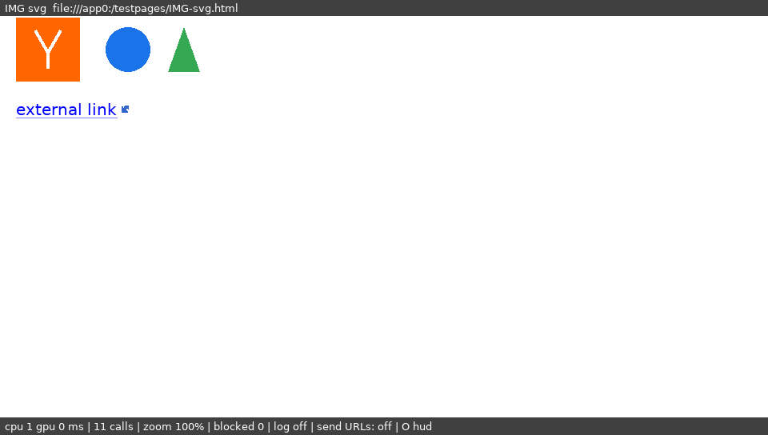
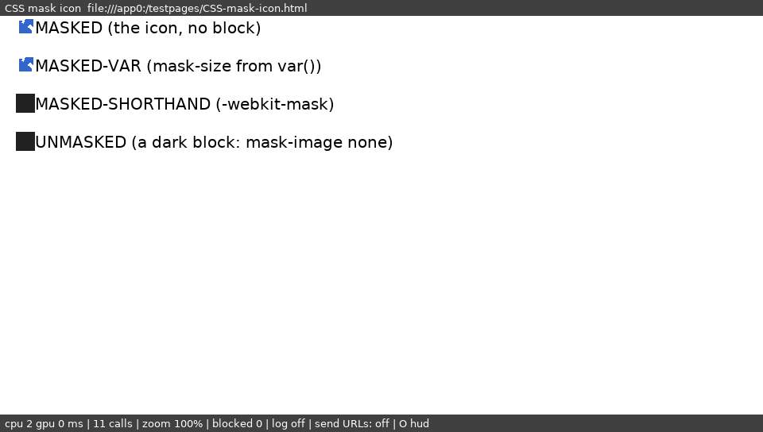

# 11 — Real websites, end to end

**Task:** make real websites load end to end on the Vita:
- example.com over http first;
- then a heavier real page over https (English Wikipedia);
- DNS, TLS, layout, JavaScript, fetch/XHR and memory on the live network.

**Method:** verify in the simulator first. `nsvita-sim` is the Vita frontend and engine with the Vita's curl +
mbedTLS, DNS on the resolver's worker thread (patch 49), QuickJS and
MacSurf's bridge, against the live internet. Stage a device hand-off only
for something device-specific.

**Status (2026-09-24, round 2 added):** SVG, mask-image icons and
`background-size` fixed (patches 59–61, "Round 2" below).

**Round 1 status:**
- example.com (http), English Wikipedia (https, article and main page),
  Hacker News, CNN Lite and a DuckDuckGo Lite search all load and lay
  out.
- Three engine/frontend root causes found and fixed (patches 55–57).
- The patch-58 section below lists the gaps left.

## The tool

`tools/run-live-sites.sh`: each site in the simulator, over the live
network, reporting:
- when the document arrived;
- its extent and title;
- hosts blocked (patch 52);
- peak memory (host RSS of a 64-bit process, so an upper bound for the
  Vita's 32-bit one);
- a screenshot once settled.

It fails if a page gets no document or no title. It needs the internet,
so it is not part of `tools/run-vita-sim.sh`; the clean-checkout chain
runs it after the simulator.

Two simulator changes support it:
- `VITA_SIM_MIN_MS` (tools/vita-sim) gives each page a minimum time
  before it may count as settled. A live page draws nothing while it
  loads, so the simulator's screenshot mode called Wikipedia settled
  after 1.3 s, before its document came.
- The autotest's `nettest.txt` now takes up to 16 pages (patch 58; it
  silently ignored more than 8).

## Root causes found and fixed

### 1. The user agent said "Linux desktop" (patch 55)

- NetSurf sent `Mozilla/5.0 (X11; Linux) NetSurf/3.12`.
- Wikipedia now serves every client from one domain: `en.m.` answers
  301 to `en.wikipedia.org`, even for real phones (checked with Android
  and iPhone user agents). It picks the skin by user agent, so we got
  desktop Vector: a 1032-px-wide page on a 960 × 544 screen.
- JavaScript meanwhile saw `MacSurf/2.3 (Macintosh; PPC Mac OS 9)`,
  MacSurf's hard-coded navigator: two different browsers.

The fix:
- **HTTP:** the core's `NETSURF_UA_FORMAT_STRING` hook, in
  `frontends/vita/Makefile.defaults`:
  `Mozilla/5.0 (PlayStation Vita 3.65) AppleWebKit/537.73 (KHTML, like Gecko) Mobile NetSurf/3.12 VitaBrowser/0.1`.
  (`%.0s` swallows the uname sysname the core formats in.)
- **JavaScript:** `navigator.userAgent` and `appVersion` read the same
  string, and `platform` is "PlayStation Vita".
- **Result:** Wikipedia serves its mobile Minerva skin.

### 2. Body's overflow did not go to the viewport (patch 56)

- **CSS 2.1 §11.1.1:** the root element's `overflow` applies to the
  viewport, and so does the body's when the root's is `visible`. The
  element itself then behaves as `overflow: visible`.
- **NetSurf** gave body's `overflow` to the body box. Upstream NetSurf has
  the same gap.
- **The failure:** Minerva has `html, body { height: 100% }` and
  `body { overflow-y: scroll }`. So the body became a scroll box one
  viewport high, holding the whole article: the extent was 1011 × 544,
  with a scrollbar inside the page. The Vita window, whose scrolling is
  the page's, could not reach anything below the first screen.
- **Minimal case** (`CSS-overflow-viewport.html`): exactly those two rules
  plus 60 paragraphs gave 960 × 544. Variants with `overflow-x: hidden`,
  or `height: 100%` alone, were already right.

**The fix:**
- A box flag, `OVERFLOW_TO_VIEWPORT`, is set at the start of every
  layout on the root, and on `<body>` when the root's `overflow` is
  `visible`.
- `box_overflow_x/y()` give the *used* value (`visible` for a flagged
  box).
- All 21 `css_computed_overflow_[xy](box->style)` reads in `layout.c`,
  `redraw.c` and `box_inspect.c` go through them. The float-dimension
  helper, given a style rather than a box, is left alone.

**Result:** the minimal case is 960 × 2280, and Wikipedia's article is
one page, 1011 × 25 076.

### 3. A space leading an inline element's text vanished (patch 57)

- **The failure:** "Claude discovers … repeats(anthropic.com)" on every
  Hacker News row. The markup is `<a>Title</a> (<a…>`.
- **The mechanism:** `box_construct_text` strips a text box's leading
  space and gives it to the box before it (`prev->space`). After
  `</a>`, that box is the span's `BOX_INLINE` start marker, and
  `layout_line` ignored `space` on inline start boxes in both passes, as
  did `layout_minmax_line` in the widths. Upstream has the same code.
- **The fix:** an inline start box's `space` counts like an inline end's,
  measured in the inline's own font.
- **Minimal case** (`CSS-inline-space.html`): the second word lands at
  the same x with the space inside or outside the element.
  `run-vita-sim.sh` checks this from the plot dump.

## Results on the live network

From the clean-checkout chain (patches 1–58), 2026-09-24. Times are the
simulator's on the build PC's connection, so they're a lower bound for
the Vita (run 11: example.com took 0.9 s on the device, http, and 1.4 s
over https).

| site | document after | extent | blocked | host RSS | title |
|---|---|---|---|---|---|
| http://example.com/ | 245 ms | 960 × 544 | 0 | 17 MB | Example Domain |
| https://en.m.wikipedia.org/wiki/PlayStation_Vita | 2 320 ms | 1011 × 25 076 | 0 | 76 MB | PlayStation Vita - Wikipedia |
| https://en.wikipedia.org/wiki/Main_Page | 2 351 ms | 985 × 4 349 | 0 | 47 MB | Wikipedia, the free encyclopedia |
| https://news.ycombinator.com/ | 1 403 ms | 960 × 1 301 | 0 | 25 MB | Hacker News |
| https://lite.cnn.com/ | 577 ms | 960 × 3 641 | 0 | 25 MB | Breaking News, Latest News and Videos \| CNN |
| https://lite.duckduckgo.com/lite/?q=playstation+vita | 1 002 ms | 960 × 1 746 | 0 | 25 MB | playstation vita at DuckDuckGo |

What each layer did on the Wikipedia article:
- **DNS:** four hosts (en.m, en, thumb.wikimedia, upload.wikimedia),
  each resolved on the worker in 10–55 ms, with 41 cache hits.
- **TLS:** every fetch over https with mbedTLS against the bundled
  Mozilla roots; 51 fetches (the page, 5 stylesheets / modules, about 40
  images).
- **JavaScript:** MediaWiki's ResourceLoader ran. Its startup module
  fetched further modules through script insertion (`load.php?modules=…`
  gadgets, centralNotice), and the bridge drove its script-driven
  relayouts (379 reconvert steps). There were **no script exceptions in the
  log**.
- **Layout:** the Minerva skin with flex headers, the infobox with its
  images, and tables.

## Round 2: SVG, masks, background-size (patches 59–61)

### 4. SVG images (patch 61, tools/build-vita.sh)

- **The Vita prefix:** expat 2.8.4 from vdpm
  (`~/vitasdk/bin/vdpm install expat`: vitaSDK's own vdpm, no sudo).
  The checkout under `<WORK>/vitabrowser-work/vdpm` wants a pacman it doesn't
  have.
- **libdom** is built `WITH_EXPAT_BINDING=yes`, its XML parser, which
  libsvgtiny uses.
- **libsvgtiny** is cross-built with the other support libraries.
- `NETSURF_USE_NSSVG := YES`.
- **The simulator** links the host prefix's libsvgtiny, which the host
  build already had.
- **Verified** with `IMG-svg.html`: an `` logo (a rect, a stroked
  path, a circle, a polygon, scaled 120×40 → 240×80), a CSS background
  icon, and a `background-size`d one. The first two are in the screenshot
  below. `run-vita-sim.sh` asserts ≥ 5 paths drawn and no alt text.
- **Live:** Hacker News's "Y" logo draws, with 0 SVGs refused (there were
  658 refusals on Wikipedia before).
- **The Vita build** links libsvgtiny and expat (`svgtiny_*`,
  `XML_Parse*` in the ELF).

### 5. background-size never applied (patch 59, libcss)

**Found through the mask icons**, whose size is a `background-size`:
- a 12 px SVG icon given `background-size: 48px` drew at 12 px;
- then a PNG given the same didn't scale either (it was only clipped to
  its box);
- `nsmonkey` agreed. So the bug was in the engine, not the Vita
  plotter.

**Traced stage by stage:** the tile-size code received 0 ("unset") for
every element. The cascade received a SET opcode with a packed value of
0. **The parser already emitted 0 for `48px`.**

**Root cause:**
- MacSurf's `background-size` parser (fixes191b) compared the unit from
  `css__parse_unit_keyword()` with the public `CSS_UNIT_PX` (0). That
  function returns the *bytecode* unit, `UNIT_PX = 0x100` in this libcss.
- MacSurf wrote it against an older libcss where the two coincided, so
  in our build every length read as `auto`.
- It's the only parser comparing public units this way (checked every
  file that parses units).

**Verified** (`X-bg`): SVG icon 12 → 48 px and centred, SVG logo
48 × 16, PNG 120 → 48 px wide.

### 6. mask-image icons drew as solid blocks (patch 60, libcss)

**The problem:**
- Icons like Minerva's and Vector's are a span with a
  `background-color`, shaped by `mask-image: url(icon.svg)`.
- libcss has no masking, so each drew as a solid block of its colour.
- A real mask property would need new computed-style fields, in files
  MacSurf hand-edited after generation (its `row_gap` is not in
  `select_config.py`, so regenerating would drop it).

**Instead, the parser maps the mask properties to the background ones:**
- `mask-image` and `-webkit-mask-image` → `background-image`, plus
  `background-color: transparent` (unless the value is `none`);
- `mask-size`, `mask-position` and `mask-repeat` (and their `-webkit-`
  forms) → their `background-*` counterparts;
- `mask` and `-webkit-mask` → the `background` shorthand.

The icon then shows its own shape, in the SVG's own colour rather than
the element's.

One lookup, `css__property_id()`, serves both the parser and the
deferred `var()` path, which re-parses by name at cascade time. That
matters because Minerva's `mask-size` is `calc(var(...) + 4px)`.

**Verified** (`CSS-mask-icon.html`, below):
- plain and `var()`-sized masked spans draw the icon at 24 px;
- `mask-image: none` keeps its block;
- `run-vita-sim.sh` counts exactly the two expected solid 24 × 24
  blocks.

**Limits:**
- `-webkit-mask` with `/ size` is dropped: libcss's background shorthand
  doesn't take a size.
- An element with both a background image and a mask shows only the
  mask image.

### Clean checkout, round 2

- Applied 144 + the known 2; L1 PASS; recorded plot streams unchanged.
- Renderer tests 101/101 + 30/30.
- **Simulator:** every check passes, including the new ones: `IMG-svg`
  6 paths drawn, `CSS-mask` exactly 2 blocks, interaction 22/22 at both
  paces, 68 of 68 frames identical batched vs per glyph.
- **Live, Wikipedia excluded (see below):**

  | site | document | extent | RSS |
  |---|---|---|---|
  | example.com | 279 ms | 960 × 544 | 17 MB |
  | Hacker News | 1 580 ms | 960 × 1 303 | 25 MB |
  | CNN Lite | 614 ms | 960 × 3 620 | 25 MB |
  | DDG search | 1 174 ms | 960 × 1 754 | 24 MB |

- **The Vita build** is packaged with libsvgtiny, expat and
  `css__property_id` in the ELF.

### Wikipedia rate-limits repeated test loads

After about 15 loads of the Wikipedia article in an hour (about 50
requests each), Wikimedia answered "Too many requests. Please respect our
robot policy".
- Run `run-live-sites.sh`'s Wikipedia pages sparingly.
- The round-2 chain ran it without them.
- A person browsing is far below that rate.

## Round 3: widths, the mask colour, a device crash (patches 62–66)

### 7. Wikipedia's 1011-px width had two causes (patches 64, 65)

**The finder:** a local snapshot of the article (HTML and its two
stylesheets, served from the scratchpad) plus a temporary box-tree walk,
since removed. It printed every box whose right edge passed 962.

**JavaScript geometry can't help here:**
- `getBoundingClientRect` returns 0s, and `offsetWidth` is undefined.
- That's by MacSurf's design: `MACSURF_JS_GEOMETRY` is 0, because real
  geometry costs about 1.6 s of synchronous layout per measurement
  burst. It's allowed only inside user-event handlers.

**The causes:**
1. **An unbreakable citation URL** (964 px, in an 897-px column).
   - `.content { word-wrap: break-word }` should break it, and MacSurf's
     fixes202 implements the character break. But it fires only when the
     font split returns 0.
   - The Vita's split follows the framebuffer contract and returns the
     whole length when there is no break opportunity.
   - The fallback now fires in both cases.
2. **Minerva's icon-only header button:**
   - `min-width: 44px`, in a flex nav whose last child has
     `margin-right: -12px`.
   - `layout_minmax_block` raised a box's min width to its `min-width`
     but left the preferred (max) width below it. Only the
     intrinsic-keyword branch fixed that up.
   - So the button reported 16 px, the nav got 4 px, and the button sat
     25 px past the screen.

**Checked:** in the final layout pass, no box passes 960. The regression
page `CSS-overflow-x.html` holds both cases, and the simulator asserts
the page is exactly 960 wide.

### 8. The mask's transparent colour must win (patch 66)

- Live, the page-action icons were still solid bars after patch 60.
- Minerva's `.minerva-icon { background-color }` comes **after** its
  `.minerva-icon--* { mask-image }` rules, at the same specificity, so it
  beat the injected `transparent`.
- A masked element's colour only shows through the mask, which isn't
  drawn, so the `transparent` is now important, on that opcode alone.
- **Verified:**
  - `CSS-mask-icon.html` gained the Minerva-order case (MASKED-LATE),
    and it draws the icon;
  - live Wikipedia shows the language, star and pencil icons.

### 9. A layout assertion aborted the browser on the device (patch 62)

Hardware run 14 (doc 10): on claude.ai's Cloudflare challenge page, the
line min-width assert fired: `assert(0 <= *line_min)`, layout.c:1121,
from the crash dumps. The likely path:
- under `white-space: nowrap`, a line's min is its max;
- max sums inline boxes' `max_width`;
- NetSurf's `UNKNOWN_MAX_WIDTH` / `UNKNOWN_WIDTH` sentinels are
  `INT_MAX`, so one left in the sum wraps negative.

The line, block and table min/max functions now clamp to `0 ≤ min ≤ max`
before their asserts. The line clamp logs `minmax line clamped`, so a
device run shows whether and where it fires.

## Round 4: claude.ai — past Cloudflare, into the React app (patches 69–75)

Hardware run 15 (doc 10): Cloudflare turned claude.ai/code away as "too
old", YouTube drew black and white, and the system screenshot saved
nothing (fixed on the device side by patch 68, SELECT + ✕). This round
takes claude.ai from the challenge page to its own React app.

### 10. Cloudflare scored the request, not the browser (patches 69, 70)

The challenge page ran and then showed "Browser not supported". But real
Chromium (Playwright) is not challenged at all. It gets the sign-in page
directly, so the decision is made on the request. Measured with curl
over HTTP/1.1 (the Vita's libcurl has no HTTP/2):

| request | answer |
|---|---|
| Chrome Android UA | 403, "Just a moment..." |
| Chrome UA + `Accept: text/html,...` | **200, the app** |
| Chrome UA + that Accept, over HTTP/2 (curl's) | 403 |
| the Vita UA (patch 55) + that Accept | 403 |

- **Patch 69:** `ux0:data/VitaBrowser/useragent.txt` picks the user
  agent. It is created on first start with `chrome` (Chrome 140 on
  Android); `safari`, `firefox`, `vita` or a whole string also work.
  `navigator.platform` and `navigator.vendor` follow the choice.
- **Patch 70:** page loads (verifiable fetches) send Chrome's navigation
  `Accept` and `Upgrade-Insecure-Requests`. Before, it was curl's `*/*`.
  Scripts' fetch()/XHR and sub-resources are unchanged.

The simulator uses the Vita's own curl + mbedTLS, so its TLS fingerprint
is the device's. It now gets the app page, not the challenge.

### 11. The app is ES modules: 66 of them, 19 MB (patch 71)

claude.ai's page has one `<script type="module">`:
- its static imports reach **66 modules, 19 MB** (three levels);
- dynamic `import()` reaches **2,645 modules, 167 MB**.

MacSurf ran external modules as classic scripts, which is a SyntaxError
at the first `import`. Its loader could only find inline modules and the
Mac's disk cache.

QuickJS links a module graph synchronously, so the sources must be in
hand before linking starts. The loader now works like this:
- `js_exec_module` scans the module's static imports (`from "x"`,
  `import "x"`, resolved with `nsurl_join`).
- It fetches each level in parallel through `fetch_get_blocking()`: a
  private curl multi with 6 transfers, the same UA, CA bundle, name
  lookups and timeouts. `file:` URLs are read directly.
- Level by level, that is **65 modules in ~1 s** on a desktop link.
- The loader compiles each module from that registry and frees its
  source.
- A dynamic `import()` fetches its module, and that module's static
  graph, when it runs. It blocks, as a module link must.
- Module scripts are deferred, and inline ones are too (queued, then run
  after the deferred scripts).

Two more fixes came out of it:
- **The JS heap cap.** At MacSurf's 96 MB every allocation failed, and
  QuickJS reported it as a bare `null` rejection. The compiled app is
  **~99 MB on the 64-bit host**; about 60 MB is expected on the Vita. The
  cap now scales with the pointer size: **128 MB of the Vita's 192 MB
  heap**, and 256 MB in the simulator.
- **Rejections are visible.** A module's evaluation promise is checked,
  so a throw is logged with its stack instead of passing as success.

### 12. The page's scripts saw an abandoned document (patch 72)

The app threw "Root element #root not found". Its DOM ended at the
`<meta charset="UTF-8">`, **byte 1185**, which is past hubbub's
1024-byte prescan. When the parser meets that meta, it restarts the parse
into a *new* document (`html_process_encoding_change`). The JS realm,
wired to the first document when the thread was made, kept answering
from the abandoned one.

The new `js_thread_rebind_document()` re-wires the realm after the
switch. testpages `JS-module` puts its charset past byte 1024 on purpose.

### 13. Web APIs the app needs (patches 73, 75)

`vita_polyfill.js` is compiled in and evaluated in every realm after the
bridge. Each item below was found as the app's next failure, or by
testpages `JS-apis`, a census of 176 APIs: 121 present before, **151
after**, 10/10 behaviour checks.

- **URL / URLSearchParams:** MacSurf's were stubs. `.entries()` was
  missing, and the app's first failure was spreading it. Checked against
  Node on 20 URLs.
- **TextEncoder:** encoded Latin-1 bytes, not UTF-8.
- **Intl:** QuickJS-ng has none. Added an en-US one, matched against
  Node's ICU on about 200 cases. (Chrome's time format uses a plain space
  before AM/PM, not ICU's U+202F.)
- **IndexedDB:** the app's idb-keyval opens one at boot. It is in memory
  now, and not kept between restarts.
- **getComputedStyle** returned `undefined` for anything the cascade did
  not answer. The UI kit calls `animationName.split` and
  `backgroundColor.trim()` on it.
- **Smaller gaps:**
  - `window.parent` and `window.top` were undefined, so
    `parent.postMessage` threw;
  - `requestIdleCallback` passed no deadline;
  - `document.fonts` was missing;
  - `PerformanceObserver.supportedEntryTypes` was missing;
  - console extras;
  - iterable Headers.
- **Patch 75:** MacSurf skipped any classic script over **256 KB**.
  YouTube's app is one 1.6 MB bundle, so its page stayed an empty black
  shell. The cap is now 8 MB on the Vita.

### Where claude.ai stands (simulator, 2026-09-24)

- `https://claude.ai/code` loads the app.
- The app boots React, routes itself client-side to
  `/login?...returnTo=/code`, and draws the login page's content.
- The page is **unstyled**. claude.ai's CSS does not reach the page yet.
- Host RSS is 260 MB for the 64-bit process; the JS heap is 99 MB of it.
- The remaining console noise is non-fatal:
  - `detectIncognito cannot determine the browser` (a fingerprint
    script);
  - a `Method Not Allowed` from an API call.

### YouTube

- With patch 75, m.youtube.com runs its app and draws its loading
  skeleton.
- The skeleton's black blocks are the "black and white" page of run 15.
  Its colours are CSS custom properties, which are not resolved yet.
- The feed then stops on a `startsWith` of undefined in the bundle. The
  stack is truncated in the log: the bundle's URL is 600+ characters.

## Round 5: modern CSS reaches the page (patches 76–82)

### 14. MacSurf's CSS rewrites never ran (patch 76)

MacSurf does most of its modern-CSS support before libcss sees a sheet,
in a fork of `css.c` (`cssh_css.c`). About 25 text passes cover:
- `@supports` and `@layer` (unwrapped or dropped);
- grid templates, placement and areas, rewritten to its `-macsurf-grid`
  dialect;
- logical properties, `inset`, `transform`, `text-shadow`, gradients,
  `calc()` folding.

The Vita build compiled plain `css.c`. The fork is of an older `css.c`, so
it cannot simply be swapped in.

- `css_rewrite.c` now holds MacSurf's functions verbatim, plus its pass
  chain as `macsurf_css_rewrite()`.
- `css.c` gathers each sheet and rewrites it whole at convert time.
  MacSurf rewrote each network chunk, which breaks a rule split between
  two reads.
- `style=""` attributes get the inline rewrite, and their
  `--properties` are seen by descendants.
- A new pass folds `calc()` in `@media` preludes to px. Minerva's
  `(max-width: calc(1120px - 1px))` was invalid to libcss, and it dropped
  the block that hides the page-action labels. **Wikipedia's "Language /
  Watch / Edit" labels are now hidden.**

Results:
- claude.ai's 1.4 MB Tailwind sheet, all inside `@layer`, now applies.
  The rewrite costs 373 ms on a desktop.
- **Standard CSS grid works**. testpages L3 now has explicit
  placement, spans, `fr` and gaps right; `grid-auto-flow: column` still
  loses two items. This covers the "standard grid-template-columns"
  stretch item.
- One deviation: L2's `justify-self: end` on a plain block becomes
  `text-align: right`. That is MacSurf's heuristic; browsers ignore it.

### 15. Custom properties did not inherit (patch 77)

MacSurf's libcss keeps each element's custom properties in an
environment seeded from the parent's. The caller must hand those
environments in and out around `css_select_style`. `cssh_select.c` does
that; our `select.c` did not.

So a variable reached only the element declaring it. Every `:root` theme
variable resolved to nothing: claude.ai's fonts and spacing, YouTube's
dialog background, most of Minerva's colours. Probe pages now pass
for `:root`, `html`, `body`, a parent, and fallbacks.

### 16. Flex gap, rgba, and the true page width (patches 78, 79, 82)

- **Flex gap (78):** the gaps were added on top of the flexed items, so
  a row overflowed by its gaps. Wikipedia's page-action row ran 40 px
  past its column.
- **rgba (79):** NetSurf's colour type has no alpha, so
  `rgba(0,0,0,.6)` painted solid black. YouTube's consent scrim was a
  black page. The background alpha now goes into the plot opacity.
- **Page width (82):**
  - Wikipedia's "1011 px" was the extent at "document after", which is
    mid-layout. Once loaded it is **960**.
  - `log.txt` now records `page X: loaded, extent WxH`. When a page is
    wider than the screen, it also lists the innermost boxes sticking
    out.
  - `run-live-sites.sh` reports the loaded extent.

### 17. Scripts: stale realms, anchors, interfaces (patches 80, 81)

- **A freed context (80).** After claude.ai redirected to `/login`, an
  old page's async script ran `js_set_current_script` against a freed
  context (SIGSEGV). JS entry points now check that their realm is live.
- **The polyfill was overwritten (80).** The bridge re-installs its DOM
  after the realm is built (`js_newthread`, encoding restarts), which
  overwrote polyfill properties. The polyfill runs again after each
  install, and every section is idempotent.
- **Anchor URL parts (81).** YouTube reads `a.pathname`; these were
  undefined before.
- **Missing interfaces (81).** `HTMLObjectElement` and 60-odd others are
  now defined, with `instanceof` answered by tag.
- **ChildNode methods on every tag's prototype (81).** `<title>` had no
  `remove()`, which took claude.ai's app down.

### State (simulator)

- **claude.ai/code:** the login page, centred, with its serif heading,
  logo and email field. The buttons have no fills yet; likely
  `color-mix()` / `oklab` colours, which libcss cannot parse.
- **YouTube:** the EU consent dialog draws correctly over a dimmed
  skeleton. It is cut off below, so its buttons are not visible yet.
- **Wikipedia:** icons-only page actions, 960 px wide.

## Round 6: speed (patches 84–88, quickjs/02)

Hardware run 16 put numbers on it (doc 10): 15–25 s per real site, and
claude.ai spending 12.6 s on CSS, 13 s downloading, and 82 s compiling
before it ran out of memory.

### 18. The CSS rewrite chain was 25 full scans (patch 84)

Timed per pass on the desktop (claude.ai's sheet, 382 ms):
- `modern_compat` took 154 ms: it scanned the whole sheet once per
  dropped property name, 43 times.
- `logical_properties` took 120 ms: it tried 30 aliases at every byte.

The fixes:
- Both now scan once, trying names only at word starts whose first letter
  can begin a name.
- Every other pass runs only when one of its trigger names occurs in the
  sheet (found with memchr).

The output is byte-identical on claude.ai's, YouTube's and Wikipedia's
sheets, and 2.7–4.9× faster. `css.c` also caches the last 16 rewrites by
content, because `<style>` blocks are re-parsed on every reformat.

### 19. Every connection was a new TLS handshake (patch 85)

- `curl_easy_duphandle` copies no session cache, so each handle's first
  connection to a host did a full handshake: 543 ms of CPU on the Vita.
- The module loader's own curl multi had separate connections too.
- One `CURLSH` now shares SSL sessions, DNS and connections. claude.ai's
  65-module fetch dropped from 1.0 to 0.64 s here; the Vita gains far
  more per avoided handshake.

### 20. JavaScript: parse once, keep less (patch 87, quickjs/02)

- **Setup scripts.** Each page's realm parsed the same setup scripts: the
  bridge's ~40 and the polyfill. They are now compiled once and read back
  as bytecode, so a realm takes 4.5 ms instead of 16 here.
- **Source text.** QuickJS keeps every function's source for `toString`,
  one copy per function, nested ones included. A new QuickJS option
  (`JS_SetStripFunctionSource`) skips that for scripts of 128 KB or more.
  claude.ai's heap goes from 99 to 76 MB.
- **A card cache for modules.** Compiled modules go to
  `ux0:data/VitaBrowser/jscache/` with their static imports.
  - Hash-named modules (Vite's) are neither fetched nor parsed on a later
    visit.
  - Other modules are fetched, and their bytecode is reused when the
    source text is unchanged.
  - A second claude.ai visit: module run 2.19 → 0.31 s, title at 4.9 s
    instead of 11.8 s (simulator).
- **A dead end, for the record.** I first compiled modules in a scratch
  context and moved them over as stripped bytecode. That needed a full GC
  per batch, since MacSurf keeps automatic GC off, and those collections
  were a third of all CPU time (gprof). Stripping at parse time replaced
  it.

### 21. Forms did not submit on the Vita (patch 88)

Form fields are converted to the form's charset through iconv, and the
Vita's newlib iconv has no converters (the engine log said `Could not
encode name for fetch data`). UTF-8, Latin-1 / Windows-1252 and ASCII are
now converted directly.

### 22. The ARM clock (patch 86)

Browsing now runs at 444 MHz / bus 222, pass D's clocks; the ARM used to
stay at its boot 333 MHz.

### 23. background-size percentages (patches 89 + 90)

Round 6 §5: the V1 parser (patch 59) took `<length>` px only, so a
`background-size` percentage rejected the whole declaration and read as
`auto`. Written by Hermes overnight on 2026-09-25 and revised by Claude the
same morning.

- **89 (libcss):** `bg_size__axis()` parses one axis: a px length (other
  units fall back to `auto`, as in V1) or a percentage stored as
  `-(1000 + P)`, P clamped to 0..31000 (codes -32000..-1000). V1 px
  handling is unchanged, so existing bytecode stays valid. (Commit
  `ef026f0`'s message says "-100..-1"; that is wrong, the patch uses the
  offset.)
- **90 (netsurf):** all three readers in `redraw.c` resolve a percent code
  (`BG_SIZE_IS_PCT` / `BG_SIZE_PCT`): the image tile helper
  `html_redraw_bg_tile_size`, the gradient tiler, and the inline-box
  path. Hermes's first version touched only the helper. It also scaled
  the percentage twice: the positioning area is already in device px, but
  the result went through the explicit-length `* scale` again, so percent
  tiles were the wrong size at any zoom other than 1x. A percent on one
  axis with `auto` on the other keeps the image's aspect ratio; for a
  gradient, `auto` means the whole box.

**Not the claude.ai button fix.** Hermes's notes said claude.ai's empty
button fills were `background-size: 100% 100%` gradients. Before 89/90,
though, an unparsed size on a gradient already painted one full rect, so
percentages could not have left the fills empty. `color-mix()` / `oklab`
(round 6 §5) is still the leading suspect.

**Collision:** another percentage implementation (commit `04358f9`, filed as
patch 84, a number already taken by the CSS rewrite speed patch) landed
next to 89/90 and was reverted in `9ccd0f0`. Its test page is back:
`CSS-background-size-pct.html` (100x50 image in 300x200 boxes at
`100% 100%`, `50% 50%`, `150%`, `33% 25%`, `auto`, plus a 320x200 gradient at
`50% 50%`). `run-vita-sim.sh` asserts the PLOT BITMAP sizes (300x200,
150x100, 450x225, 99x50) and the gradient tiles (two 160-px columns, no
full-width stripe; the check fails with the gradient branch disabled).
Em/rem still read
as `auto`.

## Round 7: claude.ai's buttons (patches 91–93)

The login page's buttons had no fills. The guess was `color-mix()` /
`oklab`; it was wrong. Each button is a `relative isolate` element holding
an `absolute -z-[1] inset-0` span with a `bg-fill-primary` span inside.
Three separate bugs stopped the fill from painting:

### 24. `:is()` and `:where()` never matched (patch 91, libcss)

MacSurf's fixes359 parsed `:is()` / `:where()` / `:has()` by throwing the
argument away; the matcher then always said no. Tailwind v4 relies on
them: claude.ai defines its whole palette under `:where(:root,:host)`, so
every `var(--cds-gray-*)`, and every fill and surface colour built on
one, resolved to nothing.

- **Parse.** The argument is split at top-level commas. Each alternative
  goes through `parseSelector` on its own, and alternatives that fail
  (`:host`, pseudo-elements) are dropped: a forgiving list. The result is
  stored in a new detail value type, `SELLIST`, owned by the selector.
- **Specificity.** `:where()` adds 0; `:is()` adds its most specific
  argument.
- **Match.** `match_chain_at()` matches one argument as a complex
  selector with the node as its subject. It checks the subject's element
  name itself (the rule hash does that for top-level selectors), and it
  uses neither the reject cache nor the cascade.
- **`:has()`** still never matches. Its argument skip now counts FUNCTION
  tokens, though: `a, b:has(:not(.x))` no longer ends the pseudo-class
  early and drops the whole rule, `a` included.

### 25. The CSS rewrite on a big sheet (patch 92)

- **`inset` never expanded on claude.ai's 1.4 MB sheet.** The inset pass
  (and the 2-value logical-shorthand pass) grew its buffer only while
  writing an expansion. Plain copies gave up (`goto grow_fail`) once the
  fixed 256-byte headroom was used, and that discarded the whole pass. A
  small test sheet never reached that point, so `inset: 0` worked there
  and failed on the real site.
- **`z-index: calc(1 * -1)` was dropped.** The calc folder wrote
  `-1.0000`, which is not an `<integer>`. Whole-number results now print
  as integers.

### 26. More network pages (patch 93)

The frontend read at most 16 lines of `nettest.txt` and dropped the rest
silently. The two new test pages pushed JS-module past the limit, and its
check reported "module did not run". The limit is now 32, and any lines
past it are logged.

**Tests.** `CSS-is-where.html` has one block per case (matches,
forgiving lists, complex arguments, specificity, `:where` inside `:not`,
`:has` in a list). `CSS-rewrite-bigsheet.html` has a 24-inset sheet with a
long tail, plus flex `order: calc(1 * -1)`. Both are asserted in
`run-vita-sim.sh`, and both checks fail with patches 91 and 92 removed.

**State (simulator).** The login page has Claude's off-white surface,
white cards and a dark "Download" button with white text. The outlined
buttons (Google, Apple, email) still show no ring: it is
`box-shadow: inset 0 0 0 1px …`. MacSurf packs a box-shadow into 32 bits
(8-bit x/y, inset, RGB555), with no blur or spread, so a 1px ring cannot
be stored, and the Vita never paints an inset shadow. The ring colour is
`hsl(from var(--cds-neutral-900) h s l / 10%)`, and neither relative
colours nor `color-mix()` parse yet. Buttons are also 20 px tall, not 24:
`height: calc(1.5rem * var(--cds-rem-scale,1))` does not resolve in
layout.

**Debugging.** The simulator got two scratch hooks that are not in any
patch: `VITA_SIM_EVAL=file.js` runs a script when a screenshot is taken
(the script leaves its results in localStorage), and
`VITA_SIM_BOXDUMP=file` writes `box_dump()` with computed styles.

## Round 8: rings, borders, modern colours (patches 94–100)

Round 7 left claude.ai's outlined buttons without their ring, a
`box-shadow: inset 0 0 0 1px …` in a relative colour. Getting it to paint
took seven fixes, found one layer at a time.

### 27. Tailwind's variables never got their initial values (94, 95, 99)

Tailwind v4 composes every shadow from variables:
`box-shadow: var(--tw-inset-shadow), var(--tw-inset-ring-shadow), …`.
Their starting values come from a fallback for browsers without
`@property`: `@layer properties{@supports (…){*,:before,:after,::backdrop{--tw-shadow:0 0 #0000;…}}}`.
Three bugs stopped that block from applying:

- **Nested `@supports` (94).** The at-rule pass copied a kept block
  verbatim, so an `@supports` inside a `@layer` reached libcss, which
  drops unknown at-rule blocks. The pass now reruns while at-rules remain.
- **Escaped quotes (94).** The class `.\[font-feature-settings\:\'liga\'_1\]`
  made the at-rule pass start a "string" at `\'` and skip about 400 KB,
  including 20 of claude.ai's 34 `@supports` blocks. The same bug was in
  both grid passes and in the calc folder's declaration-end finder. An
  escaped character is now copied as a pair.
- **`::backdrop` (95).** An unknown pseudo-element invalidates the whole
  selector list. It now parses and never matches, like `::placeholder`.
- **`--x: initial` (99).** This sets the property to the
  guaranteed-invalid value, so `var(--x, fallback)` must use the
  fallback. MacSurf stored the word "initial" instead, and Tailwind's
  `var(--tw-shadow-color, <colour>)` became `… initial`.

### 28. box-shadow keeps every shadow (96, 97)

- **Parse and store (96).** MacSurf kept at most 3 shadows, packed into
  32 bits each (8-bit x/y, inset, RGB555), with no blur, spread or alpha.
  Tailwind's ring is the 5th shadow in its list and is all spread. Now
  every visible shadow is kept, up to 8, and invisible ones (`0 0 #0000`)
  are dropped. The list lives in a new style field, read with
  `css_computed_box_shadow_full()`. It holds x, y, blur, spread, inset and
  currentColor flags, and ARGB. An unparseable part invalidates the
  declaration. The `var()` re-parse at select time does not check trailing
  tokens, and a skipped colour used to read as currentColor.
- **Paint (97).** `html_redraw_box` paints outer shadows before the
  background, as the shadow rect minus the border box, with the clip
  widened to the parent's. Inset shadows go after the background, as
  bands inside the padding box. Alpha and `opacity` go into the plot
  opacity, like rgba backgrounds. Blur is approximated (+blur/2 spread,
  alpha × 2/(2+blur)) and corners are square. `box_ink_outset` sizes outer
  shadows from the list.

### 29. Colour syntax (98)

`rgb(from C r g b / A)` and `hsl(from C h s l / A)` are supported, with
channel keywords and literal rgb channels; `calc()` on channels stays
invalid. So are `color-mix(in srgb | srgb-linear | oklab …)` (lab, lch and
oklch approximated as oklab, with premultiplied mixing) and
`oklab(L a b / A)` with `none`. There is no libm: sRGB↔linear uses a table
and cube roots use Newton's method. Checked by hand against a Python
reference: red + blue in oklab = (140, 83, 162); #fcfcfb 90% + #0b0b0b in
oklab = (224, 224, 223). `oklab(0% none none/.1)` gets alpha 25 instead of
26, because `.1` loses a little as fixed-point.

### 30. Borders (100)

- **Hairlines.** A non-zero width under 1px snaps up to 1px.
  `border-[0.5px]` used to vanish.
- **Alpha.** A border colour's alpha now reaches the plotters, so
  Tailwind's default 10%-black border no longer draws solid.
- **Rounded boxes.** A box with a border-radius skipped the border
  painter. MacSurf's stand-in stroke ignored the border width, so every
  rounded box under Tailwind's preflight `border: 0 solid` got a 1px
  frame. Rounded boxes now use the normal border painter, with square
  corners like the Vita's backgrounds.
- **`apply-patches.sh` sorts numerically.** The glob put `100-*` between
  `10-*` and `11-*`.

**Tests.** `CSS-box-shadow.html` checks the ring, spread, placeholder list
with `initial`, a `hsl(from)` ring, an invalid colour, a 0.5px border and
a rounded translucent border. `CSS-modern-color.html` checks nine
colour, at-rule, `::backdrop` and `initial` blocks by opacity bucket. With
94–100 removed, every shadow and border check reads 0, and 7 of 9 colour
blocks fail. The other two (103, 105) are solid either way. The plot has
no colours, which is why colour values were checked by hand.

**Reference rendering.** `VITA_SIM_EVAL` can store
`document.documentElement.outerHTML`. With scripts stripped and the sheets
fetched from assets-proxy (not Cloudflare-gated), headless Chromium
renders that DOM locally for a like-for-like comparison. Cloudflare
started challenging the sim after about 10 claude.ai loads in an hour.

**State (static DOM snapshot, simulator vs Chromium).** The fills,
off-white surfaces, card hairlines, button rings and the "OR" divider
match. What still differs is layout: Tailwind spacing is
`calc(var(--spacing) * N)`, which does not resolve in `padding`,
`height` or `gap`, so cards have no padding, buttons are 20 px tall, and
icons and labels are not centred. Corners are square and the header logo
is missing.

## Not done: the gaps left

- **claude.ai/code:**
  - Layout: `calc(var(--spacing) * N)` in padding, height and gap
    (Tailwind's whole spacing scale); centring an icon and label in
    buttons; border-radius (round 8).
  - Then the Vita itself: 19 MB over Wi-Fi, a compile of about 60 MB of
    heap on a 444 MHz CPU, and React's first render. Run 16 measures it.
  - Signing in comes after that.
- **YouTube:** the consent dialog's cut-off buttons (it needs to scroll), then the feed.
- **Wikipedia article: 1045 px wide.** The new `wide box` log lines point
  at a header `SPAN` (x 936–1034) and a reference-list `LI`, probably a
  long unbreakable citation URL.
- **claude.ai's first visit on the Vita** still has to parse 19 MB. Only
  run 17 can say whether it now fits in time and memory.
- **Memory:** host RSS peaks at about 78 MB for the Wikipedia article (a
  64-bit process). The Vita's heap budget is 192 MB. The autotest logs
  `mem[...]` per page on the device.
- **`background-size` percentages** now parse and draw (patches 89/90,
  round 6 §23); **em/rem** still read as `auto` (MacSurf's parser takes
  px only).
- **`-webkit-mask` with `/ size`** is dropped (libcss's background
  shorthand has no size).
