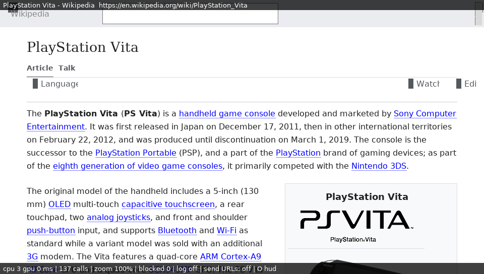

# 11 — Real websites, end to end

**Task:** make real websites load end to end on the Vita:
- example.com over http first;
- then a heavier real page over https (English Wikipedia);
- DNS, TLS, layout, JavaScript, fetch/XHR and memory on the live network.

**Method:** verify in the simulator first. `nsvita-sim` is the Vita frontend and engine with the Vita's curl +
mbedTLS, DNS on the resolver's worker thread (patch 49), QuickJS and
MacSurf's bridge, against the live internet. Stage a device hand-off only
for something device-specific.

**Status (2026-09-24):**
- example.com (http), English Wikipedia (https, article and main page),
  Hacker News, CNN Lite and a DuckDuckGo Lite search all load and lay
  out.
- Three engine/frontend root causes found and fixed (patches 55–57).
- The patch-58 section below lists the gaps left.

## The tool

`tools/run-live-sites.sh`: each site in the simulator, over the live
network, reporting:
- when the document arrived;
- its extent and title;
- hosts blocked (patch 52);
- peak memory (host RSS of a 64-bit process, so an upper bound for the
  Vita's 32-bit one);
- a screenshot once settled.

It fails if a page gets no document or no title. It needs the internet,
so it is not part of `tools/run-vita-sim.sh`; the clean-checkout chain
runs it after the simulator.

Two simulator changes support it:
- `VITA_SIM_MIN_MS` (tools/vita-sim) gives each page a minimum time
  before it may count as settled. A live page draws nothing while it
  loads, so the simulator's screenshot mode called Wikipedia settled
  after 1.3 s, before its document came.
- The autotest's `nettest.txt` now takes up to 16 pages (patch 58; it
  silently ignored more than 8).

## Root causes found and fixed

### 1. The user agent said "Linux desktop" (patch 55)

- NetSurf sent `Mozilla/5.0 (X11; Linux) NetSurf/3.12`.
- Wikipedia now serves every client from one domain: `en.m.` answers
  301 to `en.wikipedia.org`, even for real phones (checked with Android
  and iPhone user agents). It picks the skin by user agent, so we got
  desktop Vector: a 1032-px-wide page on a 960 × 544 screen.
- JavaScript meanwhile saw `MacSurf/2.3 (Macintosh; PPC Mac OS 9)`,
  MacSurf's hard-coded navigator: two different browsers.

The fix:
- **HTTP:** the core's `NETSURF_UA_FORMAT_STRING` hook, in
  `frontends/vita/Makefile.defaults`:
  `Mozilla/5.0 (PlayStation Vita 3.65) AppleWebKit/537.73 (KHTML, like Gecko) Mobile NetSurf/3.12 VitaBrowser/0.1`.
  (`%.0s` swallows the uname sysname the core formats in.)
- **JavaScript:** `navigator.userAgent` and `appVersion` read the same
  string, and `platform` is "PlayStation Vita".
- **Result:** Wikipedia serves its mobile Minerva skin.

### 2. Body's overflow did not go to the viewport (patch 56)

- **CSS 2.1 §11.1.1:** the root element's `overflow` applies to the
  viewport, and so does the body's when the root's is `visible`. The
  element itself then behaves as `overflow: visible`.
- **NetSurf** gave body's `overflow` to the body box. Upstream NetSurf has
  the same gap.
- **The failure:** Minerva has `html, body { height: 100% }` and
  `body { overflow-y: scroll }`. So the body became a scroll box one
  viewport high, holding the whole article: the extent was 1011 × 544,
  with a scrollbar inside the page. The Vita window, whose scrolling is
  the page's, could not reach anything below the first screen.
- **Minimal case** (`CSS-overflow-viewport.html`): exactly those two rules
  plus 60 paragraphs gave 960 × 544. Variants with `overflow-x: hidden`,
  or `height: 100%` alone, were already right.

**The fix:**
- A box flag, `OVERFLOW_TO_VIEWPORT`, is set at the start of every
  layout on the root, and on `<body>` when the root's `overflow` is
  `visible`.
- `box_overflow_x/y()` give the *used* value (`visible` for a flagged
  box).
- All 21 `css_computed_overflow_[xy](box->style)` reads in `layout.c`,
  `redraw.c` and `box_inspect.c` go through them. The float-dimension
  helper, given a style rather than a box, is left alone.

**Result:** the minimal case is 960 × 2280, and Wikipedia's article is
one page, 1011 × 25 076.

### 3. A space leading an inline element's text vanished (patch 57)

- **The failure:** "Claude discovers … repeats(anthropic.com)" on every
  Hacker News row. The markup is `<a>Title</a> (<a…>`.
- **The mechanism:** `box_construct_text` strips a text box's leading
  space and gives it to the box before it (`prev->space`). After
  `</a>`, that box is the span's `BOX_INLINE` start marker, and
  `layout_line` ignored `space` on inline start boxes in both passes, as
  did `layout_minmax_line` in the widths. Upstream has the same code.
- **The fix:** an inline start box's `space` counts like an inline end's,
  measured in the inline's own font.
- **Minimal case** (`CSS-inline-space.html`): the second word lands at
  the same x with the space inside or outside the element.
  `run-vita-sim.sh` checks this from the plot dump.

## Results on the live network

From the clean-checkout chain (patches 1–58), 2026-09-24. Times are the
simulator's on the build PC's connection, so they're a lower bound for
the Vita (run 11: example.com took 0.9 s on the device, http, and 1.4 s
over https).

| site | document after | extent | blocked | host RSS | title |
|---|---|---|---|---|---|
| http://example.com/ | 245 ms | 960 × 544 | 0 | 17 MB | Example Domain |
| https://en.m.wikipedia.org/wiki/PlayStation_Vita | 2 320 ms | 1011 × 25 076 | 0 | 76 MB | PlayStation Vita - Wikipedia |
| https://en.wikipedia.org/wiki/Main_Page | 2 351 ms | 985 × 4 349 | 0 | 47 MB | Wikipedia, the free encyclopedia |
| https://news.ycombinator.com/ | 1 403 ms | 960 × 1 301 | 0 | 25 MB | Hacker News |
| https://lite.cnn.com/ | 577 ms | 960 × 3 641 | 0 | 25 MB | Breaking News, Latest News and Videos \| CNN |
| https://lite.duckduckgo.com/lite/?q=playstation+vita | 1 002 ms | 960 × 1 746 | 0 | 25 MB | playstation vita at DuckDuckGo |

What each layer did on the Wikipedia article:
- **DNS:** four hosts (en.m, en, thumb.wikimedia, upload.wikimedia),
  each resolved on the worker in 10–55 ms, with 41 cache hits.
- **TLS:** every fetch over https with mbedTLS against the bundled
  Mozilla roots; 51 fetches (the page, 5 stylesheets / modules, about 40
  images).
- **JavaScript:** MediaWiki's ResourceLoader ran. Its startup module
  fetched further modules through script insertion (`load.php?modules=…`
  gadgets, centralNotice), and the bridge drove its script-driven
  relayouts (379 reconvert steps). There were **no script exceptions in the
  log**.
- **Layout:** the Minerva skin with flex headers, the infobox with its
  images, and tables.

## Not done: the gaps left

- **SVG images are refused** (`NETSURF_USE_NSSVG=NO`). Examples:
  - Wikipedia's wordmark and the footer logos;
  - Hacker News's "Y" logo;
  - the "external link" icon CSS puts on each of Wikipedia's 656
    external links. That's one fetch, then 656 refused content objects
    from the cache; no network cost.

  libsvgtiny builds for the host already. The Vita needs it
  cross-built, plus an XML parser: libdom's XML binding is built with
  `WITH_EXPAT_BINDING=no`, and expat is not yet in the Vita prefix.
  **The next item.**
- **`mask-image` is not parsed** (libcss). Icon spans painted by
  `background-color` through a mask draw as solid bars: Minerva's
  Language / Watch / Edit icons, and Vector's. They are cosmetic.
- **Minerva's page-action labels** ("Language", "Watch", "Edit") show
  clipped, where they should be visually hidden. The same "visually
  hidden" rules on minimal pages (inline, inline-flex, nested flex) hide
  the label correctly, so something specific to Minerva's markup or the
  scripts' changes remains to be found.
- **Wikipedia's article is 1011 px wide:** the page-actions row overflows
  the 960-px screen by 51 px.
- **Memory:** host RSS peaks at about 78 MB for the Wikipedia article (a
  64-bit process: pointers and allocator overhead double some of it).
  The Vita's budget is 192 MB of heap. A device run would give the real
  figure, and the autotest already logs `mem[...]` per page.
